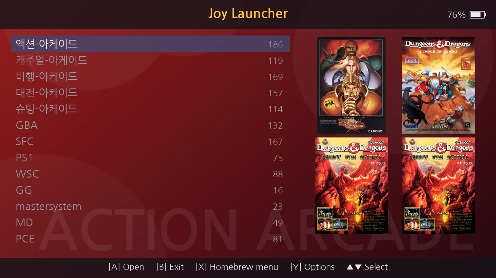

# Joy Launcher

[한국어](README.md) | **English**

A homebrew game launcher for the Nintendo Switch. Copy an Android **Pegasus ROM pack** to the SD card as-is: Joy Launcher reads `metadata.pegasus.txt`, shows the games by category and launches them with **RetroArch cores / PPSSPP**.

## Features
- Converts the Android launch settings of Pegasus lists (RetroArch cores, PPSSPP app) for the Switch (mapping rules in `/JoyLauncher/cores.txt`)
- Finds ROMs in per-system folders even without a list file; reads ES-DE `gamelist.xml`
- Box art and screenshots; grabs a frame from the preview video when there is no screenshot
- Per-category background themes with the free default theme **JoyBasic**, launch log, cached game list (fast start)
- Korean / English interface, background music from your own mp3/ogg files, HOME-style battery indicator
- Systems beyond the Switch's performance (above PS1/PSP) are excluded or hidden automatically
- **Automatic updates from GitHub Releases** (Y Options → Update)

## Installation
1. Download the latest `JoyLauncher_<version>.zip` from [Releases](https://github.com/JyJyLab/JoyLauncher/releases) and copy `switch/` and `JoyLauncher/` to the root of the SD card
2. Install RetroArch for Switch (with cores) and PPSSPP
3. Copy your ROM pack to `/roms` and start Joy Launcher from the Album (homebrew menu)

Manual: [docs/manual-en.md](docs/manual-en.md)

## Building
- Switch: devkitPro (devkitA64, libnx) + portlibs `switch-sdl2 switch-sdl2_image switch-sdl2_ttf switch-sdl2_mixer switch-ffmpeg switch-curl switch-dav1d` → `make`
- Desktop test build (Linux): `make -f Makefile.linux` (SDL2, SDL2_mixer, FFmpeg, libcurl dev packages)
- Default theme: `python3 tools/make_joybasic.py` (Pillow) → `themes/JoyBasic`
- Release: pushing a `vX.Y.Z` tag makes GitHub Actions build and publish a release (`joylauncher.nro`, `.sha256`, zip). The launcher's updater uses the latest release.

## License
- Joy Launcher: GPL-3.0 (`LICENSE`) — it statically links FFmpeg built with GPL options
- NanumGothic font: SIL Open Font License 1.1 (`OFL.txt`)
- stb_image_write: Public Domain / MIT
- No ROMs, BIOS files or third-party theme images are included. The JoyBasic theme is self-made.
