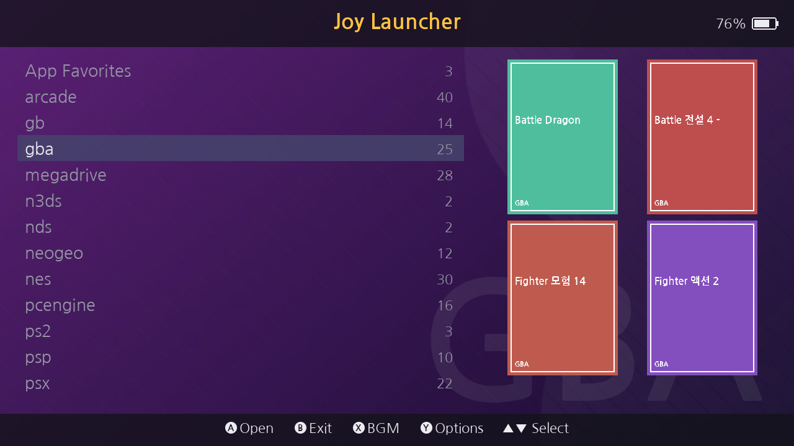

# Joy Launcher (Android)

[한국어](README.md) | **English**

A game launcher for Android. It is a fork of [Joy Launcher](https://github.com/JyJyLab/JoyLauncher) for the Nintendo Switch: **the theme syntax and folder layout are the same, so themes work on both.**
It reads **Pegasus metadata** or **ES-DE game lists** in your ROM folders, shows the games by category and starts them with the emulator apps you have installed.

## Features
- **No system limits**: anything with an installed emulator runs (retro systems, NDS, 3DS, PS2, GC/Wii, Switch, PS3, Xbox 360 …). The system/emulator table is the one from ES-DE for Android (195 systems, 106 emulators); files with the same syntax add new systems and emulators
- **Emulator choice = Pegasus + ES-DE**
  1. the launch command (`am start …`) in a ROM pack's `metadata.pegasus.txt` is used as it is
  2. otherwise the ROM folder name gives the system and an installed emulator is picked ("Choose emulator" in Options changes it)
- ROM folders are found automatically: `ROMs` / `Roms` / `roms` on internal storage and SD cards, Pegasus' `game_dirs.txt`, the ES-DE ROM folder
- Settings and themes live in **`/JoyLauncher`** at the root of the storage, free to edit with any file manager
- **App Favorites**: pick installed apps into a category (Options → Apps)
- **Sound choice (X button)**: Common BGM, Theme BGM, Video sound or Silent, one at a time. Every theme can carry its own BGM (`themes/<theme>/bgm`)
- **Button names follow the controller**: `+` `−` for Nintendo pads, `START` `SELECT` for the others. Option to swap A/B (select/cancel)
- **On-screen controller**: touch buttons appear when no controller is connected
- Box art, screenshots and **preview videos**: when the selected game has a video it plays in place of the screenshot (can be turned off in Options)
- Themes: per-category backgrounds and logos, screen layouts with `layout.txt` (grids, carousels, fonts, colors, transitions). Four stock themes included. Also receives themes from the PC Theme Builder (Switch version) over FTP
- Favorites and recently played tabs, custom categories, Korean / English, battery indicator
- The screen keeps the theme's 1280x720 coordinates while text and images are drawn at the device resolution, so it stays sharp on high-resolution displays

## Install
1. Download `JoyLauncher.apk` of the **Android release** (tag `android-v…`) from [Releases](https://github.com/JyJyLab/JoyLauncher/releases) and install it (Android 7.0 or later, arm64). Releases tagged `v…` are the Switch version
   - Later versions are installed from "Check for updates" in Options
2. On first start it asks for **All files access** → allow it (to read your ROM folders and to use the `/JoyLauncher` folder)
3. Put ROMs in `ROMs` (or `Roms` / `roms`) on the storage. For other places list them in `/JoyLauncher/roots.txt`, one per line
4. Install emulators separately (RetroArch, DuckStation, PPSSPP …)

Manual: [docs/manual-en.md](docs/manual-en.md) · 한국어: [docs/설명서.md](docs/설명서.md)

Making themes (shared with the Switch version): [theme-guide-en.md](docs/theme-guide-en.md) · [theme-layout-en.md](docs/theme-layout-en.md)

## Build
- Android: see `android/README.md` (no Gradle: NDK + CMake, SDL2 / SDL2_image / SDL2_ttf / SDL2_mixer built from source → apk)
- Desktop test build (Linux): `make -f Makefile.linux` → `./joylauncher_desktop` (screenshots and launch arguments; Android functions are simulated by `source/platform_desktop.cpp`)
- Theme Builder: use the one from the Switch repository

## License
- Joy Launcher: GPL-3.0 (`LICENSE`)
- System/emulator tables (`romfs/systems/es_systems.xml`, `es_find_rules.xml`): ES-DE Frontend, MIT (`romfs/systems/LICENSE.ES-DE.txt`)
- SDL2, SDL2_image, SDL2_ttf, SDL2_mixer: zlib License; FreeType: FTL; stb / dr_libs: Public Domain / MIT
- NanumGothic font: SIL Open Font License 1.1 (`OFL.txt`)
- Theme packs: same as the Switch version (`README.txt` in each theme folder)
- No ROMs, BIOS files or emulators are included.
