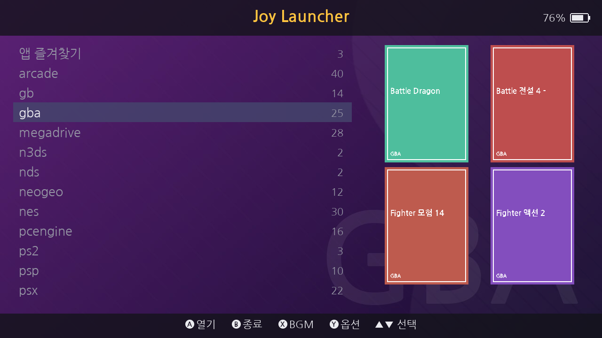

# Joy Launcher

**한국어** | [English](README.en.md)

닌텐도 스위치용 홈브루 게임 런처입니다. 안드로이드용 **페가수스(Pegasus) 롬 모음**을 SD 카드에 그대로 복사하면 `metadata.pegasus.txt` 를 읽어 카테고리별로 보여 주고, 고른 게임을 **RetroArch 코어 / PPSSPP** 로 바로 실행합니다.

## 특징
- 안드로이드용 페가수스 목록의 실행 설정(RetroArch 코어·PPSSPP 앱)을 스위치용으로 자동 변환 (`/JoyLauncher/cores.txt` 로 대체 규칙 지정)
- 목록 파일이 없어도 기종별 폴더의 롬을 자동 인식, ES-DE 설정 팩(`ES-DE/gamelists`·`downloaded_media`) 지원 — 폴더마다 섞어 써도 됨
- 박스·화면 사진, 화면 사진이 없으면 미리보기 영상에서 장면 추출
- 카테고리별 배경 테마, 테마 팩 3종 포함(**기본팩 · 레트로팩 · 벽골김씨팩**), 실행 기록, 게임 목록 캐시(빠른 시작)
- 테마의 `layout.txt` 로 화면 구성 바꾸기: 기종 카드 격자, 박스 사진 격자, 요소 위치·글꼴·색, 내 그림·글자 추가
- NDS 게임은 DraStic 스위치판(`/switch/DrasticDS.nro`)이 있으면 그것으로 실행
- 홈브루 즐겨찾기: 옵션에서 고른 nro 게임(포팅 게임 등)을 카테고리 맨 위에 모아 실행
- 즐겨찾기(− 버튼), 한국어 / 영어 화면, 직접 넣은 mp3·ogg 배경 음악, HOME 화면과 같은 배터리 표시
- 스위치에 RetroArch 코어(PSP 는 PPSSPP)가 있는 기종의 게임만 표시 (성능이 부족한 기종은 기본 숨김)
- **깃헙 릴리스 자동 업데이트** (Y 옵션 → 업데이트) — 런처 본체만 바뀝니다. 테마 팩은 테마 설정 창의 "<팩 이름> 내려받기" 또는 릴리스 zip 으로

## 설치
1. [Releases](https://github.com/JyJyLab/JoyLauncher/releases) 에서 최신 `JoyLauncher_<버전>.zip` 을 받아 `switch/` 와 `JoyLauncher/` 를 SD 카드 루트에 복사
2. 스위치용 RetroArch(코어 포함)와 PPSSPP 를 설치
3. 롬 모음을 `/roms` 에 복사하고 앨범(홈브루 메뉴)에서 Joy Launcher 실행
   - 롬 파일·폴더 이름은 영문(ASCII)을 권장합니다 (한글 이름은 목록에서 빠지거나 깨질 수 있음)
   - ES-DE 팩은 롬을 `/roms`, `ES-DE/gamelists`·`downloaded_media` 를 `/ES-DE` 에 복사

자세한 사용법: [docs/설명서.md](docs/설명서.md) · English: [docs/manual-en.md](docs/manual-en.md)

나만의 테마 추가·제작: [docs/테마_만들기.md](docs/테마_만들기.md) · English: [docs/theme-guide-en.md](docs/theme-guide-en.md)

테마로 화면 구성 바꾸기(격자 화면·위치·글꼴·색, `layout.txt`): [docs/테마_레이아웃.md](docs/테마_레이아웃.md) · English: [docs/theme-layout-en.md](docs/theme-layout-en.md)

## 빌드
- 스위치: devkitPro (devkitA64, libnx) + portlibs `switch-sdl2 switch-sdl2_image switch-sdl2_ttf switch-sdl2_mixer switch-ffmpeg switch-curl switch-dav1d` → `make`
- 데스크톱 테스트(리눅스): `make -f Makefile.linux` (SDL2, SDL2_mixer, FFmpeg, libcurl 개발 패키지)
- 테마 팩: 기본팩 `python3 tools/make_joybasic.py` (Pillow) → `themes/JoyBasic` · 레트로팩 `tools/make_retropack.py <응애팩 테마 Resource 폴더>` → `themes/RetroPack` · 벽골김씨팩 그림 `tools/make_byeokgolkim.py <원본 폴더>` → `themes/ByeokgolKim`
- 릴리스: `vX.Y.Z` 태그를 올리면 GitHub Actions 가 빌드해 릴리스(`joylauncher.nro`, `.sha256`, zip)를 만듭니다. 런처의 자동 업데이트는 최신 릴리스를 사용합니다.

## 기여자

| 기여자 | 기여도 |
|---|---|
| **월스트리트킴** (레트로게임 갤러리) | 30% |

## 라이선스
- Joy Launcher: GPL-3.0 (`LICENSE`) — GPL 로 빌드된 FFmpeg 를 정적 링크하므로
- 나눔고딕 글꼴: SIL Open Font License 1.1 (`OFL.txt`)
- stb_image_write: Public Domain / MIT
- 롬·BIOS 는 포함하지 않습니다.
- 테마 팩: **기본팩**(`themes/JoyBasic`)은 자체 제작으로 자유롭게 쓰고 고칠 수 있습니다. **레트로팩**(`themes/RetroPack`)은 응애팩 테마 그림 발췌, **벽골김씨팩**(`themes/ByeokgolKim`)은 벽골김씨 님이 ES-DE 테마 Canvas(Siddy212, CC0 1.0)를 바탕으로 구성한 테마이며 글꼴은 Cafe24 Ohsquare air 입니다. 두 팩의 게임기 사진·로고·상표의 권리는 각 권리자에게 있고, 런처의 GPL 과는 별개입니다. (각 폴더의 `README.txt`)
