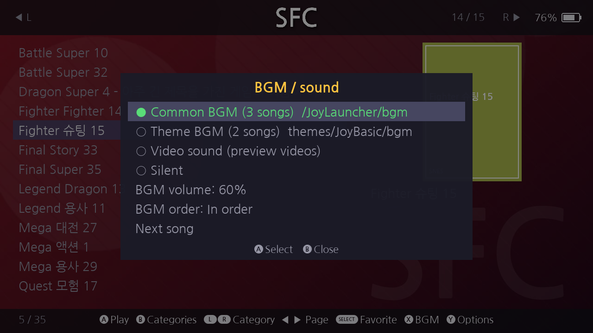
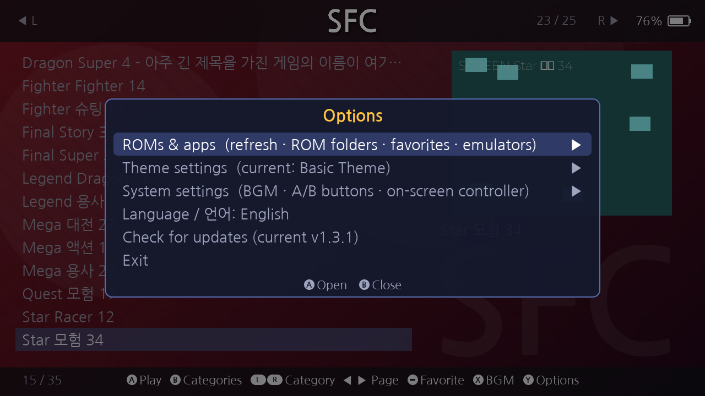

# Joy Launcher (Android) manual

The Android version of Joy Launcher for the Switch. Screens and themes are the same; how games are started and a few Android-specific things differ.


## 1. Install and first start
1. Download `JoyLauncher.apk` of the Android release (tag `android-v…`) from [Releases](https://github.com/JyJyLab/JoyLauncher/releases) and install it (Android 7.0 or later, arm64 devices). For new versions, **Options → Check for updates** shows the release page: download `JoyLauncher.apk` there and install it over the old one (**[A] Open in browser**; settings and themes stay). The app does not download or install the apk itself (install-permission issues). It also checks at start (`auto_update=off` in `settings.txt` turns that off).
2. On first start a screen explains that **access to all files on the storage** is required. Press any button or the screen to open the settings → **allow Joy Launcher** → go back and it continues.
   - It is needed to read your ROM folders and to keep settings and themes in the `JoyLauncher` folder at the root of the storage.
   - On Android 10 or earlier the storage permission dialog is shown instead.
3. The four stock themes are unpacked into `JoyLauncher/themes` on first start.

## 2. Folders
Settings and themes are in **`/JoyLauncher`** at the root of the internal storage (`/storage/emulated/0/JoyLauncher`). Edit them freely with a file manager or from a PC.

| File / folder | Contents |
|---|---|
| `themes/<theme>/` | themes (same syntax as the Switch version) |
| `settings.txt` | settings (theme, language, sound choice / BGM, effects, preview videos, A/B swap, on-screen controller) |
| `roots.txt` | ROM folders, one per line. `auto=off`, `esde=<ES-DE folder>` |
| `emulators.txt` | emulator per ROM folder / category / system |
| `custom_systems/` | new systems and emulators (`es_systems.xml`, `es_find_rules.xml`, ES-DE syntax) |
| `app_favorites.txt` · `favorites.txt` | App Favorites · game favorites |
| `categories.txt` · `categories/` | custom categories and their images |
| `bgm/` | Common BGM (mp3, ogg). Theme BGM goes in `themes/<theme>/bgm/` |
| `cache/` | app icons |
| `launch_log.txt` | recent launches (which emulator was chosen and why) |
| `crash_log.txt` | crash log: after an unexpected exit the next start records the cause (Android 11 or later) and the last log lines |

## 3. ROM folders
Found automatically:
- `ROMs` / `Roms` / `roms` and `Emulation/roms` on the internal storage and SD cards
- the game folders of Pegasus (`pegasus-frontend/game_dirs.txt`)
- the ROM folder in the ES-DE settings (`ES-DE/settings/es_settings.xml`)

For other places add lines to `/JoyLauncher/roots.txt` (e.g. `/storage/1234-ABCD/Games`). `auto=off` turns the automatic search off.

Game lists are read in three ways, mixed per folder:
1. **Pegasus**: `metadata.pegasus.txt` in the folder
2. **ES-DE**: `gamelist.xml` in the folder, or `ES-DE/gamelists/<folder>/gamelist.xml` with `ES-DE/downloaded_media`
3. **No list**: the folder name gives the system; files with that system's extensions are games

After adding or removing ROMs, images or videos use **Options → Refresh game list**.

- Box art and screenshots can be png, jpg or **webp** (e.g. `media/<game>/boxFront.webp` of JoiPlay packs for Pegasus). `\n` in descriptions becomes a line break, and Japanese/Chinese characters missing from the launcher font are drawn with the device's CJK font.

### Preview videos
When the selected game has a preview video it starts after a moment in place of the screenshot and loops. Until it appears the screenshot (or the box art) is shown.
- Where videos are found: Pegasus `assets.video`, `<video>` in `gamelist.xml`, ES-DE `downloaded_media/<system>/videos`, and in the ROM folder `media/<game name>/video.mp4` or `<game name>.mp4` in `videos/`, `snap/`, `media/videos/` (mp4, mkv, webm … whatever the device can play)
- The video has sound only when "Video sound" is chosen in **BGM / sound (X)**; with a BGM choice it plays silently (chapter 7).
- The video stops while a window (Options, Apps …) is open and when a game is started.
- **Options → Preview videos** turns them on and off (`video=on/off` in `settings.txt`).

## 4. Starting games: how the emulator is chosen
There are **no system limits**. All games are shown and the emulator is chosen when a game is started.

0. **What `emulators.txt` says** (looked up by ROM folder → category → system name)
1. **The launch command in the Pegasus metadata** (`launch: am start …`), used as it is.
   - If that app is not installed, another build of the same emulator is used (e.g. RetroArch 64-bit ↔ plain).
   - If it is not an `am start` command (packs made for the Switch or Linux), RetroArch is started with the core named there.
2. **ROM folder name → system → installed emulator** (the ES-DE way)
   - A RetroArch core seen in your ROM packs is used if there is one; otherwise the first installed emulator in the system's list (ES-DE order).
   - For PS1, PS2, PSP, N64, NDS, 3DS, GC, Wii, Saturn and Dreamcast an installed standalone emulator (DuckStation, NetherSX2, PPSSPP …) is preferred over RetroArch.
   - When one emulator has several launch modes, the one matching the file is used (PS3: ISO / directory / game serial; Windows: .steam / .epic …).
   - Folder names: ES-DE names (`psx` `ps2` `switch` `n3ds`), short names (`PS1` `FC` `SFC` `MD`), names like `PS2 (USA)`, `FBNEO ACT`, `Sony PlayStation 2`.
   - The alternative emulator in ES-DE game lists (`altemulator`) is respected.

Without an emulator the launcher tells you so when you start the game ("No … emulator is installed (supported: …)").

### Changing the emulator
**Options (Y) → Choose emulator** sets the emulator for the current category (on the game screen: the ROM folder of the selected game). The choice is saved in `emulators.txt`, which can also be written by hand:
```
psx=DuckStation (Standalone)
snes=snes9x
switch=am start -n dev.eden.eden_emulator/org.yuzu.yuzu_emu.activities.EmulationActivity -a android.nfc.action.TECH_DISCOVERED -d {file.uri}
ps2=%EMULATOR_NETHERSX2% %ACTION%=android.intent.action.MAIN %EXTRA_bootPath%=%ROMSAF%
hiddenfolder=none
```
Left: ROM folder, category or system name. Right: an emulator name (a part is enough) / a Pegasus-style command / an ES-DE-style command / `none`.
Pegasus variables: `{file.path}`, `{file.uri}` (file provider), `{file.documenturi}` (SAF document), `{file.name}`, `{file.basename}`, `{file.dir}`.

### Emulators that use storage access (SAF)
DuckStation, NetherSX2, Dolphin, Azahar, PPSSPP and others receive the game as a "document address". **Add the system's ROM folder as a game folder inside the emulator once** (the same requirement as with ES-DE and Pegasus). Add the system folder (e.g. `ROMs/ps2`), not the whole ROM folder.

### Adding systems and emulators
Put `es_systems.xml` and `es_find_rules.xml` with the ES-DE syntax in `/JoyLauncher/custom_systems/`. Files in `ES-DE/custom_systems` are read as well.

## 5. Controls
| Button | Categories | Games |
|---|---|---|
| A | open | play |
| B | exit (asks) | back to categories |
| X | BGM / sound | BGM / sound |
| Y | options | options |
| L · R | | previous / next category |
| ZL · ZR | | view: all → favorites → recently played |
| − (SELECT) | | favorite on / off |
| + (START) | exit (asks) | exit (asks) |

Android's **Back** equals B.
- **Button names**: `+` `−` for Nintendo controllers, `START` `SELECT` for the others.
- **Swap A and B** (Options): B selects and A cancels; the button names on screen follow.

## 6. On-screen controller
Touch buttons appear when no controller is connected. They hide when a controller is connected or a button is pressed, and show again when you touch the screen. **Options → On-screen controller**: Auto / Always / Off.

## 7. Sound: BGM and video sound
**X** opens **BGM / sound** (the same item is in Options). Only **one** of these is heard at a time; BGM and video sound never play together.



| Choice | What plays |
|---|---|
| Common BGM | mp3/ogg in `/JoyLauncher/bgm`, the same songs with every theme |
| Theme BGM | mp3/ogg in the `bgm` folder of the theme in use (`/JoyLauncher/themes/<theme>/bgm`). It follows the theme; a theme without songs is silent |
| Video sound | the sound of preview videos (chapter 3); no BGM |
| Silent | nothing |

- The same window has BGM volume (◀ ▶, steps of 10%), order (in order / shuffle) and next song.
- If a choice shows 0 songs, add files to that folder and open the window again. No music is included.
- Theme BGM works the same way in the Switch version (1.2.0 or later), so themes with BGM are shared as they are.
- Settings file: `sound=common/theme/video/off`, `bgm_volume=0-100`, `bgm_shuffle=on/off` (an old `bgm=on` becomes Common BGM).

## 8. App Favorites
**Options (Y) → Apps** opens the list of installed apps: A opens the app, −(SELECT) adds it to or removes it from **App Favorites**, which is shown at the top of the categories.
(It takes the place of "Homebrew Favorites" of the Switch version. Themes use the image name `hbfav`; `appfav` is used first if present.)

## 9. Options (Y)


Refresh game list · Theme (select, delete, download the stock themes) · Receive themes from PC (FTP) · BGM / sound · Language · Screen effects · Preview videos · Apps / App Favorites · Choose emulator · Swap A and B · On-screen controller · Exit.

## 10. Themes (compatible with the Switch version)
The theme syntax is the same. Themes from the Switch version work here as they are, and the other way round.
- Guides: [theme-guide-en.md](theme-guide-en.md), [theme-layout-en.md](theme-layout-en.md)
- `[+]` `[-]` `[A]` `[B]` in hints follow the controller and the settings, also in hints written by a theme.
- "Homebrew menu" in hints of Switch themes is shown as "BGM" (what X does here).
- A `bgm` folder inside a theme folder is that theme's BGM (chapter 7).
- For systems the Switch version does not have (ps2, n3ds, switch, ps3 …) use the ES-DE system names for the images (`backgrounds/ps2.jpg`).

## 11. Troubleshooting
| Problem | Check |
|---|---|
| No games found | ROM folder name (`ROMs` / `Roms` / `roms`) or `roots.txt`; the all-files permission |
| The emulator opens but not the game | Is the system's ROM folder added as a game folder in the emulator (chapter 4)? Options → Choose emulator |
| RetroArch opens but the game does not run | Is that core installed in RetroArch? Pick another one in Choose emulator |
| Which emulator was used? | `/JoyLauncher/launch_log.txt` |
| The launcher closed suddenly | start it again and see `/JoyLauncher/crash_log.txt` (attach it to bug reports) |
| Select / cancel are the wrong way round | Options → Swap A and B |
| New games do not appear | Options → Refresh game list |
| No preview video | Is Options → Preview videos on? Check the video's place and name (chapter 3) and refresh the game list. Formats the device cannot play show the screenshot only |
