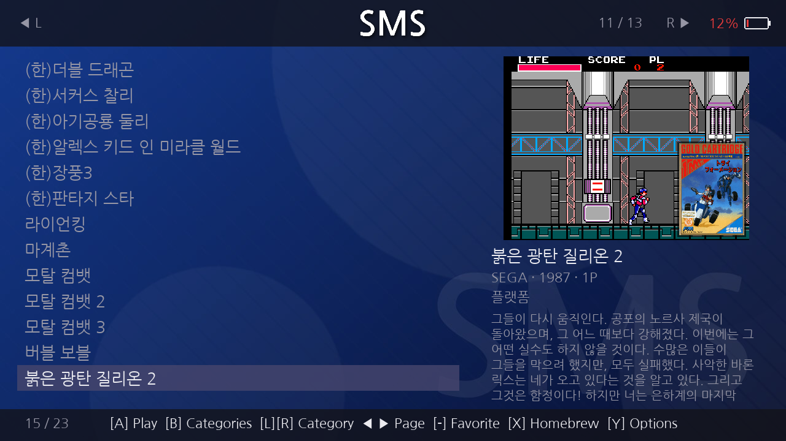
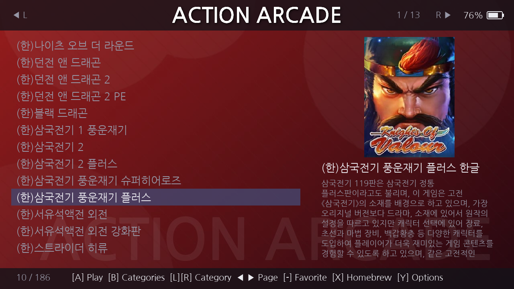
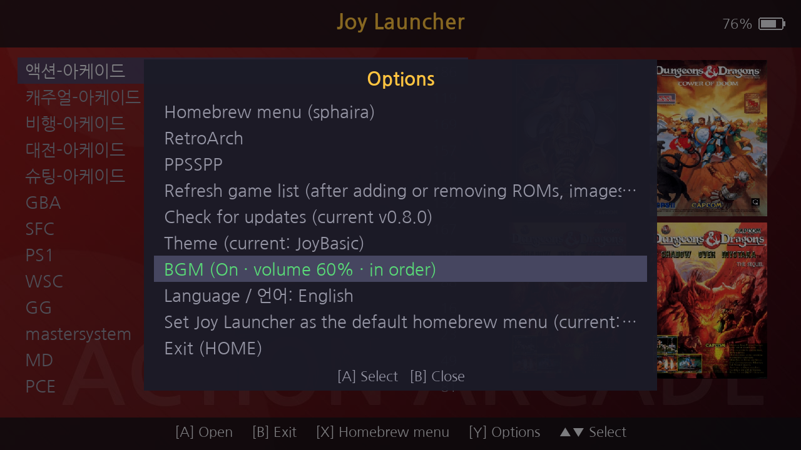

# Joy Launcher (Nintendo Switch homebrew)

[한국어 설명서](설명서.md)

Joy Launcher reads an Android **Pegasus ROM pack** copied to the Switch SD card as-is, shows the games by category, and launches the selected game with **RetroArch cores / PPSSPP**.

- Converts the Android launch settings in `metadata.pegasus.txt` (RetroArch cores, PPSSPP app) to Switch programs automatically.
- Works without a list file too: ROMs in per-system folders are found and matched automatically. ES-DE `gamelist.xml` is also read.
- Shows box art, screenshots and descriptions. When there is no screenshot, it grabs a frame from the preview video.
- Per-category background themes. The free default theme **JoyBasic** is included.
- Korean / English interface (default: the Switch system language).
- Plays your own mp3/ogg files as **background music (BGM)**.
- Shows the **battery level** at the top right, like the Switch HOME screen.
- Only shows systems the Switch runs well (arcade to PS1, PSP).


---

## 1. Requirements

| Item | Location | Notes |
|---|---|---|
| RetroArch for Switch + cores | `/switch/retroarch_switch.nro`, `/retroarch/` | Arcade to PS1 |
| PPSSPP (Switch homebrew) | `/switch/ppsspp/PPSSPP.nro` | PSP |
| Joy Launcher | `/switch/joylauncher/joylauncher.nro` | This launcher |

ROMs and ROM packs are not included.

## 2. Package contents

`JoyLauncher_<version>.zip` from [Releases](https://github.com/JyJyLab/JoyLauncher/releases):

```
switch/joylauncher/joylauncher.nro   the launcher
JoyLauncher/themes/JoyBasic/         free default theme (section 8)
설명서.md                             Korean manual
Manual_en.md                         this manual
OFL.txt                              license of the built-in font (NanumGothic)
LICENSE                              launcher license (GPL-3.0)
```

## 3. Installation

1. Copy `switch/` and `JoyLauncher/` from the zip to the root of the SD card.
   - `JoyLauncher/` only contains the default theme. If `/JoyLauncher` already exists, merge it; your settings stay.
   - If you don't want the default theme, copying `switch/` is enough. **`/JoyLauncher` is created automatically on first run.**
2. Copy your Pegasus ROM pack (with its ROM folders) to `/roms` on the SD card (section 4).
3. Start **Joy Launcher** from the Album (homebrew menu).
4. To come back to the launcher automatically after a game, press **Y** for Options, choose **"Set Joy Launcher as the default homebrew menu"** and press A again to confirm.

Both common homebrew menus are handled:

- **nx-hbmenu** (Atmosphere default): backed up to `/switch/hbmenu.nro`, then replaced.
- **sphaira**: its `replace_hbmenu` setting is turned off first so it doesn't overwrite the launcher. sphaira itself stays at `/switch/sphaira/sphaira.nro`.

**"Restore the original homebrew menu"** in Options puts the previous menu and the sphaira setting back.

### Created automatically on first run (`/JoyLauncher/`)

| File / folder | Contents |
|---|---|
| `settings.txt` | settings (theme, language, BGM...; section 10) |
| `cores.txt` | core mapping (section 5) |
| `library.cache` | saved game list (section 7) |
| `cache/` | frames grabbed from videos (section 6) |
| `themes/` | themes + guide `README.txt` (section 8) |
| `bgm/` | background music + guide `README.txt` (section 9) |
| `state.txt`, `launch_log.txt` | created when you launch a game |

### Applet mode

Started from the Album, the Switch runs homebrew in **applet mode** with less memory, and a red **"Applet mode"** label appears at the top left. Most games still run; if a large game is slow or won't start, run the launcher in **title mode (full memory)**, e.g. by holding R while starting a game.

## 4. Your ROM pack

The default ROM folder is `/roms`. Folders are read two levels deep, and each folder is checked in this order:

1. **`metadata.pegasus.txt`**: the Pegasus list is used as-is (Android lists too). The same `collection` name in different folders becomes one category. `launch:` may point directly to a Switch nro.
2. **`gamelist.xml`**: ES-DE / EmulationStation list (names, descriptions, images).
3. **No list file**: ROM files are registered automatically. The system is guessed from the folder name (gba, snes, sfc, md, psx, ps1, psp, fbneo...) or the file extension.

- RetroArch playlists (`.lpl`) are not read.
- Games whose ROM file is missing are hidden.
- More ROM folders: list them in `/JoyLauncher/roots.txt`, one per line.
- **Use ASCII names for ROM files, folders and `media/<rom name>/` folders.** Non-ASCII (e.g. Korean) names are hidden in the Switch FTP (ftpd) listing and can drop out of the game list or break in RetroArch's file browser and playlists. When renaming, change the ROM file, its `media/<rom name>/` folder and the `file:` line in `metadata.pegasus.txt` together (the `game:` title can stay as it is).

## 5. Systems and cores

| | Systems | Runs with |
|---|---|---|
| Shown | Arcade (FBNeo, MAME 2003-Plus, MAME 2010), SFC, FC, GB/GBC, GBA, Mega Drive, Master System, Game Gear, PC Engine, WonderSwan, Neo Geo Pocket, PC-98, DOS, MSX, PS1... | RetroArch cores |
| Shown | PSP | PPSSPP |
| Hidden by default | NDS, N64, Saturn, Dreamcast, NAOMI/Atomiswave | too slow; change `hide_cores` in `settings.txt` |
| Excluded | PS2, PS3, 3DS, GameCube/Wii/Wii U, PS Vita, Switch, Xbox, Windows/Android apps | never shown |

The Android core named in the list is mapped to a Switch core in this order: `cores.txt` `[user]` → `cores.txt` `[auto]` → a Switch core with the same name → the system judged from the core/emulator name → folder name / extension. MAME games use MAME 2003-Plus or MAME 2010, whichever supports the romset.

`/JoyLauncher/cores.txt` format: `android_core=switch_core[,next candidate...]`. A value starting with `/` is an nro path; `none` hides that core's games. Example: `snes9x2005_plus=snes9x`. (The comments in this file are Korean only.)

Every launch is logged in `/JoyLauncher/launch_log.txt` (last 20), including the original core and how the Switch core was chosen.

## 6. Images and video frames

- With a screenshot, the screenshot is shown large and the box art small at the bottom right. Otherwise the box art is shown large.
- Box art, screenshots and videos are found in `assets.*`, `media/<rom name>/`, and the common image/video folders (boxFront, boxart, covers, screenshots, snaps, Named_Snaps, videos...).
- **Video frames**: for games with only a preview video, a frame is grabbed and saved in `/JoyLauncher/cache/`. Automatic by default; **"Extract video frames"** in Options does all at once (B stops). `video_frames=manual` in `settings.txt` turns automatic extraction off.
- Once the frames are extracted you may delete the video files; the frames are tied to the ROM file, not the video.



## 7. Saved game list

The game list is saved in `/JoyLauncher/library.cache` for a fast start, and re-read automatically when ROM folders, list files, RetroArch cores, `cores.txt [user]`, `hide_cores` or the launcher version change. If you only added or removed ROM/image/video files, use **"Refresh game list"** in Options.

## 8. Themes

Themes live in `/JoyLauncher/themes/<theme name>/`:

```
backgrounds/<name>.jpg(png)   category background
logos/<name>.png              logo shown instead of the game list title (optional)
backgrounds/default.jpg       default background (optional)
theme.txt                     dim=0-255 (darken backgrounds) and name mapping
```

Images are matched by: category name in `theme.txt` → ROM folder name (e.g. `/roms/GBA` → `backgrounds/GBA.jpg`) → the category's shortname or name → the first matching folder of a merged category. Case is ignored. Map non-ASCII category names in `theme.txt`, e.g. `액션-아케이드=arcade_action`, `SNES=SFC`.

### Default theme JoyBasic

> Themes are not installed by the launcher's automatic update. Download the release zip and copy `JoyLauncher/themes/JoyBasic/` to the SD card.

The release zip includes the free default theme **JoyBasic**; copied to `/JoyLauncher/themes/JoyBasic/`, it is selected on first run.

- Backgrounds are color gradients with simple shapes, logos are system names in NanumGothic Bold — **all self-made**, no company logos or game images, free to use and modify.
- Common ROM folder names (SFC, MD, PS1, GBA, PCE, WSC...) and the arcade categories of popular Korean packs are mapped in `theme.txt`.
- Regenerate it with `tools/make_joybasic.py` in the repository.

Change themes with **Y** Options → **"Theme"** → A. **"Default (no background)"** turns themes off. Other theme images are not included for copyright reasons.

## 9. Controls and menus

| Screen | Controls |
|---|---|
| Categories | ▲▼ select / A open / B exit (confirm: A exit, B back) / X homebrew menu / Y options / + exit at once |
| Game list | ▲▼ move / ◀▶ page / L·R previous·next category / A play / B back / **− add/remove favorite** / X homebrew menu / Y options / + exit |

The left and right sticks work like the D-pad, and holding a direction repeats.

- After a game you return to the same game in the list. After exiting (HOME) you start at the top of the categories.
- **Favorites**: press **−** in a game list to add the game to favorites, again to remove it. Favorites get a ★ and appear in a **"Favorites"** category at the top of the category list (only when there are any). Saved in `/JoyLauncher/favorites.txt`, kept across list refreshes. Theme background name: `favorites`.


- **Info panel**: game title at the top, then developer · year · players, genre and description. If the developer field holds a longer title that starts with the list title, that longer title is shown. A long description scrolls up slowly after 3 seconds, pauses 3 seconds at the end and starts over.
- **Long text**: names, options and messages that don't fit scroll slowly sideways on the selected row (after a short pause). Other rows end with "…".
- **Battery**: level (%) and a battery icon at the top right, like the HOME screen. Green with a bolt while charging, red at 15% or less.



**Y Options** (▲▼ select / A run / ◀▶ change value / B close; only installed items are shown):

| Item | |
|---|---|
| Homebrew menu (sphaira / nx-hbmenu), RetroArch, PPSSPP | start them directly |
| Extract video frames | section 6 (only when frames are missing) |
| Refresh game list | section 7 |
| Check for updates / Install update | see "Automatic updates" |
| Theme | section 8 |
| BGM | A opens the BGM window; see "Background music" (dimmed when there are no songs) |
| Language / 언어 | Auto (system language) → 한국어 → English, applied immediately |
| Set as default homebrew menu / Restore | section 3 |
| Exit (HOME) | |



### Background music (BGM)

- Put **mp3 or ogg** files in `/JoyLauncher/bgm/` and restart the launcher; BGM items appear in Options. No music is included.
- **"BGM"** in Options opens the BGM window (B closes it): **BGM: On/Off** (default off), **Volume** (◀▶ in 10% steps), **Order** (in order / shuffle), **Next song** (while on).
- Music keeps playing across screens and moves to the next song at the end. Unreadable files are skipped.
- Before a game or another program starts, and on exit, the music fades out and the audio is closed.
- Sleep or HOME pauses it; when you return it resumes with a 1-second fade-in.

### Language

The interface is available in Korean and English. **Auto** (default) follows the Switch system language: Korean if the system is Korean, otherwise English. Change it in Options → **"Language / 언어"**. Game names, descriptions and category names are shown as written in the ROM pack.

### Automatic updates

- At start the launcher checks GitHub Releases in the background and briefly shows "New version vX.Y.Z is available" (it does not install by itself).
- Install: **Y** Options → **"Install update: vX.Y.Z"** → A, then A again to confirm. B cancels the download.
- The file is verified (size and SHA-256) before replacing; the old file is kept as `joylauncher.nro.old`. If Joy Launcher is the default homebrew menu, `/hbmenu.nro` is updated too. The launcher then restarts.
- **Automatic updates replace only the launcher (`joylauncher.nro`).** Themes such as JoyBasic are not installed or updated automatically: download `JoyLauncher_<version>.zip` from the release page and copy `JoyLauncher/themes/` to `/JoyLauncher/themes/` on the SD card yourself.
- `auto_update=off` in `settings.txt` turns the start-up check off.

## 10. Settings (`/JoyLauncher/settings.txt`)

| Key | Values |
|---|---|
| `theme` | theme folder name (empty = no theme) |
| `hide_cores` | cores to hide, comma separated (empty = show all) |
| `video_frames` | `auto` / `manual` |
| `auto_update` | `on` / `off` |
| `language` | `auto` / `ko` / `en` |
| `bgm`, `bgm_volume`, `bgm_shuffle` | `on`/`off`, `0`-`100`, `on`/`off` |

## 11. Troubleshooting

- **A game is missing**: rename non-ASCII ROM file names to ASCII (section 4); check the ROM file exists, the system isn't excluded/hidden, and the Switch core exists. After adding ROMs, use "Refresh game list".
- **Wrong core**: read "Original core / Chosen by" in `launch_log.txt` and add a line to `[user]` in `cores.txt`.
- **Doesn't return to the launcher after a game**: "Set Joy Launcher as the default homebrew menu" in Options.
- **Large games are slow or won't start**: if the red "Applet mode" label is shown, start the launcher in title mode.
- **BGM items are dimmed**: there are no mp3/ogg files in `/JoyLauncher/bgm/`. Add some and restart.

---

Font: NanumGothic (SIL Open Font License 1.1, `OFL.txt`)
