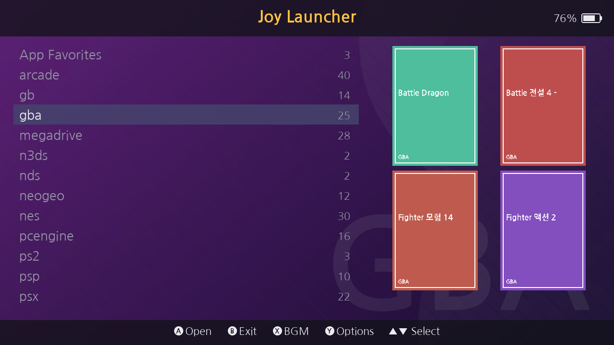
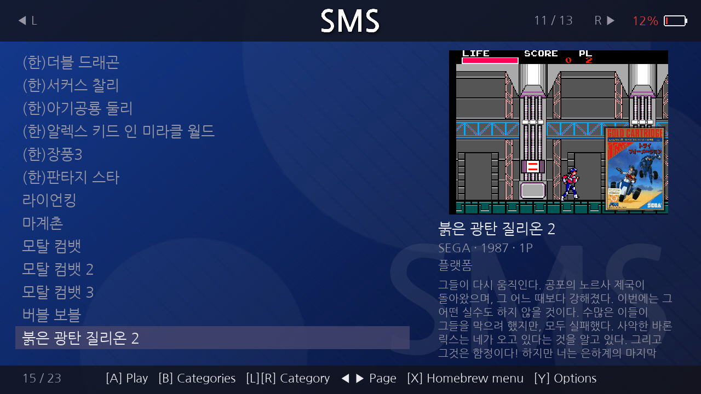
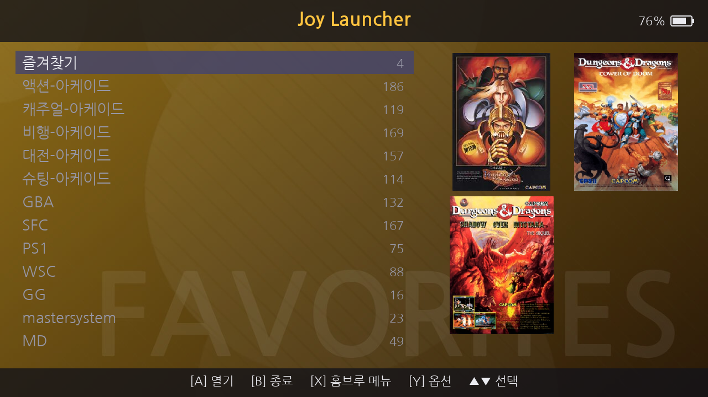
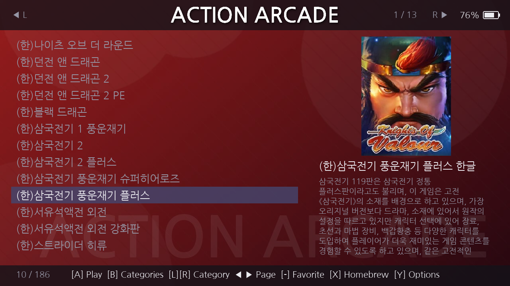
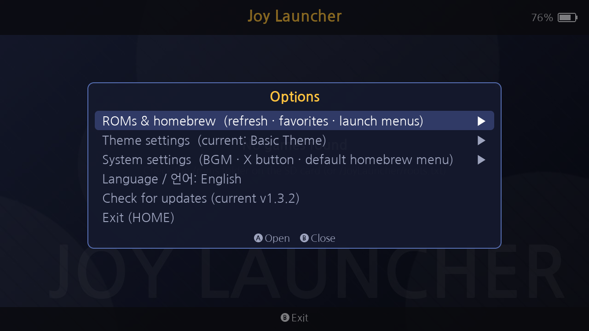

# Joy Launcher (Nintendo Switch homebrew)

[한국어 설명서](설명서.md)

Joy Launcher reads an Android **Pegasus ROM pack** copied to the Switch SD card as-is, shows the games by category, and launches the selected game with **RetroArch cores / PPSSPP**.

- Converts the Android launch settings in `metadata.pegasus.txt` (RetroArch cores, PPSSPP app) to Switch programs automatically.
- Works without a list file too: ROMs in per-system folders are found and matched automatically. ES-DE packs (`ES-DE/gamelists`, `downloaded_media`) are read as they are.
- Shows box art, screenshots and descriptions. When there is no screenshot, it grabs a frame from the preview video.
- Per-category background themes. Four theme packs are included: **Basic Theme, Retro Theme, WallStreetKim's Theme, Retro Game Gallery Theme**.
- The PC program **Joy Theme Builder** (Windows, Linux) lets you make themes while seeing the Switch screen as it will look, and send them to the Switch (section 8).
- Korean / English interface (default: the Switch system language).
- Plays your own mp3/ogg files as **background music (BGM)**.
- Shows the **battery level** at the top right, like the Switch HOME screen.
- Only shows systems the Switch runs well (arcade to PS1, PSP).



---

## 1. Requirements

| Item | Location | Notes |
|---|---|---|
| RetroArch for Switch + cores | `/switch/retroarch_switch.nro`, `/retroarch/` | Arcade to PS1 |
| PPSSPP (Switch homebrew) | `/switch/ppsspp/PPSSPP.nro` | PSP |
| Joy Launcher | `/switch/joylauncher/joylauncher.nro` | This launcher |

ROMs and ROM packs are not included.

## 2. Package contents

`JoyLauncher_<version>.zip` from [Releases](https://github.com/JyJyLab/JoyLauncher/releases):

```
switch/joylauncher/joylauncher.nro   the launcher
JoyLauncher/themes/JoyBasic/         Basic Theme (section 8)
JoyLauncher/themes/RetroPack/        Retro Theme
JoyLauncher/themes/ByeokgolKim/      WallStreetKim's Theme
JoyLauncher/themes/DcGall/           Retro Game Gallery Theme
설명서.md                             Korean manual
Manual_en.md                         this manual
theme-guide-en.md                    how to add/make themes (section 8)
theme-layout-en.md                   how to change the screen layout (layout.txt)
테마_만들기.md                        theme guide (Korean)
테마_빌더.md                          PC theme builder guide (Korean)
OFL.txt                              license of the built-in font (NanumGothic)
LICENSE                              launcher license (GPL-3.0)
```

## 3. Installation

1. Copy `switch/` and `JoyLauncher/` from the zip to the root of the SD card.
   - `JoyLauncher/` only contains the four theme packs. If `/JoyLauncher` already exists, merge it; your settings stay.
   - If you don't want the default theme, copying `switch/` is enough. **`/JoyLauncher` is created automatically on first run.**
2. Copy your Pegasus ROM pack (with its ROM folders) to `/roms` on the SD card (section 4).
3. Start **Joy Launcher** from the Album (homebrew menu).
4. To come back to the launcher automatically after a game, press **Y** for Options, choose **"Set Joy Launcher as the default homebrew menu"** and press A again to confirm.

The current homebrew menu (`/hbmenu.nro`) is handled by type (judged from the program name inside the nro):

- **nx-hbmenu** (default in Atmosphere, Kefir etc.): backed up to `/switch/hbmenu.nro`, then replaced. If another program is already there, it is not overwritten and the backup goes to `/switch/hbmenu_prev/nx-hbmenu.nro`.
- **sphaira**: replaced; sphaira itself stays at `/switch/sphaira/sphaira.nro`.
- **Any other menu**: backed up to `/switch/hbmenu_prev/<program name>.nro`, then replaced.
- **sphaira's auto-replace** (`replace_hbmenu`): if sphaira is installed, this option is turned off whatever the current menu is (when on, starting sphaira overwrites `/hbmenu.nro`). The original value is saved and restored when you go back to sphaira. If it gets turned on again (e.g. by a sphaira update), the launcher tells you at start and turns it off.

**"Restore the original homebrew menu"** in Options puts the previous menu back (without a record, it uses the backups it finds).

**After updating Atmosphere**: the Atmosphere zip contains `hbmenu.nro` (nx-hbmenu), so extracting it to the SD card replaces Joy Launcher at `/hbmenu.nro`. Start Joy Launcher once from the album (nx-hbmenu): it shows "The default homebrew menu was changed to nx-hbmenu", backs up the new nx-hbmenu and puts **"Set Joy Launcher as the default homebrew menu again"** at the top of Options. Choose it.

### Created automatically on first run (`/JoyLauncher/`)

| File / folder | Contents |
|---|---|
| `settings.txt` | settings (theme, language, BGM...; section 10) |
| `cores.txt` | core mapping (section 5) |
| `library.cache` | saved game list (section 7) |
| `cache/` | frames grabbed from videos (section 6) |
| `themes/` | themes + guide `README.txt` (section 8) |
| `bgm/` | Common BGM + guide `README.txt` (section 9). Theme BGM goes in `themes/<theme>/bgm/` |
| `state.txt`, `launch_log.txt` | created when you launch a game |
| `debug_log.txt`, `debug_state.txt` | created when the launcher starts (diagnostic log, section 11) |

### How to start the launcher

Joy Launcher is not installed as an app with its own icon. It **takes the place of the Switch homebrew menu (`/hbmenu.nro`)** ("Set Joy Launcher as the default homebrew menu" above). The homebrew loader always starts `/hbmenu.nro`, so every way of opening the homebrew menu opens Joy Launcher.

| Method | Memory | Notes |
|---|---|---|
| **Start an installed game/app while holding R** | full (title mode) | On the HOME screen pick any game and press A **while holding R**; Joy Launcher opens instead of the game. (Atmosphere default; the key is `override_any_app_key` in `/atmosphere/config/override_config.ini`) |
| **Install a homebrew-menu forwarder NSP** | full (title mode) | A forwarder NSP that starts `/hbmenu.nro`, installed with DBI etc., gives a HOME screen icon (e.g. Kefir's "Homebrew menu" NSP or one made with a forwarder tool) |
| **Album** | less (applet mode) | Browsing, settings and opening the homebrew menu only. **Games cannot be started.** See "Applet mode" below |

> When a game ends, the homebrew loader opens `/hbmenu.nro` (= Joy Launcher) again, so you come straight back to the launcher.

### Applet mode

Started from the Album, the Switch runs homebrew in **applet mode** with less memory, and a red **"Applet mode"** label appears at the top left.

In applet mode the launcher **does not start games or RetroArch/PPSSPP; it only shows a warning.** On hardware, RetroArch failed for PS1, PSP, FBNeo and GBA alike for lack of memory, and quitting it then crashed the Switch HOME menu (error 2144-0001), requiring a reboot. To play, open the launcher in **title mode (full memory)**, e.g. by holding **R** while starting an installed game.

## 4. Your ROM pack

The default ROM folder is `/roms`. Folders are read two levels deep, and each folder is checked in this order:

1. **`metadata.pegasus.txt`**: the Pegasus list is used as-is (Android lists too). The same `collection` name in different folders becomes one category. `launch:` may point directly to a Switch nro.
2. **`gamelist.xml`** in the folder: EmulationStation-style list (Batocera, RetroBat etc.: names, descriptions, images).
3. **ES-DE list** (`ES-DE/gamelists/<folder name>/gamelist.xml`): see "ES-DE packs" below.
4. **No list file**: ROM files are registered automatically. The system is guessed from the folder name (gba, snes, sfc, md, psx, ps1, psp, fbneo...) or the file extension.

Each folder is judged separately, so you can mix them (e.g. GBA with a Pegasus list, SFC with an ES-DE list).

### ES-DE packs

ES-DE keeps game lists and images outside the ROM folders. Copy them like this:

| Original (Android etc.) | Switch SD card |
|---|---|
| `ROMs/<system>/` (ROMs) | `/roms/<system>/` |
| `ES-DE/gamelists/` | `/ES-DE/gamelists/` |
| `ES-DE/downloaded_media/` | `/ES-DE/downloaded_media/` |

- The rest of the ES-DE folder (settings, themes, custom_systems...) is not needed.
- Lists and images are matched by ROM folder name (case-insensitive), so keep the ES-DE system names (gba, megadrive, psx...).
- Images: box from covers → 3dboxes → physicalmedia → miniatures → marquees; game screen from screenshots → titlescreens → fanart. Videos in `videos` are used to grab a frame when there is no screenshot (section 6); you can delete them afterwards.
- Launching: an emulator chosen in the list (per game or per system, e.g. MAME 2003-Plus, PCSX ReARMed, PPSSPP) picks the core; otherwise folder name / extension.
- Categories get the launcher's system names (Mega Drive, GBA...).
- The ES-DE folder is looked for at `/ES-DE` (next to the ROM folder). If it is elsewhere, add a line `esde=/path/ES-DE` to `/JoyLauncher/roots.txt`.
- Games in Pegasus-list folders that have no images also get ES-DE images.

Other notes:

- RetroArch playlists (`.lpl`) are not read.
- Games whose ROM file is missing are hidden.
- More ROM folders: list them in `/JoyLauncher/roots.txt`, one per line.
- **Use ASCII names for ROM files, folders and `media/<rom name>/` folders.** Non-ASCII (e.g. Korean) names are hidden in the Switch FTP (ftpd) listing and can drop out of the game list or break in RetroArch's file browser and playlists. When renaming, change the ROM file, its `media/<rom name>/` folder and the `file:` line in `metadata.pegasus.txt` together (the `game:` title can stay as it is).

## 5. Systems and cores

**Display rule:** a game is shown when the Switch has a **RetroArch core** for its system (`/retroarch/cores/…_libretro_libnx.nro`); PSP uses the **PPSSPP** app (`/switch/ppsspp/PPSSPP.nro`). Games of systems without a core are not shown, and appear automatically on the next start once you add the core.

- The launcher starts the **core file directly with the ROM**, not through the RetroArch app (each Switch RetroArch core is a full RetroArch nro).
- With the distributed RetroArch this covers arcade (FBNeo, MAME 2003-Plus, MAME 2010), SFC, FC, GB/GBC, GBA, Mega Drive, Master System, Game Gear, PC Engine, WonderSwan, Neo Geo Pocket, PC-98, DOS, MSX, PS1 and more.

**Exception 1 – hidden by default:** NDS, N64, Saturn, Dreamcast and NAOMI/Atomiswave are hidden even with a core, because they are too slow. Remove them from `hide_cores` in `settings.txt` to show them.
NDS is shown and launched with the DraStic Switch port (`/switch/DrasticDS.nro`, DrasticDS_nx) when it is installed. It runs `.nds`, `.zip` and `.rar`; `.7z` is hidden. After a game you return to the launcher through the DrasticDS screen (quit there).

**Exception 2 – PS2 etc.:** systems without a Switch core (PS2, PS3, 3DS, GameCube/Wii/Wii U, PS Vita, Switch, Xbox, Windows/Android apps) are filtered by folder name (`PS2`, `Sony PlayStation 2`, `3DS`...) and by the emulator named in the list (AetherSX2, NetherSX2, ARMSX2, Citra, Azahar, Dolphin, Yuzu, Vita3K...), so they are not mistaken for PS1 etc. (PS2 `.chd`/`.iso` share extensions with PS1.)

The Android core named in the list is mapped to a Switch core in this order: `cores.txt` `[user]` → `cores.txt` `[auto]` → a Switch core with the same name → the system judged from the core/emulator name → folder name / extension. MAME games use MAME 2003-Plus or MAME 2010, whichever supports the romset.

`/JoyLauncher/cores.txt` format: `android_core=switch_core[,next candidate...]`. A value starting with `/` is an nro path; `none` hides that core's games. Example: `snes9x2005_plus=snes9x`. (The comments in this file are Korean only.)

- It also applies to packs whose list already names a Switch core (`…_libretro_libnx.nro`) and to games recognised by folder name. Use that core name on the left, e.g. FB Alpha 2012 for arcade: `fbneo=fbalpha2012`
- A core name is `<name>` in `/retroarch/cores/<name>_libretro_libnx.nro`; the full file name also works.
- If none of the cores you wrote exists, the setting is ignored and the default core is used. A notice appears at start and the launch log shows «cores.txt [user] ignored: core not found».
- Do not edit `library.cache` by hand. It is rebuilt when cores or settings change, and your edit is lost.

Every launch is logged in `/JoyLauncher/launch_log.txt` (last 20), including the original core and how the Switch core was chosen.

## 6. Images and video frames

- With a screenshot, the screenshot is shown large and the box art small at the bottom right. Otherwise the box art is shown large.
- Box art, screenshots and videos are found in `assets.*`, `media/<rom name>/`, and the common image/video folders (boxFront, boxart, covers, screenshots, snaps, Named_Snaps, videos...).
- **Video frames**: for games with only a preview video, a frame is grabbed and saved in `/JoyLauncher/cache/`. Automatic by default; **"Extract video frames"** in Options does all at once (B stops). `video_frames=manual` in `settings.txt` turns automatic extraction off.
- Once the frames are extracted you may delete the video files; the frames are tied to the ROM file, not the video.



## 7. Saved game list

The game list is saved in `/JoyLauncher/library.cache` for a fast start, and re-read automatically when ROM folders, list files (including ES-DE `gamelists`), RetroArch cores, `cores.txt [user]`, `hide_cores` or the launcher version change. If you only added or removed ROM/image/video files, use **"Refresh game list"** in Options.

## 8. Themes

Themes live in `/JoyLauncher/themes/<theme name>/`.

> How to make or add your own theme in detail: **[Theme guide](theme-guide-en.md)** (`theme-guide-en.md` in the release zip)
> How to change the screen layout (grid screens, positions, fonts and colors): **[Theme layout guide](theme-layout-en.md)** (`theme-layout-en.md`)


```
backgrounds/<name>.jpg(png)   category background
logos/<name>.png              logo shown instead of the game list title (optional)
backgrounds/default.jpg       background of the "No games found" screen (optional)
theme.txt                     dim=0-255 (darken backgrounds) and name mapping
```

Images are matched by: category name in `theme.txt` → ROM folder name (e.g. `/roms/GBA` → `backgrounds/GBA.jpg`) → the category's shortname or name → the first matching folder of a merged category. Case is ignored. Map non-ASCII category names in `theme.txt`, e.g. `액션-아케이드=arcade_action`, `SNES=SFC`.

### Included theme packs

| Name in the theme picker | Folder | Content |
|---|---|---|
| **Basic Theme** | `themes/JoyBasic` | self-made pictures: color backgrounds per system family + system-name logos. Selected on first run |
| **Retro Theme** | `themes/RetroPack` | console photo backgrounds and logos per system (excerpt of the Eungae pack theme pictures) |
| **WallStreetKim's Theme** | `themes/ByeokgolKim` | system card grid + list panel screens (a theme that changes the layout too, `layout.txt`) |
| **Retro Game Gallery Theme** | `themes/DcGall` | gallery-board style screens (gallery cards + a board table with number, title and views), white/navy design. Needs launcher v1.1.0 or later |

> Themes are not installed by the automatic update. Use **"Download the 4 stock themes"** near the bottom of the theme picker ("Download the 4 stock themes again" when all four are there). It downloads the four packs one after another from the latest GitHub release, checks size and SHA-256, unpacks into `/JoyLauncher/themes/<folder>/`, replaces the stock images and keeps images you added. B cancels. (Needs internet; otherwise copy `JoyLauncher/themes/` from the release zip.)

- **Basic Theme**: color gradients with simple shapes and system names in NanumGothic Bold — all self-made, no company logos or game images, free to use and modify. Regenerate it with `tools/make_joybasic.py`.
- **Retro Theme**: excerpt (systems the Switch launcher uses) of the theme pictures of the Eungae pack, an Android Pegasus collection. The pictures belong to their owners.
- **WallStreetKim's Theme**: arranged by WallStreetKim from the ES-DE theme Canvas (Siddy212, CC0). Console photos and logos belong to their owners. Font: Cafe24 Ohsquare air.
- **Retro Game Gallery Theme**: font Noto Sans KR (SIL Open Font License 1.1, `fonts/OFL-NotoSansKR.txt`), icons from the ES-DE theme Canvas (Siddy212, CC0). The "dcinside" text on screen is a parody label, unrelated to DCinside.
- Basic, Retro and WallStreetKim's Theme map common ROM folder names (SFC, MD, PS1, GBA, PCE, WSC...) and the arcade categories of popular Korean packs in `theme.txt`.

Change themes with **Y** Options → **"Theme"** → A. **"Default (no background)"** turns themes off. To use other pictures, make your own theme folder ([Theme guide](theme-guide-en.md)).

**Deleting a theme**: in the theme picker select a theme and press **X** (or **−**), then **A** to confirm; `/JoyLauncher/themes/<folder>` is deleted. If it was the theme in use, the launcher switches to Basic Theme (or no theme). (Hint line: `[A] Apply [X] Delete [B] Close`)

### Receive themes from PC (FTP)

Send themes made on a PC over Wi-Fi without taking out the SD card.

- **Y** Options → **"Receive themes from PC (FTP)"** (right below Theme, or the last row of the theme picker)
- The screen shows `ftp://<Switch IP>:<port>`. The port is 5000 (5001, 5002 or 5021 if it is busy).
- FTP is open only while this screen is shown. Leave user and password empty (anonymous).
- Only `/JoyLauncher/themes/…`, `/JoyLauncher/categories.txt` and `/JoyLauncher/categories/…` can be written or deleted; everything else is refused.
- The screen shows the PC connection, received/removed counts and a recent log.
- **B** closes it and reloads the themes.
- On the PC, use **File → Send to Switch** in the theme builder (or any FTP client).

### Custom categories

`/JoyLauncher/categories.txt` combines categories (e.g. PlayStation = PS1+PS2+PSP), includes or excludes them and hides categories (`[hide]`). Pictures in your own folder `/JoyLauncher/categories/{backgrounds,logos,icons}/` are used by every theme that lacks that picture. Syntax: **[테마_레이아웃.md](테마_레이아웃.md) chapter 12** (Korean).

### Theme builder (PC)

**Joy Theme Builder** is a PC program for making themes while seeing the Switch screen exactly as the launcher draws it. Releases include Windows 10/11 64-bit (`JoyThemeBuilder_win64_<version>.zip`) and Linux x86_64 (`JoyThemeBuilder_linux_x86_64_<version>.tar.gz`) builds. Send a theme straight to the Switch over FTP, or export it as a zip or folder. Guide: **[테마_빌더.md](테마_빌더.md)** (Korean).

## 9. Controls and menus

| Screen | Controls |
|---|---|
| Categories | ▲▼ select / A open / B exit (confirm: A exit, B back) / X homebrew menu / Y options / + exit at once |
| Game list | ▲▼ move / ◀▶ page / L·R previous·next category / **ZL·ZR view tabs** / A play / B back / **− add/remove favorite** / X homebrew menu / Y options / + exit |

The left and right sticks work like the D-pad, and holding a direction repeats.

- After a game you return to the same game in the list. After exiting (HOME) you start at the top of the categories.
- **View tabs**: **ZL·ZR** in a game list switch between **All · Favorites · Recently played**.
- **Favorites**: press **−** in a game list to add the game to favorites, again to remove it. Favorites get a ★ and appear in a **"Favorites"** category at the top of the category list (only when there are any). Saved in `/JoyLauncher/favorites.txt`, kept across list refreshes. Theme background name: `favorites`.



- **Info panel**: game title at the top, then developer · year · players, genre and description. If the developer field holds a longer title that starts with the list title, that longer title is shown. A long description scrolls up slowly after 3 seconds, pauses 3 seconds at the end and starts over.
- **Long text**: names, options and messages that don't fit scroll slowly sideways on the selected row (after a short pause). Other rows end with "…".
- **Battery**: level (%) and a battery icon at the top right, like the HOME screen. Green with a bolt while charging, red at 15% or less.



**Y Options** (▲▼ select / A run / ◀▶ change value / B close; only installed items are shown):

| Item | |
|---|---|
| Homebrew menu (name version), RetroArch, PPSSPP | start them directly (installed and backed-up homebrew menus, the previous default first) |
| Extract video frames | section 6 (only when frames are missing) |
| Refresh game list | section 7 |
| Check for updates / Install update | see "Automatic updates" |
| Theme | section 8 |
| Receive themes from PC (FTP) | section 8 |
| Screen effects | on / off: theme motion (smooth list movement, horizontal/vertical carousel lists, fade/slide screen transitions, background crossfade) |
| BGM / sound | A opens the sound window: Common BGM, Theme BGM or Silent, BGM volume and order; see "Background music" (green while a BGM choice is active) |
| Language / 언어 | Auto (system language) → 한국어 → English, applied immediately |
| Homebrew Favorites: add / remove | see "Homebrew Favorites" below (green when some nro are added) |
| Set as default homebrew menu / Set again / Restore | section 3 ("Set again" appears at the top if another menu took over) |
| Exit (HOME) | |



### Homebrew Favorites (ports and other nro games)

Games that come as an nro on the SD card (ports and other homebrew games) can be kept like favorites.

- **Y** options → **"Homebrew Favorites: add / remove"** opens the list of nro files found under `/switch` on the SD card (two folder levels deep).
- **A** or **−** adds (★, green) or removes (☆), **B** closes; the change applies at once.
- As soon as one nro is added, a **"Homebrew Favorites"** category appears at the top of the category list (right below Favorites), with a ★ before each name. Names, authors, versions and icons come from the nro itself.
- **−** in that category removes the nro from Homebrew Favorites (adding is done in the options window).
- **A** starts it; when it exits you come back to the launcher (when the launcher is the default homebrew menu). In album (applet) mode it is blocked like the games.
- Theme background name: `hbfav`.
- The list is saved in `/JoyLauncher/homebrew_favorites.txt`, one nro path per line. A deleted nro only drops out of the category and comes back when the file is restored.

### Background music (BGM)

- **"BGM / sound"** in Options opens the sound window (B closes it). Choose one of three (● = current), since v1.2.0:
  - **Common BGM**: **mp3 / ogg** files in `/JoyLauncher/bgm/`, the same songs with every theme.
  - **Theme BGM**: mp3 / ogg in the `bgm` folder of the theme in use (`/JoyLauncher/themes/<theme>/bgm/`). It follows the theme; a theme without songs is silent. See section 3 of the [theme guide](theme-guide-en.md).
  - **Silent** (default)
  - The same window has **BGM volume** (◀▶ in 10% steps), **BGM order** (in order / shuffle) and **Next song** (while BGM plays).
- If a choice shows 0 songs, add files to that folder and open the window again. No music is included.
- The "BGM: On/Off" item of v1.1 is gone; an old `bgm=on` becomes Common BGM.
- Music keeps playing across screens and moves to the next song at the end. Unreadable files are skipped.
- Before a game or another program starts, and on exit, the music fades out and the audio is closed.
- Sleep or HOME pauses it; when you return it resumes with a 1-second fade-in.

### Language

The interface is available in Korean and English. **Auto** (default) follows the Switch system language: Korean if the system is Korean, otherwise English. Change it in Options → **"Language / 언어"**. Game names, descriptions and category names are shown as written in the ROM pack.

### Automatic updates

- At start the launcher checks GitHub Releases in the background and briefly shows "New version vX.Y.Z is available" (it does not install by itself).
- Install: **Y** Options → **"Install update: vX.Y.Z"** → A, then A again to confirm. B cancels the download.
- The file is verified (size and SHA-256) before replacing; the old file is kept as `joylauncher.nro.old`. If Joy Launcher is the default homebrew menu, `/hbmenu.nro` is updated too. The launcher then restarts.
- **Automatic updates replace only the launcher (`joylauncher.nro`).** Get the four theme packs with **Y Options → Theme → "Download the 4 stock themes again"**, or download the release zip and copy `JoyLauncher/themes/` to the SD card yourself.
- `auto_update=off` in `settings.txt` turns the start-up check off.

## 10. Settings (`/JoyLauncher/settings.txt`)

| Key | Values |
|---|---|
| `theme` | theme folder name (empty = no theme) |
| `hide_cores` | cores to hide, comma separated (empty = show all) |
| `video_frames` | `auto` / `manual` |
| `auto_update` | `on` / `off` |
| `language` | `auto` / `ko` / `en` |
| `sound`, `bgm_volume`, `bgm_shuffle` | `common`/`theme`/`off` (Common BGM / Theme BGM / silent), `0`-`100`, `on`/`off` |
| `effects` | `on` / `off` (screen effects) |

Other files in `/JoyLauncher/`: `homebrew_favorites.txt` holds the nro added to "Homebrew Favorites" (section 9), `favorites.txt` the favorite games, `playcount.txt` play counts per game, `categories.txt` and `categories/` the custom categories and their pictures (section 8), `debug_log.txt` the diagnostic log (start, launch, exit, crash; moved to `debug_log_old.txt` above 512 KB, with `debug_state.txt` as its helper; section 11).

## 11. Troubleshooting

- **A game is missing**: check that the Switch has a **RetroArch core** for the system (PSP: PPSSPP; section 5 display rule), that the system isn't hidden/excluded, that the ROM file exists and that its name is ASCII (section 4). After adding ROMs, use "Refresh game list".
- **Wrong core**: read "Original core / Chosen by" in `launch_log.txt` and add a line to `[user]` in `cores.txt`.
- **Doesn't return to the launcher after a game**: "Set Joy Launcher as the default homebrew menu" in Options. After an Atmosphere update, start the launcher once from the album and choose "Set again" (section 3).
- **No images/descriptions for an ES-DE pack**: check that `/ES-DE/gamelists` and `/ES-DE/downloaded_media` were copied and that the ROM folder names match the ES-DE system names (section 4).
- **"Games can't be started in album (applet) mode"**: the launcher was opened from the Album. Open it in title mode, e.g. by holding R while starting an installed game (section 3).
- **No BGM**: in Options → BGM / sound check that the chosen source has songs (Common BGM = `/JoyLauncher/bgm/`, Theme BGM = the `bgm/` folder of the theme). Add files and open the window again.
- **An error closes the software when starting another app or returning to the launcher**: read the last entries of `/JoyLauncher/debug_log.txt`, or attach it to a bug report. It records threads and memory left by the previous app ("LEFTOVER"), the crashing thread and address ("CRASH"), and a summary of Atmosphère's error reports (`/atmosphere/crash_reports` etc.).

---

Font: NanumGothic (SIL Open Font License 1.1, `OFL.txt`)
