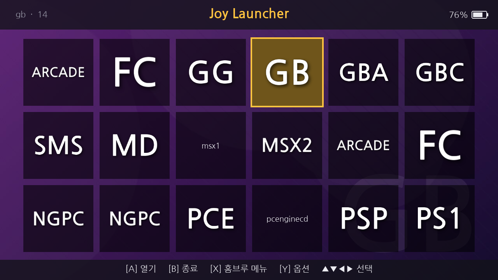

# Joy Launcher — Theme Layout Guide (layout.txt)

[Theme guide](theme-guide-en.md) · [Manual](manual-en.md) · 한국어: [테마_레이아웃.md](테마_레이아웃.md)

**From v1.0.0**, a theme can change the **screen layout itself** with a `layout.txt` file in the theme folder:

- the category screen as a **grid of system cards**, the game list as a **grid of box art**
- **position and size** of the list, pictures, description, title, battery and help line
- **fonts, text sizes and colors**
- your own **pictures (panels, frames, decoration) and texts** anywhere

A theme without `layout.txt` looks exactly as before. Write **only what you want to change**.

| Grid category screen (JoyBasic pictures + layout.txt) |
|---|
|  |

---

## 1. Basics

- The screen is **1280 × 720**. All positions and sizes are pixels in that space.
- A screen is a set of **elements** (pictures, texts, a list ...). There are two screens:
  - `categories` — the category (system) screen
  - `games` — the game list screen
- Each element has a name; `[screen.element]` selects it.
  - A **built-in name** (table in section 6) changes that element; only the properties you write change.
  - A **new name** with a `type` adds an element.
- `rect = left,top,width,height` places an element.

```ini
# Example: list on the right, pictures on the left
[games.list]
rect = 532,92,720,546

[games.media]
rect = 40,92,440,300

[games.info]
rect = 40,404,440,256
```

### File format

- `layout.txt` directly in the theme folder, saved as **UTF-8**
- `name = value` lines under `[section]` headers, one per line
- Lines starting with `#` or `;` are comments. A trailing comment needs **a space before `#`** (`size = 24   # note`). A `#` at the start of a value is a color.
- Picture and font files are **paths inside the theme folder** (`ui/card.png`). Use ASCII names.
- Bad lines are skipped; when the theme is chosen a notice says "layout.txt has N problem(s)". Details go to **`layout_errors.txt`** in the theme folder (line: what). The file is removed when everything is fine.
- To reload an edited `layout.txt`: **Y Options → Theme → same theme → A**

## 2. Quick try — JoyBasic as a grid

1. Copy `/JoyLauncher/themes/JoyBasic` on the SD card and rename the copy to `JoyGrid`.
2. Create `JoyGrid/layout.txt` with the text below.
3. In the launcher: Y Options → Theme → JoyGrid

```ini
[categories.preview]
visible = off

[categories.list]
style = grid
rect = 60,100,1160,548
columns = 6
rows = 3
gap = 16,16
image = logo
padding = 16
card_color = #00000090
selection = #ffc440
color = text
size = 20

[categories.name]
type = text
text = {category}  ·  {games}
rect = 40,26,400,0
size = 22
color = dim
```

- The preview is turned off and the list becomes a 6×3 grid; cells show the theme's `logos/` pictures.
- In a grid you move with **▲▼◀▶**.
- `categories.name` is a new text element showing the highlighted category and its game count.

## 3. Sections

| Section | Content |
|---|---|
| `[theme]` | fonts, colors, background color (section 4) |
| `[names]` | display names for categories (section 5) |
| `[categories.<element>]` | elements of the category screen |
| `[games.<element>]` | elements of the game screen |

## 4. `[theme]` — fonts and colors

```ini
[theme]
font = fonts/regular.ttf        # regular font (ttf / otf)
font_bold = fonts/bold.ttf      # bold font (defaults to font)
background_color = #101828      # color behind everything when there is no background picture
color.text = #ffffff
color.dim = #c8c8d0
color.accent = #7fd4ff
color.selection = #7fd4ff60
color.bar = #00000080
color.mycolor = #ff8800         # your own color name (use: color = mycolor)
```

- Text containing characters your font does not have (e.g. Korean in a Latin-only font) is drawn with the **built-in font** (NanumGothic).
- From v1.3.0 the options window, theme picker, message boxes and other menus follow the theme colors (rounded corners, matching panel / border / text) — see “Menu windows” in section 11.

### Colors

| Form | Example |
|---|---|
| `#rrggbb` | `#ffc440` |
| `#rrggbbaa` (last two digits = opacity, 00 clear ~ ff solid) | `#00000080` |
| `#rgb` | `#fc4` |
| `r,g,b` or `r,g,b,a` (0-255) | `255,196,64,128` |
| color name | `text`, `dim`, `accent`, `selection`, `bar`, or a name defined in `[theme]` |

Built-in color names:

| Name | Used for | Default |
|---|---|---|
| `text` | normal text, selected row text | `#ebebf0` |
| `dim` | dimmed text (list, description) | `#9696a5` |
| `accent` | title | `#ffc440` |
| `selection` | selection bar | `#46466ed2` over a background picture, else `#464660` |
| `bar` | top / bottom bars | `#14141a` (translucent over a background picture) |

Setting `color.<name>` in `[theme]` changes every element that uses that name.

## 5. `[names]` — display names

```ini
[names]
액션-아케이드 = Arcade (Action)
gba = Game Boy Advance
```

`category name (or shortname, or ROM folder name) = name to show`. Applies to the list and `{category}`. Picture lookup (theme.txt) is not affected.

## 6. Built-in elements

This is the screen without `layout.txt`. A section with one of these names changes that element. Hide with `visible = off`.

### categories

| Name | type | rect | Content |
|---|---|---|---|
| `background` | image | 0,0,1280,720 | per-category background (`backgrounds/`) |
| `topbar` | rect | 0,0,1280,76 | top bar |
| `bottombar` | rect | 0,668,1280,52 | bottom bar |
| `list` | list | 28,92,720,546 | category list (13 rows, game counts) |
| `preview` | preview | 800,96,440,510 | 2×2 box art of the highlighted category |
| `title` | text | 320,18,640,0 | "Joy Launcher" |
| `applet` | text | 100,26,0,0 | applet mode mark |
| `battery` | battery | 1056,28,200,20 | battery |
| `hint` | text | 640,680,0,0 | button help |

### games

| Name | type | rect | Content |
|---|---|---|---|
| `background` | image | 0,0,1280,720 | per-category background |
| `topbar` / `bottombar` | rect | | bars |
| `list` | list | 28,92,720,546 | game list (13 rows) |
| `media` | media | 800,92,440,300 | screenshot + box art (small, bottom right) |
| `info` | info | 800,404,440,256 | title, developer, year, genre, description |
| `title` | text | 320,18,640,0 | category name (logo if there is one) |
| `applet` | text | 100,26,0,0 | applet mode mark |
| `prev` | text | 30,26,0,0 | "◀ L" |
| `battery` | battery | 1056,28,200,20 | battery |
| `pager` | pager | (left of the battery) | "2 / 13   R ▶" |
| `counter` | text | 40,680,0,0 | "12 / 340" |
| `hint` | text | 640,680,0,0 | button help |

## 7. Element types and properties

### Common

| Property | Value | Meaning |
|---|---|---|
| `type` | see below | **First line of a new element.** Not needed when changing a built-in one |
| `rect` | `x,y,w,h` | placement (`x` `y` `w` `h` can also be set one by one) |
| `visible` | `on` / `off` | show / hide |
| `z` | number | draw order (lower = earlier = below). Built-ins: background 0, bars 10, list and pictures 30, texts 50. New elements default to 20 |
| `color` | color | text color / fill color |

### `rect` — filled rectangle

Filled with `color`; use it for translucent panels.

### `image` — picture

| Property | Value | Meaning |
|---|---|---|
| `file` | path | a picture in the theme folder (always the same) |
| `source` | `background` / `logo` / `icon` / `boxart` / `screenshot` | a picture that follows the category or game |
| `folder` | folder name | folder for `source = icon` (default `icons`) |
| `fallback` | path | picture to use when `source` finds nothing |
| `fit` | `contain` / `cover` / `stretch` | keep ratio inside the box (default) / keep ratio and fill (crop) / stretch |
| `align`, `valign` | `left` `center` `right` / `top` `center` `bottom` | position inside the box for `contain` (default center) |
| `alpha` | 0-255 | opacity |
| `dim` | 0-255 | black layer over the picture. For `background` the default is `dim` from theme.txt |
| `tint` | color | colorize the picture (e.g. recolor a white logo) |

`source` values: `background` (the highlighted/open category's `backgrounds/` picture), `logo` (`logos/`), `icon` (`icons/` or `folder`), `boxart` and `screenshot` (the selected game, game screen only; `screenshot` falls back to a video frame; the Android version plays the preview video there instead).

- `backgrounds/`, `logos/` and `icons/` pictures are all found with the **name rules** in [section 5 of the theme guide](theme-guide-en.md) (ROM folder name, theme.txt mapping).
- With `w` and `h` 0 the picture is drawn at its own size.

```ini
# One background for every category (used when a category has no own background)
[categories.background]
fallback = backgrounds/default.png
```

### `text`

| Property | Value | Meaning |
|---|---|---|
| `text` | text | what to show; `{placeholders}` are replaced (section 8) |
| `font` | `regular` / `bold` | |
| `size` | 6-200 | text size |
| `align` | `left` / `center` / `right` | align to the left edge / center / right edge of `rect` |
| `valign` | `top` / `center` / `bottom` | vertical position when `h` is set |
| `wrap` | `on` / `off` | multi-line (wrap at `w`, scroll slowly when taller than `h`) |
| `scroll` | `on` / `off` | scroll a single line wider than `w` (off: cut with …) |
| `logo`, `logo_rect` | `on` / `off`, `x,y,w,h` | show the category logo at `logo_rect` instead of the text when there is one |

- With `w` 0 there is no width limit and `x` is the anchor (`rect = 640,680,0,0` + `align = center` centers at x=640).
- Nothing is drawn when all placeholders are empty.

### `list` — the category / game list

One per screen. `style` picks the look.

| Property | Value | Meaning |
|---|---|---|
| `style` | `text` / `grid` | rows of text / grid |
| `color`, `selected_color` | color | text color, text color of the selected item |
| `selection` | color | selection bar (text) or the frame behind the selected cell (grid, when there is no `selector`) |
| `selector` | path | selection picture, stretched over the row or cell |
| `selector_grow` | number | make the selection picture this much larger on every side |
| `font`, `size` | | text |
| `scrollbar` | `auto` / `on` / `off` | scroll bar (v1.3.4). Default `auto` = only when the items do not fit. Text and grid lists: vertical, 6 px right of the list; horizontal carousel: centered below the largest cell (max 320 px); vertical carousel: on the right |
| `scrollbar_color` | color | thumb color; the track is the same color at 25%. Default = `color.scrollbar` in `[theme]`, else `dim` |
| `scrollbar_width` | number 1–30 | thickness (default 4) |
| `scrollbar_offset` | `x` or `x,y` | move it from the default spot |

> Launchers up to 1.3.3 report the scrollbar keys as unknown, so add `requires = 1.3.4` when you use them (the theme builder does it on export). Without the keys, 1.3.4 and later still show the default bar on lists that overflow; set `scrollbar = off` to hide it. Menu windows (options, theme picker, homebrew favorites…) also show one inside their right edge in `color.menu_dim` when they overflow.

`style = text`: `row_height` (decimals allowed; rows = `h` ÷ `row_height`, or set `rows`), `text_offset = x` or `x,y` (text position in the row; without `y` it is centered vertically), `align`, and for the category list `count`, `count_color`, `count_size`, `count_offset`.

`style = grid`:

| Property | Value | Meaning |
|---|---|---|
| `columns`, `rows` | number | cell size is computed from `rect` and `gap` |
| `gap` | `x,y` | space between cells |
| `image` | `icon` / `logo` / `boxart` / `none` | cell picture. Default: `icon` on the category screen, `boxart` on the game screen |
| `folder` | folder name | folder of the `icon` pictures (default `icons`) |
| `padding` | `n` or `left,top,right,bottom` | inner margin of a cell |
| `card` | path | cell background picture (stretched to the cell) |
| `card_grow` | number | make the card picture larger than the cell (for shadows) |
| `card_color` | color | cell background color (no picture needed) |
| `selected_scale` | 0.5-2.0 | enlarge the selected cell (e.g. 1.08) |
| `label` | `auto` / `on` / `off` | name label. `auto` (default): only in cells without a picture, centered / `on`: always, at the bottom / `off` |
| `label_height` | number | label height for `label = on` |

- Grid: ▲▼◀▶ move one cell. Text list: ▲▼ one row, ◀▶ one page.
- `image = boxart` in a category grid shows the first game's box art.
- Cell pictures are shrunk to the cell size when loaded, so large pictures (e.g. 800×1000) work; **loading time** grows with picture size though — up to twice the cell size is a good choice.

### `preview`, `media`, `info`, `battery`, `pager`

- `preview` (category screen): box art of the highlighted category in `columns` × `rows` cells, `gap = x,y`.
- `media` (game screen): large screenshot (or video frame; on Android the preview video plays here) with the box art small at the bottom right; only the box art when there is no screenshot. `overlay = off` hides the small box art. For separate pictures hide `media` and add `image` elements with `source = boxart` / `screenshot`.
- `info` (game screen): title → developer · year · players → genre → description, top to bottom. `title_color`, `title_size` (27), `color`, `size` (22), `desc_size` (20). For separate texts hide `info` and add `text` elements.
- `battery`: drawn at the **right edge** of `rect`; `color` changes its color.
- `pager` (game screen): "2 / 13   R ▶", right-aligned to `rect`, or left of the battery when no `rect` is set.

## 8. Text placeholders

| Placeholder | Content |
|---|---|
| `{category}` | highlighted / open category |
| `{games}` | number of games in it |
| `{index}`, `{count}` | position / total in the list (categories on the category screen, games on the game screen) |
| `{category_index}`, `{category_count}` | category number / total |
| `{title}`, `{longtitle}` | selected game's title / long title |
| `{developer}`, `{year}`, `{release}`, `{players}`, `{genre}` | game data |
| `{meta}` | "developer · year · players" in one line |
| `{description}` | game description (use with `wrap = on`) |
| `{hint}` | button help of the screen |
| `{clock}` | time (HH:MM) |
| `{app}`, `{version}` | "Joy Launcher", launcher version |
| `{applet}` | "Applet mode" in applet mode, otherwise empty |

## 9. Example: card grid + list panel

A grid of system cards and a game screen with a list panel on the left. The included **WallStreetKim's Theme** (`themes/ByeokgolKim`) is built this way — its `layout.txt` is a good file to experiment with. For your own theme you supply the pictures.

```
MyTheme/
├─ backgrounds/default.png          background for everything
├─ icons/<rom folder>.png           system card pictures (4:5 portrait)
├─ logos/<rom folder>.png
├─ ui/card.png                      card shadow
├─ ui/selector.png                  selection frame
├─ ui/panel.png                     list panel
├─ fonts/regular.ttf
├─ theme.txt                        dim=160
└─ layout.txt
```

```ini
[theme]
font = fonts/regular.ttf
color.text = #ffffff
color.dim = #d0d0d8
color.accent = #ffffff

# ---- category screen
[categories.background]
fallback = backgrounds/default.png
[categories.topbar]
visible = off
[categories.bottombar]
visible = off
[categories.preview]
visible = off

[categories.title]
text = {category}
size = 30
rect = 240,26,800,0

[categories.count]
type = text
text = {games} GAMES
size = 20
color = dim
rect = 240,66,800,0
align = center

[categories.list]
style = grid
rect = 112,112,1056,520
columns = 5
rows = 2
gap = 24,24
card = ui/card.png
card_grow = 6
selector = ui/selector.png
selector_grow = 3
selected_scale = 1.06

[categories.hint]
size = 18
color = dim
rect = 640,676,0,0

# ---- game screen
[games.background]
fallback = backgrounds/default.png
[games.topbar]
visible = off
[games.bottombar]
visible = off

[games.panel]
type = image
file = ui/panel.png
rect = 0,0,640,720
fit = stretch

[games.list]
rect = 50,84,540,550
row_height = 50
size = 24
text_offset = 20
color = #505058
selected_color = #101014
selection = #00000026

[games.counter]
rect = 320,42,0,0
align = center
color = #606068
size = 18

[games.title]
rect = 664,50,572,0
logo_rect = 730,26,360,84
[games.prev]
rect = 664,60,0,0
[games.pager]
rect = 1016,60,220,0
[games.battery]
rect = 1056,14,200,20

[games.media]
rect = 664,130,572,290
[games.info]
rect = 664,436,572,214

[games.hint]
size = 16
color = dim
rect = 952,684,0,0
```

## 10. Notes

- A theme's `layout.txt` only takes effect on **v1.0.0 or later**; older versions apply just the backgrounds and logos.
- Overlapping elements are ordered by `z`. With equal `z`, built-in elements come first, then new ones in file order.
- Do not hide the `list`: navigation keeps working even when it is invisible.
- To match a striped panel picture exactly, `row_height` accepts decimals (e.g. `50.4`).
- For light themes set dark `color.text` / `color.dim`; the battery color is `[<screen>.battery] color`.
- Mind copyright when sharing a theme that contains company logos or console photos.

## 11. Extensions (v1.1.0+)

Themes that use these should set `requires = 1.1.0` in `[theme]` (the theme builder adds it on export).

Button icons (v1.2.0+): `[A]` `[B]` `[X]` `[Y]` `[L]` `[R]` `[ZL]` `[ZR]` `[+]` `[-]` `[L/R]` in hints and messages are drawn as Switch button shapes (circles / rounded bars, letters cut out) in the text color and size. Turn it off with `button_icons = off` in `[theme]`.

- **Cell elements** `[screen.<list>.<name>]`: drawn in every cell (grid) or row (text list). `rect` is relative to the cell; width/height ≤ 0 = to the cell edge (negative = that much less). `type` defaults to text. `state = all | selected | normal`, `selected_color`, negative `z` = below the cell content. `label = off` on the list hides the built-in name.
- **Conditions**: `visible_if = <placeholder>` / `hidden_if` (empty or `0` = false).
- **Placeholders**: `{name}` `{short}` `{system}` `{num}` `{num_desc}` `{fav}` `{playcount}` `{lastplayed}` `{selected}` `{file}` `{date}`. Templates: `{a,b,c| · }` joins non-empty values; `{key?yes:no}`; `{key=value?yes:no}`.
- **`[strings]` / `[strings.en]`**: replace UI text. Keys `hint.categories`, `hint.categories_grid`, `hint.games`, `hint.games_grid`, or any original Korean UI string.
- **X button name per platform (v1.3.0+)**: themes are shared by the Switch and Android versions, so the name right after `[X]` (up to the next `[button]` or two spaces) is adjusted: Android (X = BGM · sound settings) always shows `BGM`; Switch (X = homebrew menu) keeps the theme's own word and only replaces Android names (BGM / sound / music) with `Homebrew`. Applies to hints and theme text elements, not to placeholder values such as game names. The Switch default hint is now `[X] Homebrew` (`[strings]` keyed by the old `[X] 홈브루 메뉴` text still work).
- **Menu windows (v1.3.0+)**: options, BGM · sound, theme picker, favorites pickers, emulator picker, FTP, exit / progress / message boxes are drawn with rounded corners in theme colors. `[theme]` keys: `color.menu` (panel), `color.menu_border`, `color.menu_title`, `color.menu_text`, `color.menu_dim`, `color.menu_select` (selection bar), `color.menu_select_text`, `menu_radius` (0–40, default 14), `menu_border_width` (0–8, default 2). Colors left out are derived from the theme: panel = `background_color` → `bar` → dark default; border = same hue, clearly lighter/darker (≥ 2.2:1); text = `text` (falls back to white/black below 4.5:1); title = complementary hue of the panel (gray panel → `accent` → yellow) adjusted to 4.5:1; selection = between panel and border. Error (red) / done (green) boxes keep their colors and only get the corners and border. With no theme the old colors stay, only the corners are rounded. `color.menu…` is ignored silently by 1.2.0 and older; `menu_radius` / `menu_border_width` make older versions report an unknown key, so add `requires = 1.3.0` when you use them (the theme builder does this on export).
- **Screen aspect fitting (Android v1.3.6+, not the Switch)**: 16:9 = unchanged. Wider/narrower landscape screens (width/height ≥ 1.25: 16:10, 3:2, 4:3, 20:9 …) use height 720 and width 720×aspect (900–1600) and scale only the horizontal coordinates of `layout.txt` (4:3 = 0.75); text sizes and picture ratios stay. Grids drop columns to keep the cell shape (5 → 4 on 4:3); carousels scale spacing (and cell size when narrower). Full-screen `fit = stretch` pictures stretch by the same factor, so lines drawn in them still match — but text drawn into pictures looks squashed, use `text` elements. One-line text without a width (hints) shrinks to fit. Per element `anchor = scale` (default) / `left` / `right` / `center` / `stretch` / `fixed`; `[theme] auto_fit = off` disables fitting. Near-square screens (0.8–1.25, e.g. Anbernic RG Rotate 720x720) read `layout_1x1.txt` (720x720 coordinates, over a built-in square layout, problems in `layout_1x1_errors.txt`); themes without it whose `layout.txt` changes no elements (fonts/colors only, e.g. Basic and Retro) get the built-in square layout, other themes stay 1280x720 with bars. Portrait: unchanged. `[theme] canvas = <w>x<h>` (320–2560) sets the coordinate size directly. Theme builder: «화면비» (aspect) in the top bar previews 16:9 · 16:10 · 4:3 · 1:1; in 1:1 it edits `layout_1x1.txt` («1:1 구성 만들기» creates it). Older versions report `anchor` / `auto_fit` / `canvas` as unknown keys.
- **Built-in system names**: folder/category names (FC, SFC, MD, PS1, 액션-아케이드 …) map to ES-DE names (nes, snes, megadrive, psx, arcade_action …), so ES-DE theme art works without theme.txt lines.
- **Theme builder**: see 테마_빌더.md (Korean).
