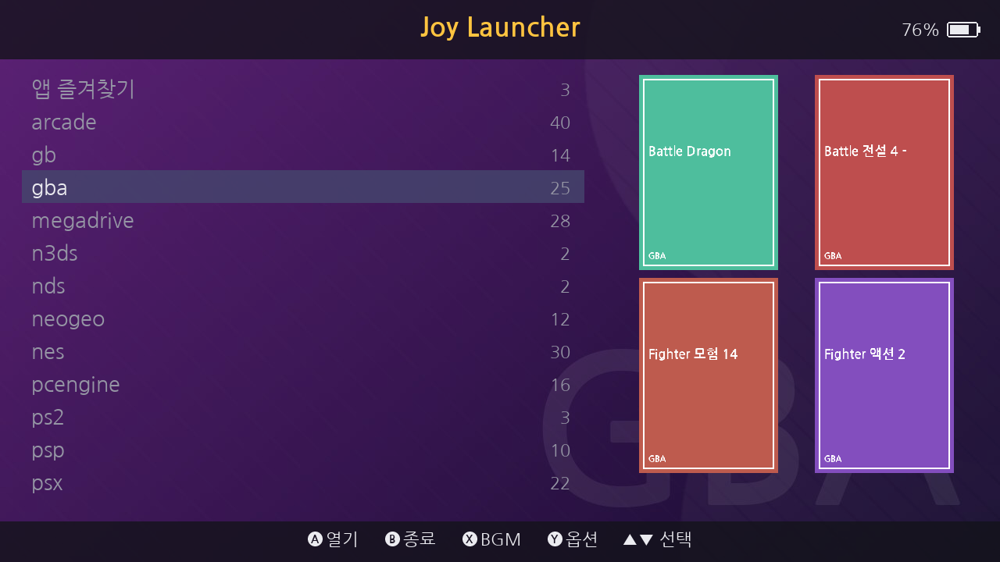
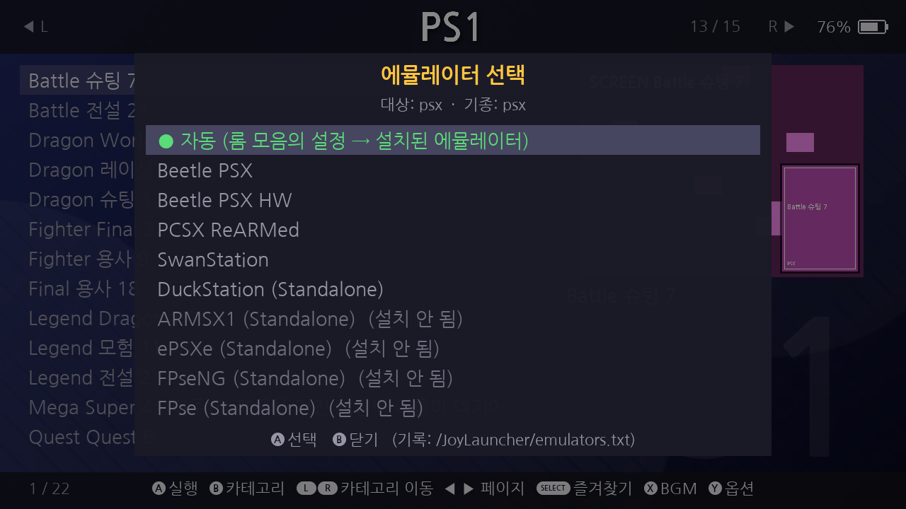
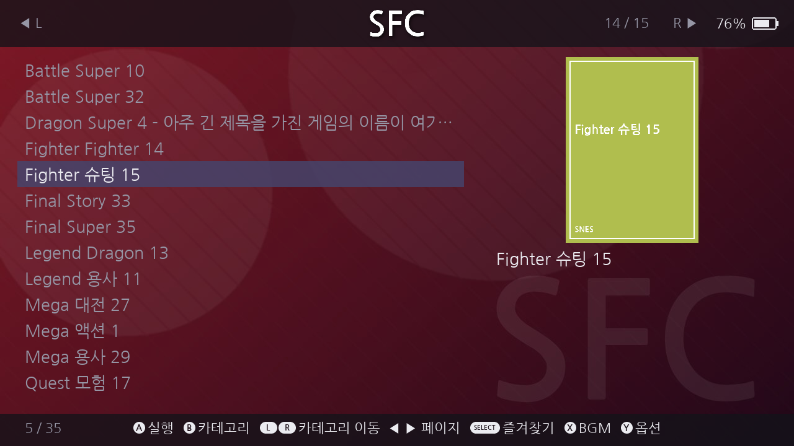
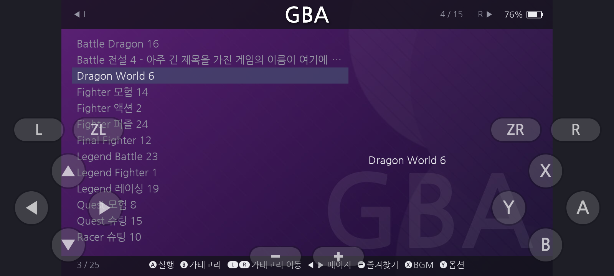
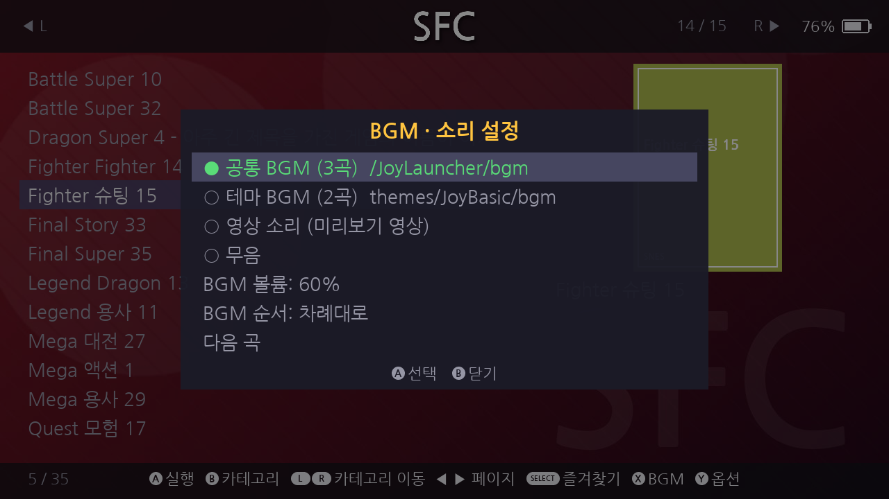
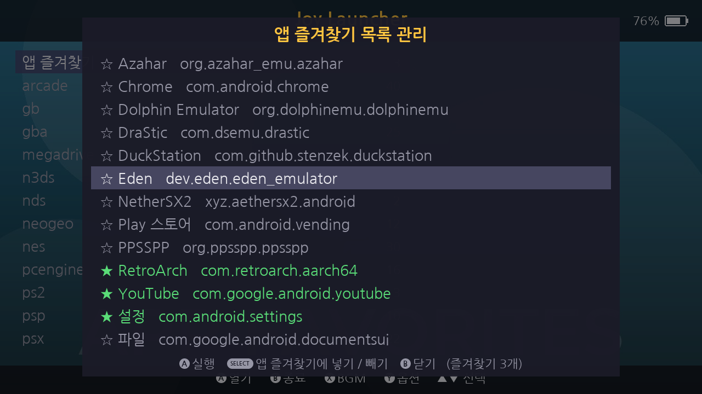
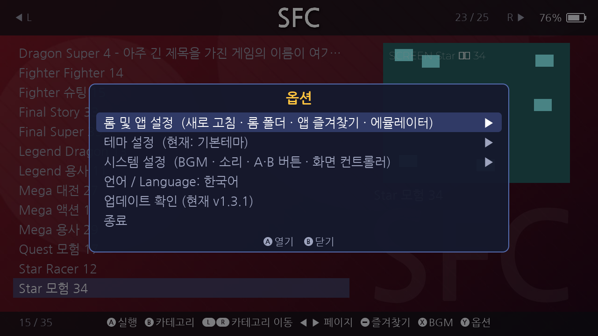

# Joy Launcher (안드로이드) 설명서

스위치용 Joy Launcher 의 안드로이드판입니다. 화면·테마는 스위치판과 같고, 게임을 실행하는 방법과 안드로이드에 맞춘 몇 가지가 다릅니다.



## 1. 설치와 첫 실행
1. [릴리스](https://github.com/JyJyLab/JoyLauncher/releases) 에서 안드로이드판(태그 `android-v…`)의 `JoyLauncher.apk` 를 받아 설치합니다 (안드로이드 7.0 이상, arm64 기기). 새 버전은 **옵션 → 업데이트 확인** 이 알려 주는 릴리스 페이지에서 `JoyLauncher.apk` 를 받아 직접 덮어 설치합니다 (**[A] 브라우저로 열기**, 설정·테마는 그대로). 앱이 apk 를 받아 설치하지는 않습니다 — 다른 앱 설치 권한 문제. 시작할 때도 확인해 알려 줍니다 (`settings.txt` 의 `auto_update=off` 로 끔).
2. 처음 실행하면 **저장소의 모든 파일에 접근할 권한**을 안내하는 화면이 나옵니다. 아무 버튼이나 화면을 누르면 설정 화면이 열립니다 → **Joy Launcher 허용** → 뒤로 돌아오면 계속됩니다.
   - 롬 폴더를 읽고, 저장소 루트의 `JoyLauncher` 폴더에 설정·테마를 두기 위한 권한입니다.
   - 안드로이드 10 이하는 저장소 권한 창이 뜹니다.
3. 처음 실행 때 기본 테마 4종(기본테마 · 레트로테마 · 벽골김씨테마 · 레트로게임갤러리테마)이 `JoyLauncher/themes` 에 풀립니다.
4. 이어서 **롬 폴더 확인** 창이 열립니다.
   - 자동으로 찾은 롬 폴더(내장 / SD 카드)가 보이면 **A = 이대로 사용** (그 폴더들을 `roots.txt` 에 저장, 자동 찾기는 계속) · **B = 직접 선택**
   - 직접 선택: 안드로이드 기본 **파일 관리자(폴더 선택)** 가 열립니다. ROMS 폴더까지 들어가 **이 폴더 사용 → 허용** 을 누르면 그 위치가 `roots.txt` 에 저장되고 바로 게임 목록을 읽습니다 (찾은 게임 수 알림). 직접 고르면 **자동 찾기는 꺼지고 고른 폴더만** 씁니다 (옵션 → 롬 및 앱 설정 → 롬 폴더 설정에서 다시 켬)
   - 자동으로 찾은 폴더가 없으면 A = 파일 관리자에서 고르기, B = 나중에
   - 안드로이드 11 이상은 저장소 맨 위 · Download 맨 위 · Android 폴더는 고를 수 없습니다 (시스템 제한) — 그 안의 폴더(예: `Roms`)를 고르세요. 구글 드라이브 같은 클라우드 위치는 쓸 수 없습니다
   - 파일 관리자가 열리지 않는 기기는 앱 안에서 찾아보기 창으로 바뀝니다 (폴더 줄 옆 "기종 폴더 n개 (GBA, NDS …)" 를 보고 고르면 됨)

## 2. 폴더
설정과 테마는 내부 저장소 루트의 **`/JoyLauncher`** (`/storage/emulated/0/JoyLauncher`) 에 있습니다. 파일 관리자나 PC 연결로 자유롭게 고칠 수 있습니다.

| 파일·폴더 | 내용 |
|---|---|
| `themes/<테마>/` | 테마 (스위치판과 같은 문법) |
| `settings.txt` | 설정 (테마, 언어, 소리 선택·BGM, 화면 효과, 미리보기 영상, A·B 바꾸기, 화면 컨트롤러) |
| `roots.txt` | 롬 폴더 목록 (한 줄에 하나). `auto=off`, `esde=<ES-DE 폴더>` |
| `emulators.txt` | 롬 폴더·카테고리·기종마다 쓸 에뮬레이터 |
| `custom_systems/` | 새 기종·에뮬레이터 (`es_systems.xml`, `es_find_rules.xml` — ES-DE 와 같은 문법) |
| `app_favorites.txt` · `favorites.txt` | 앱 즐겨찾기 · 게임 즐겨찾기 |
| `categories.txt` · `categories/` | 나만의 카테고리와 그 그림 |
| `bgm/` | 공통 BGM (mp3·ogg). 테마 BGM 은 `themes/<테마>/bgm/` |
| `cache/` | 앱 아이콘 |
| `launch_log.txt` | 최근 실행 기록 (어떤 에뮬레이터를 어떻게 골랐는지) |
| `crash_log.txt` | 꺼짐 기록: 런처가 갑자기 꺼지면 다음에 켤 때 원인(안드로이드 11 이상)과 마지막 로그를 적음 |
| `library.cache` · `state.txt` · `playcount.txt` | 게임 목록 저장본 · 화면 위치 · 실행 횟수 |

## 3. 롬 폴더
아래를 자동으로 찾습니다.
- 내부 저장소와 SD 카드의 맨 위 또는 한 단계 아래에 있는 `ROMs` · `Roms` · `roms` 폴더, `Emulation/roms` (예: `/JY_Data/Roms`)
- 맨 위 폴더 안에 기종 이름 폴더(`GBA` · `NDS` · `슈퍼패미컴` …)가 둘 이상 있으면 그 폴더 (예: `/Games/GBA`, `/Games/NDS` → `/Games`)
- 페가수스의 게임 폴더 목록 (`pegasus-frontend/game_dirs.txt`)
- ES-DE 설정에 적힌 롬 폴더 (`ES-DE/settings/es_settings.xml`)

다른 곳에 있으면 옵션 → 롬 및 앱 설정 → **롬 폴더 설정** 에서 고르거나 (1장 4번), `/JoyLauncher/roots.txt` 에 한 줄씩 적습니다 (예: `/storage/1234-ABCD/Games`, 기종 폴더 하나 `/storage/emulated/0/내폴더/GBA` 도 됨). `auto=off` 를 적으면 자동으로 찾지 않고 적은 폴더만 씁니다.

게임 목록은 세 가지 방식으로 읽고, 폴더마다 섞여 있어도 됩니다.
1. **페가수스**: 폴더의 `metadata.pegasus.txt`
2. **ES-DE**: 폴더의 `gamelist.xml`, 또는 `ES-DE/gamelists/<폴더>/gamelist.xml` 과 `ES-DE/downloaded_media`
3. **목록 없음**: 폴더 이름으로 기종을 알아내 그 기종의 확장자를 가진 파일을 게임으로

롬·그림·영상을 넣거나 뺀 뒤에는 **옵션 → 롬 및 앱 설정 → 게임 목록 새로 고침**.

- 박스·화면 사진은 png·jpg·**webp** (JoiPlay 등 페가수스 목록의 `media/<게임>/boxFront.webp` 도 그대로). 설명의 `\n` 은 줄바꿈으로, 런처 글꼴에 없는 일본어·한자는 기기의 한중일 글꼴로 보여 줍니다.

### 미리보기 영상
고른 게임에 미리보기 영상이 있으면, 잠시 뒤 화면 사진 자리에서 영상이 재생됩니다 (끝나면 처음부터 다시). 영상이 나오기 전까지는 화면 사진(없으면 박스 사진)이 보입니다.
- 영상 찾는 곳: 페가수스 `assets.video`, `gamelist.xml` 의 `<video>`, ES-DE `downloaded_media/<기종>/videos`, 롬 폴더의 `media/<게임 이름>/video.mp4` · `videos/` · `snap/` · `media/videos/` 의 `<게임 이름>.mp4` (mp4·mkv·webm 등 기기가 재생할 수 있는 형식)
- 영상의 소리는 **BGM · 소리 설정(X)** 에서 "영상 소리" 를 골랐을 때만 납니다. BGM 을 고르면 영상은 소리 없이 재생됩니다 (7장).
- 옵션 창·앱 즐겨찾기 목록 관리 같은 창이 열려 있거나 게임을 실행하면 영상은 멈춥니다.
- **옵션 → 테마 설정 → 미리보기 영상 재생** 으로 끄고 켭니다 (`settings.txt` 의 `video=on/off`).

## 4. 게임 실행: 에뮬레이터 고르는 순서
스위치판과 달리 **기종 제한이 없습니다.** 모든 게임을 보여 주고, 실행할 때 에뮬레이터를 고릅니다.

0. **`emulators.txt` 에 정한 것** (롬 폴더 → 카테고리 → 기종 이름 순으로 찾음)
1. **페가수스 메타데이터의 실행 명령** (`launch: am start …`) — 그대로 실행합니다.
   - 적힌 앱이 기기에 없으면 같은 에뮬레이터의 다른 앱으로 바꿉니다 (예: RetroArch 64비트판 ↔ 일반판).
   - 스위치용·리눅스용 롬 모음처럼 `am start` 가 아니면 적힌 코어 이름으로 RetroArch 를 실행합니다.
2. **롬 폴더 이름 → 기종 → 설치된 에뮬레이터** (ES-DE 방식)
   - 롬 모음 목록에서 본 RetroArch 코어가 있으면 그것, 없으면 그 기종의 에뮬레이터 목록(ES-DE 순서)에서 설치된 첫 번째를 고릅니다.
   - PS1·PS2·PSP·N64·NDS·3DS·GC·Wii·새턴·드림캐스트는 설치된 단독 에뮬레이터(DuckStation·NetherSX2·PPSSPP …)를 RetroArch 보다 먼저 고릅니다.
   - 같은 에뮬레이터에 실행 방식이 여럿이면 파일에 맞는 것을 고릅니다 (PS3: ISO / 폴더 / 게임 번호, 윈도우: .steam / .epic …).
   - 폴더 이름은 `psx` `ps2` `switch` `n3ds` 같은 ES-DE 이름, `PS1` `FC` `SFC` `MD` 같은 줄임말, `PS2 한글` `FBNEO ACT` `Sony PlayStation 2` 같은 꼴, 한글 이름을 알아봅니다.
   - ES-DE 목록의 "다른 에뮬레이터" 설정(`altemulator`)을 따릅니다.

에뮬레이터가 없으면 실행할 때 "○○ 에뮬레이터가 설치되어 있지 않습니다 (지원: …)" 라고 알려 줍니다.



### 에뮬레이터 바꾸기
**옵션(Y) → 롬 및 앱 설정 → 에뮬레이터 선택** 에서 지금 카테고리(게임 화면에서는 고른 게임의 롬 폴더)에 쓸 에뮬레이터를 고릅니다. 고른 것은 `emulators.txt` 에 적힙니다.

`emulators.txt` 를 직접 쓸 수도 있습니다.
```
psx=DuckStation (Standalone)
snes=snes9x
PS2 한글=NetherSX2
switch=am start -n dev.eden.eden_emulator/org.yuzu.yuzu_emu.activities.EmulationActivity -a android.nfc.action.TECH_DISCOVERED -d {file.uri}
ps2=%EMULATOR_NETHERSX2% %ACTION%=android.intent.action.MAIN %EXTRA_bootPath%=%ROMSAF%
숨길폴더=none
```
- 왼쪽: 롬 폴더 이름 · 카테고리 이름 · 기종 이름 (대소문자 구분 없음)
- 오른쪽: 에뮬레이터 이름(일부만 적어도 됨) / 페가수스 방식 명령 / ES-DE 방식 명령 / `none`

페가수스 명령의 변수: `{file.path}` 경로, `{file.uri}` 파일 제공자 주소, `{file.documenturi}` SAF 문서 주소, `{file.name}` `{file.basename}` `{file.dir}`

### 저장소 접근 (SAF) 을 쓰는 에뮬레이터
DuckStation · NetherSX2 · Dolphin · Azahar · PPSSPP 등은 게임 파일을 "문서 주소" 로 받습니다. 이런 에뮬레이터는 **에뮬레이터 안에서 그 기종의 롬 폴더를 게임 폴더로 한 번 등록**해 두어야 런처에서 넘긴 게임이 열립니다 (ES-DE·페가수스와 같은 조건). 롬 폴더 전체가 아니라 기종 폴더(예: `ROMs/ps2`)를 등록하세요.

### 새 기종·에뮬레이터 더하기
`/JoyLauncher/custom_systems/es_systems.xml` 과 `es_find_rules.xml` 을 ES-DE 와 같은 문법으로 만들면 기종·에뮬레이터를 더하거나 바꿀 수 있습니다. ES-DE 를 쓰고 있다면 `ES-DE/custom_systems` 의 파일도 함께 읽습니다. 기본 표는 ES-DE 안드로이드판의 것입니다.

## 5. 조작
| 버튼 | 카테고리 화면 | 게임 화면 |
|---|---|---|
| A | 열기 | 실행 |
| B | 종료 (한 번 더 확인) | 카테고리로 |
| X | BGM · 소리 설정 | BGM · 소리 설정 |
| Y | 옵션 | 옵션 |
| L · R | | 이전 · 다음 카테고리 |
| ZL · ZR | | 보기: 전체 → 즐겨찾기 → 최근 실행 |
| − (SELECT) | | 즐겨찾기 넣기 / 빼기 |
| + (START) | 종료 (한 번 더 확인) | 종료 (한 번 더 확인) |
| 방향키 · 왼쪽 스틱 | 이동 | 이동 |

안드로이드의 **뒤로 가기**는 B 와 같습니다.

- **버튼 이름**: 닌텐도 계열 컨트롤러(스위치 프로·조이콘)는 `+` `−`, 그 밖(Xbox·플레이스테이션·휴대기 내장 패드)은 `START` `SELECT` 로 화면에 표시됩니다.
- **A·B 바꾸기**: 옵션 → 시스템 설정에서 켜면 B 가 선택, A 가 취소가 되고 화면의 버튼 표시도 바뀝니다. 기기의 A·B 위치가 반대일 때 씁니다.



## 6. 화면 컨트롤러 (터치)
컨트롤러가 연결되어 있지 않으면 화면에 터치 버튼이 나타납니다. 컨트롤러를 연결하거나 버튼을 누르면 사라지고, 화면을 누르면 다시 나타납니다.
**옵션 → 시스템 설정 → 화면 컨트롤러** 에서 자동 / 항상 표시 / 끔 을 고릅니다.



## 7. 소리: BGM · 영상 소리
**X** 를 누르면 **BGM · 소리 설정** 창이 열립니다 (옵션 → 시스템 설정에도 같은 항목이 있습니다). 소리는 아래 넷 중 **하나만** 납니다 — BGM 과 영상 소리가 함께 나지 않습니다.



| 선택 | 내용 |
|---|---|
| 공통 BGM | `/JoyLauncher/bgm` 의 mp3·ogg. 어느 테마에서나 같은 곡 |
| 테마 BGM | 지금 쓰는 테마 폴더 안 `bgm` 폴더의 mp3·ogg (`/JoyLauncher/themes/<테마>/bgm`). 테마를 바꾸면 그 테마의 곡으로 바뀜. 곡이 없는 테마에서는 소리가 나지 않음 |
| 영상 소리 | 미리보기 영상의 소리 (3장). BGM 은 나지 않음 |
| 무음 | 아무 소리도 내지 않음 |

- 같은 창에서 BGM 볼륨(◀ ▶ 10% 단위), 순서(차례대로 / 무작위), 다음 곡.
- 창의 곡 수가 0 이면 그 폴더에 곡을 넣고 창을 다시 열면 됩니다. 런처에는 음악이 들어 있지 않습니다.
- 테마 BGM 은 스위치판(1.2.0 이상)과 같은 방식이라 BGM 이 든 테마를 서로 그대로 씁니다.
- 설정 파일: `sound=common/theme/video/off`, `bgm_volume=0~100`, `bgm_shuffle=on/off` (예전의 `bgm=on` 은 공통 BGM 으로 넘어갑니다).

## 8. 앱 즐겨찾기
**옵션(Y) → 롬 및 앱 설정 → 앱 즐겨찾기 목록 관리** 에서 설치된 앱 목록이 열립니다. A 로 그 앱을 실행하고, −(SELECT) 로 **앱 즐겨찾기**에 넣거나 뺍니다. 앱 즐겨찾기는 카테고리 목록 맨 위(즐겨찾기 아래)에 나타납니다.
(스위치판의 "홈브루 즐겨찾기" 자리입니다. 테마의 그림 이름은 그대로 `hbfav` 를 쓰고, `appfav` 그림이 있으면 그것을 먼저 씁니다.)



## 9. 옵션 (Y)


옵션 창 맨 위는 분류 셋과 언어·업데이트·종료입니다. 분류(▶)에서 A = 그 분류 창, B = 맨 위로. 분류 창에서 연 창(테마 선택·롬 폴더·앱·에뮬레이터·BGM)은 B 로 닫으면 그 분류 창으로 돌아옵니다. Y = 옵션 창 닫기.

| 분류 | 항목 | 내용 |
|---|---|---|
| **롬 및 앱 설정** | 게임 목록 새로 고침 | 롬 폴더·에뮬레이터 표를 다시 읽음 |
| | 롬 폴더 설정 (등록 n개) | 맨 위 "지금 쓰는 롬 폴더: 등록 n곳 + 자동 m곳" · + 폴더 추가 (파일 관리자) · + 폴더 추가 (앱 안에서 찾아보기 — 파일 관리자가 안 될 때) · 자동 찾기 켜기/끄기 · 등록된 폴더 (X = 등록 해제) · 자동으로 찾은 폴더 (A = 등록). 내장 · SD 카드 · 기타 여러 곳을 함께 등록할 수 있고 게임은 모두 합쳐 보입니다 (`roots.txt` 에 저장) |
| | 앱 즐겨찾기 목록 관리 | 설치된 앱 실행, 앱 즐겨찾기 넣기/빼기 (8장) |
| | 에뮬레이터 선택 | 4장 참고 |
| **테마 설정** | 테마 선택 | 테마 고르기 · 지우기(X) · 기본 테마 4종 내려받기 · PC에서 테마 받기 |
| | 화면 효과 | 테마의 움직임·화면 전환 켜기/끄기 |
| | 미리보기 영상 재생 | 고른 게임의 영상을 화면 사진 자리에서 재생 (3장 참고) |
| | PC에서 테마 받기 (FTP) | 이 화면이 열린 동안 FTP 가 열림 (테마 빌더의 "스위치로 보내기" 에 화면의 주소·포트 입력) |
| **시스템 설정** | BGM · 소리 설정 | X 버튼과 같음: 공통 BGM · 테마 BGM · 영상 소리 · 무음, BGM 볼륨·순서 (7장) |
| | A·B 버튼 바꾸기 | 선택 ↔ 취소 |
| | 화면 컨트롤러 (터치) | 자동 · 항상 표시 · 끔 |
| 언어 | | 자동 · 한국어 · English |
| 업데이트 확인 | | 새 버전이 있으면 릴리스 페이지 주소 |
| 종료 | | |

## 10. 테마 (스위치판과 호환)
테마 문법은 스위치판과 같습니다. 스위치판 테마를 `JoyLauncher/themes` 에 그대로 넣어 쓰고, 여기서 만든 테마도 스위치판에서 그대로 씁니다.
- 만드는 법: [테마_만들기.md](테마_만들기.md), [테마_레이아웃.md](테마_레이아웃.md)
- 화면 좌표는 1280x720 그대로이고, 화면 비율이 다른 기기에서는 가운데에 맞춰 보입니다.
- 도움말의 `[+]` `[-]` `[A]` `[B]` 는 컨트롤러와 설정에 맞춰 자동으로 바뀌어 보입니다. 테마가 따로 적은 도움말에도 적용됩니다.
- 스위치판 테마의 도움말에 있는 "홈브루 메뉴" 글은 이 런처의 X 버튼 기능인 "BGM" 으로 바뀌어 보입니다.
- 테마 폴더에 `bgm` 폴더를 두면 그 테마의 BGM 이 됩니다 (7장).
- 스위치판에 없는 기종(ps2, n3ds, switch, ps3 …)의 그림은 ES-DE 기종 이름으로 넣으면 됩니다 (`backgrounds/ps2.jpg`, `logos/switch.png`). 롬 폴더 이름이 `PS2 한글` 같아도 그 기종 그림을 찾습니다.
- PC 테마 빌더는 스위치판의 것을 그대로 씁니다.

## 11. 문제 해결
| 증상 | 확인할 것 |
|---|---|
| 게임 목록이 없습니다 | 그 화면에서 **A** → 롬 폴더 고르기 (1장 4번). 또는 롬 폴더 위치·이름(3번)·`roots.txt`, 모든 파일 접근 권한. 롬을 넣은 뒤에는 다음 시작 때 자동으로 다시 읽습니다 (바로 보려면 옵션 → 롬 및 앱 설정 → 게임 목록 새로 고침) |
| 게임이 실행되지 않고 에뮬레이터만 열림 | 그 에뮬레이터에 기종의 롬 폴더를 게임 폴더로 등록했는지 (4장), 옵션 → 롬 및 앱 설정 → 에뮬레이터 선택 |
| RetroArch 가 열리지만 게임이 안 됨 | RetroArch 에 그 코어가 설치되어 있는지. 다른 코어는 에뮬레이터 선택에서 |
| 어떤 에뮬레이터로 실행했는지 모르겠음 | `/JoyLauncher/launch_log.txt` |
| 런처가 갑자기 꺼짐 | 다시 켠 뒤 `/JoyLauncher/crash_log.txt` (문제를 알릴 때 함께 보내 주세요) |
| 버튼의 선택·취소가 반대 | 옵션 → 시스템 설정 → A·B 버튼 바꾸기 |
| 화면 버튼이 안 사라짐 / 안 나옴 | 옵션 → 시스템 설정 → 화면 컨트롤러, 또는 `settings.txt` 의 `overlay=auto/on/off` |
| 새로 넣은 게임이 안 보임 | 옵션 → 롬 및 앱 설정 → 게임 목록 새로 고침 |
| 미리보기 영상이 안 나옴 | 옵션 → 테마 설정 → 미리보기 영상 재생이 켜져 있는지, 영상 파일 자리·이름(3장), 넣은 뒤 게임 목록 새로 고침. 기기가 재생하지 못하는 형식이면 화면 사진만 보임 |
