# Joy Launcher (닌텐도 스위치 홈브루)

[English manual](manual-en.md)

안드로이드용 **페가수스(Pegasus) 롬 모음**을 스위치 SD 카드에 그대로 복사하면, 그 목록을 읽어 카테고리별로 보여 주고 고른 게임을 **RetroArch 코어 / PPSSPP** 로 바로 실행하는 런처입니다.

- `metadata.pegasus.txt` 의 안드로이드 실행 설정(RetroArch 코어, PPSSPP 앱)을 스위치용으로 자동 변환합니다.
- 목록 파일이 없어도 기종별 폴더에 롬만 있으면 자동으로 찾아 연결합니다. ES-DE의 `gamelist.xml` 도 읽습니다.
- 박스 사진, 게임 화면 사진, 게임 설명을 보여 줍니다. 화면 사진이 없으면 미리보기 영상에서 한 장면을 뽑아 씁니다.
- 카테고리(기종)별 배경 테마를 고를 수 있습니다. 무료 기본 테마 **JoyBasic** 이 함께 들어 있습니다.
- 화면 문구는 **한국어 / 영어** 를 고를 수 있습니다. (기본: 스위치 본체 언어)
- 직접 넣은 mp3·ogg 를 **배경 음악(BGM)** 으로 틀 수 있습니다.
- 오른쪽 위에 스위치 HOME 화면과 같은 **배터리 잔량**을 보여 줍니다.
- 스위치 성능으로 원활히 돌아가는 기종(아케이드 ~ PS1, PSP)만 보여 줍니다.

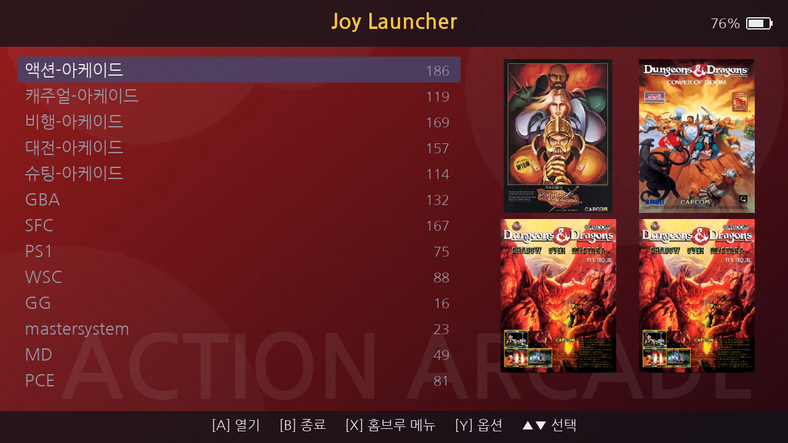

---

## 1. 준비물

아래 세 가지를 설치한 상태에서 롬 모음을 복사하면 됩니다.

| 준비물 | 설치 위치 | 비고 |
|---|---|---|
| RetroArch (스위치용) + 코어 | `/switch/retroarch_switch.nro`, `/retroarch/` | 아케이드 ~ PS1 실행. 배포용 RetroArch 를 SD 루트에 복사 |
| PPSSPP (스위치 홈브루판) | `/switch/ppsspp/PPSSPP.nro` | PSP 실행 |
| Joy Launcher | `/switch/joylauncher/joylauncher.nro` | 이 런처 |

롬과 롬 모음은 포함되어 있지 않습니다. 직접 준비해야 합니다.

## 2. 구성

깃헙 릴리스(https://github.com/JyJyLab/JoyLauncher/releases)의 `JoyLauncher_<버전>.zip`:

```
switch/joylauncher/joylauncher.nro   런처 본체
JoyLauncher/themes/JoyBasic/         무료 기본 테마 (8번)
설명서.md                             이 문서
Manual_en.md                         영어 설명서
OFL.txt                              내장 한글 글꼴(나눔고딕) 라이선스
LICENSE                              런처 라이선스 (GPL-3.0)
```

## 3. 설치

1. zip 안의 `switch/` 와 `JoyLauncher/` 폴더를 SD 카드 루트에 복사합니다.
   - `JoyLauncher/` 에는 기본 테마(JoyBasic)만 들어 있습니다. 이미 `/JoyLauncher` 가 있으면 합쳐서 복사하면 되며, 기존 설정은 그대로 남습니다.
   - 기본 테마를 쓰지 않을 거라면 `switch/` 만 복사해도 됩니다. `/JoyLauncher` 는 **처음 실행할 때 자동으로 만들어집니다.**
2. 가지고 있는 페가수스 롬 모음(롬 폴더째)을 SD 카드의 `/roms` 에 복사합니다. (4번 참고)
3. 앨범(홈브루 메뉴)에서 **Joy Launcher** 를 실행합니다.
4. 게임을 끝낸 뒤 런처로 바로 돌아오게 하려면, **Y** 로 옵션 창을 열고 **"Joy Launcher 를 기본 홈브루 메뉴로 설정"** 을 고른 뒤 A 를 한 번 더 눌러 확인합니다.

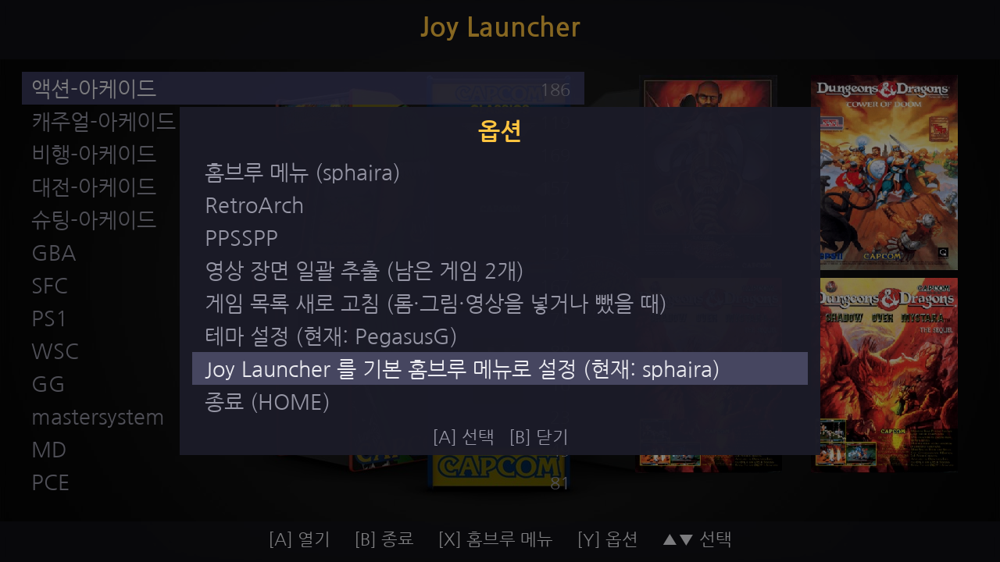

### 처음 실행할 때 자동으로 만들어지는 것 (`/JoyLauncher/`)

| 파일·폴더 | 내용 |
|---|---|
| `settings.txt` | 설정 (테마, 언어, BGM 등. 10번) |
| `cores.txt` | 코어 대체 설정 (5번) |
| `library.cache` | 저장된 게임 목록 (7번) |
| `cache/` | 영상에서 뽑은 장면 (6번) |
| `themes/` | 테마 폴더 + 안내 파일 `README.txt` (8번) |
| `bgm/` | 배경 음악 폴더 + 안내 파일 `README.txt` (9번) |
| `state.txt`, `launch_log.txt` | 게임을 실행하면 생김 (화면 위치, 실행 기록) |

따로 복사하거나 만들 필요가 없습니다.

기본 홈브루 메뉴(`/hbmenu.nro`)는 보통 두 종류이며, 둘 다 자동으로 처리합니다.

- **nx-hbmenu** (Atmosphere 기본): 원본을 `/switch/hbmenu.nro` 로 백업한 뒤 교체합니다.
- **sphaira**: sphaira 가 다시 덮어쓰지 않도록 설정(`replace_hbmenu`)을 끈 뒤 교체합니다. sphaira 본체는 `/switch/sphaira/sphaira.nro` 에 그대로 있습니다.

옵션 창의 **"원래 홈브루 메뉴로 되돌리기"** 를 고르면 이전 메뉴와 sphaira 설정이 그대로 복원됩니다.

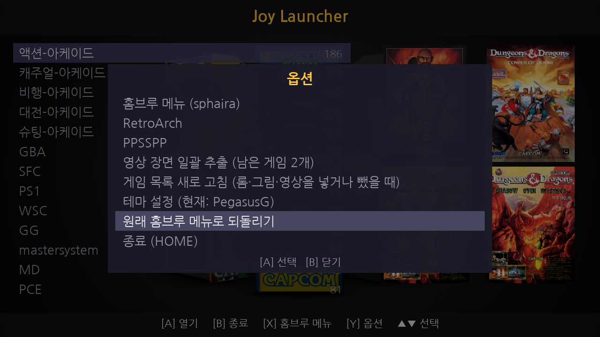

### 애플릿 모드 표시

앨범(갤러리)에서 실행하면 스위치의 **애플릿 모드**로 실행되어 쓸 수 있는 메모리가 적습니다. 이때 화면 위쪽 왼편에 빨간색 **"애플릿 모드"** 가 표시됩니다. 대부분의 게임은 그대로 되지만, 큰 게임이 느리거나 실행되지 않으면 게임(타이틀)을 R 버튼을 누른 채 실행하는 등 **타이틀 모드(풀 메모리)** 로 런처를 실행하세요. 타이틀 모드에서는 이 표시가 나오지 않습니다.

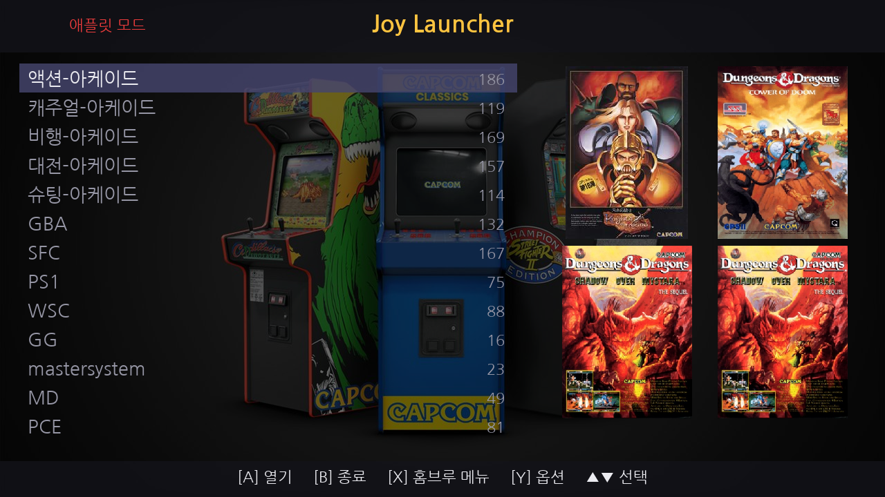

> 이전 이름(Temp Launcher)을 쓰던 경우 설정과 기본 메뉴 정보는 그대로 이어받습니다. `/switch/templauncher` 폴더는 지워도 됩니다.

## 4. 내 롬 모음 넣기

기본 롬 폴더는 SD 카드의 `/roms` 입니다. `/roms` 아래 폴더를 2단계 깊이까지 읽으며, 폴더마다 아래 순서로 게임 목록을 찾습니다.

1. **`metadata.pegasus.txt` 가 있으면** 페가수스 목록을 그대로 씁니다.
   - 안드로이드용 목록도 그대로 됩니다. (5번 참고)
   - 같은 `collection` 이름은 폴더가 달라도 한 카테고리로 합쳐집니다. (예: psx·psp 폴더를 모두 `collection: Play Station` 으로 두면 한 카테고리)
   - `file:` 은 목록 파일 기준 상대 경로(`./xxx.zip`)와 SD 절대 경로(`/roms/...`) 모두 됩니다.
   - `launch:` 에 스위치 nro 를 직접 적어도 됩니다.
     `launch: "/retroarch/cores/fbneo_libretro_libnx.nro" "{file.path}"`
2. **`gamelist.xml` 이 있으면** ES-DE / EmulationStation 목록(게임 이름·설명·이미지)을 씁니다.
3. **목록 파일이 없으면** 롬 파일을 직접 찾아 자동 등록합니다.
   - 기종은 폴더 이름(gba, snes, sfc, md, psx, ps1, psp, fbneo ...)으로, 그래도 모르면 확장자로 판단합니다.
   - 게임 이름은 롬 파일 이름, 카테고리 이름은 폴더 이름이 됩니다.
   - `.m3u` 가 가리키는 디스크 파일, `.cue` 와 짝인 `.bin`, BIOS 파일(neogeo.zip 등)은 숨깁니다.

그 밖에:

- RetroArch 플레이리스트(`.lpl`)는 읽지 않습니다.
- SD 카드에 롬 파일이 없는 게임은 표시하지 않습니다. 같은 롬이 여러 목록에 있으면 한 번만 표시합니다.
- 다른 위치의 롬 폴더도 쓰려면 `/JoyLauncher/roots.txt` 에 경로를 한 줄에 하나씩 적습니다. (예: `/Roms`)
- **롬 파일·폴더·`media/<롬 이름>/` 폴더 이름은 영문(ASCII)을 권장합니다.** 한글 이름은 스위치 FTP(ftpd) 목록에 보이지 않고, 게임 목록에서 빠지거나 RetroArch 파일 탐색기·플레이리스트에서 깨질 수 있습니다.
  - 이름을 바꿀 때는 세 곳을 함께 바꿉니다. 예) `영포티_GBA_1_0.gba` → `YoungForty_GBA_1_0.gba`
    1. 롬 파일 이름
    2. `media/영포티_GBA_1_0/` → `media/YoungForty_GBA_1_0/` (박스 사진 등)
    3. `metadata.pegasus.txt` 의 `file: ./YoungForty_GBA_1_0.gba` (게임 제목 `game:` 은 한글 그대로 둬도 됩니다)

## 5. 기종 범위와 코어 연결

### 대상 기종

| 구분 | 기종 | 실행 |
|---|---|---|
| 표시 | 아케이드(FBNeo, MAME 2003-Plus, MAME 2010), SFC, FC, GB/GBC, GBA, 메가드라이브, 마스터시스템, 게임기어, PC엔진, 원더스완, 네오지오 포켓, PC-98, DOS, MSX, PS1 등 | RetroArch 코어 |
| 표시 | PSP | PPSSPP 단독판 |
| 기본 숨김 | NDS, N64, 새턴, 드림캐스트, NAOMI·아토미스웨이브 | 성능 부족. `settings.txt` 의 `hide_cores` 에서 뺄 수 있음 |
| 제외 | PS2, PS3, 3DS, 게임큐브·Wii·Wii U, PS Vita, 스위치, 엑스박스, 윈도우·안드로이드 앱 | 표시하지 않음 |

제외 기종은 폴더 이름(`PS2`, `Sony PlayStation 2`, `3DS` 등)과, 목록에 적힌 에뮬레이터(AetherSX2, NetherSX2, Citra, Azahar, Dolphin, Yuzu, Vita3K 등)로 모두 걸러 냅니다.

### 코어를 고르는 순서

목록에 적힌 안드로이드 코어(예: `snes9x2005_plus_libretro_android.so`)를 아래 순서로 스위치 코어에 연결합니다.

1. `/JoyLauncher/cores.txt` 의 `[user]` (사용자 지정)
2. `/JoyLauncher/cores.txt` 의 `[auto]` (런처 기본 대체표)
3. 스위치에 같은 이름의 코어가 있으면 그 코어
4. 코어·에뮬레이터 이름으로 기종을 판단해 그 기종의 스위치 코어 (예: swanstation·DuckStation → pcsx_rearmed)
5. 폴더 이름·확장자로 기종을 추정

아케이드 MAME 게임은 롬셋 이름을 보고 **MAME 2003-Plus / MAME 2010** 중 그 롬셋을 지원하는 코어를 고릅니다. 두 코어 모두 지원하지 않는 롬셋은 숨깁니다.

### cores.txt (코어 대체 설정)

처음 실행하면 `/JoyLauncher/cores.txt` 가 만들어집니다.

```ini
[auto]
# 런처 기본값입니다. 런처를 실행할 때마다 다시 써지므로 여기는 고치지 마세요.
snes9x2005_plus=snes9x2010,snes9x
snes9x2005=snes9x2010,snes9x
mednafen_pce=mednafen_pce,mednafen_pce_fast
mame2010=mame2010,mame2003_plus
mamearcade=mame2003_plus,mame2010
mame=mame2003_plus,mame2010
org.ppsspp.ppsspp=/switch/ppsspp/PPSSPP.nro,ppsspp

[user]
# 사용자 지정 (런처가 바꾸지 않음). [auto] 보다 우선합니다.
```

- 형식: `안드로이드 코어 이름(또는 앱 패키지명)=스위치 코어 이름[,다음 후보...]`
- 여러 개를 쉼표로 적으면 스위치에 있는 첫 번째 코어를 씁니다.
- `/` 로 시작하면 단독 프로그램(nro) 경로입니다.
- `none` 이면 그 코어의 게임을 목록에서 숨깁니다.
- 예) 슈퍼패미컴을 최신 snes9x 로: `snes9x2005_plus=snes9x` / 원더스완 숨기기: `mednafen_wswan=none`

### 실행 기록 (launch_log.txt)

게임을 실행할 때마다 `/JoyLauncher/launch_log.txt` 에 최근 20개가 남습니다. 게임이 엉뚱한 코어로 실행되면 이 파일을 보면 원인을 알 수 있습니다.

```
[2026-10-17 14:33:22] (영)가루라왕
  카테고리: SFC
  롬 파일: /roms/SNES/....zip
  원래 코어: snes9x2005_plus
  선택 방법: cores.txt [auto]
  실행: /retroarch/cores/snes9x2010_libretro_libnx.nro
  결과: 실행 예약됨
```

## 6. 이미지와 영상 장면

### 게임 화면 사진

게임 화면 사진이 있으면 크게 보여 주고, 박스 사진은 오른쪽 아래에 작게 겹쳐 보여 줍니다. 없으면 박스 사진을 크게 보여 줍니다.

- `assets.screenshot` / `assets.titlescreen` 지정
- `media/<롬 이름>/screenshot.png(jpg)`
- `<롬 폴더>/screenshot(s)/`, `snap(s)/`, `Named_Snaps/`, `titlescreen(s)/` 폴더의 `<롬 이름>.png(jpg)`

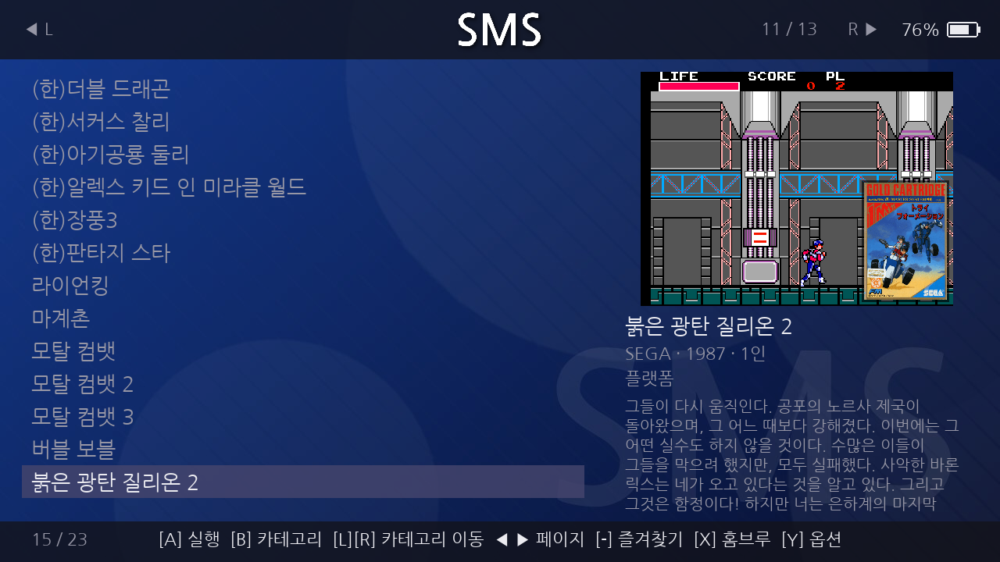

### 박스 사진

롬 모음마다 저장 방식이 달라도 아래를 모두 찾아 한 장을 보여 줍니다.

- 목록의 `assets.*` 지정: boxFront > box > cartridge > titlescreen > screenshot > logo(wheel) > marquee 순서
- 페가수스 media 방식: `media/<롬 이름>/boxFront.jpg(png)` (없으면 box, cartridge, screenshot, logo ...)
- 이미지 폴더 방식: `<롬 폴더>/<이미지 폴더>/<롬 이름>.png(jpg)` (boxFront, boxart, covers, box, images, 3dboxes, cartridge, titlescreen, screenshot(s), snap, Named_Boxarts, wheel, logo, marquee)

### 영상 장면 (화면 사진 대신)

화면 사진 없이 미리보기 영상(mp4 등)만 있는 롬 모음은, **런처가 영상에서 한 장면을 뽑아 화면 사진 대신** 보여 줍니다. 영상을 쓰려면 영상 파일도 SD 카드에 복사해야 합니다.

- 찾는 곳: `assets.video`, `media/<롬 이름>/video.mp4`, `snap(s)/`, `video(s)/`, `Named_Videos/`, `movies/` 폴더의 `<롬 이름>.mp4`
- 뽑은 장면은 `/JoyLauncher/cache/` 에 jpg 로 저장되어 다음부터 바로 보입니다. (지워도 다시 만들어집니다)
- **자동 추출**(기본): 게임을 보고 있으면 잠시 뒤 자동으로 뽑습니다.
- **일괄 추출**: **Y** 옵션 창의 **"영상 장면 일괄 추출 (남은 게임 N개)"** 로 한 번에 뽑을 수 있습니다. B 로 중지할 수 있고, 중지해도 뽑은 장면은 남습니다. 끝나면 결과 알림이 뜨며, **B** 로 닫습니다.
- 자동 추출을 끄려면 `settings.txt` 에서 `video_frames=manual` 로 바꿉니다. (일괄 추출만 사용)
- **장면을 뽑은 뒤에는 영상 파일을 지워도 됩니다.** 장면은 롬 파일 기준으로 저장되므로 영상이 없어도 그대로 보입니다. SD 카드 용량을 아끼려면 영상을 복사한 뒤 "영상 장면 일괄 추출" 을 한 번 하고, 영상 파일(폴더)을 지운 다음 "게임 목록 새로 고침" 을 하세요.
- 단, 영상을 지운 뒤 `/JoyLauncher/cache/` 를 지우면 장면을 다시 만들 수 없습니다. 롬 파일 이름이나 위치를 바꾼 경우도 장면을 다시 뽑아야 합니다.

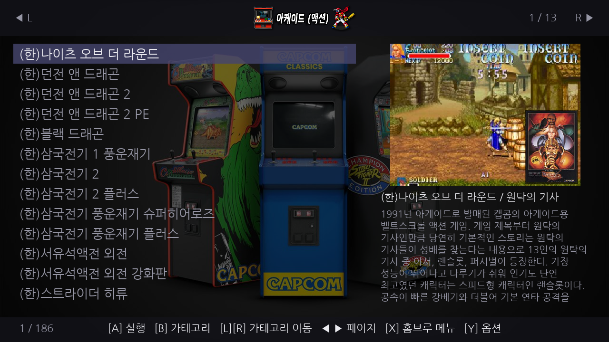

| 옵션 창의 일괄 추출 | 진행 중 | 완료 |
|---|---|---|
| 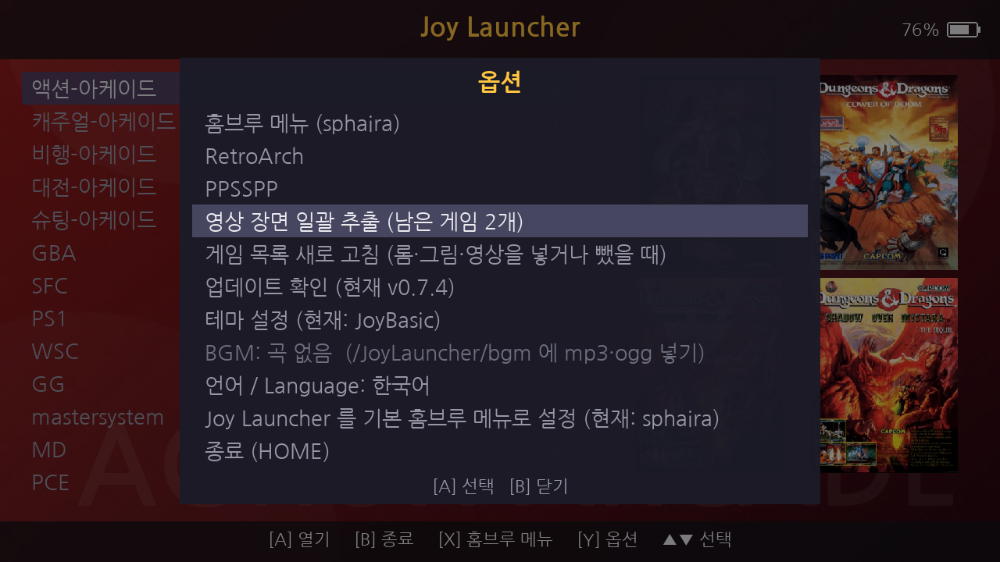 | 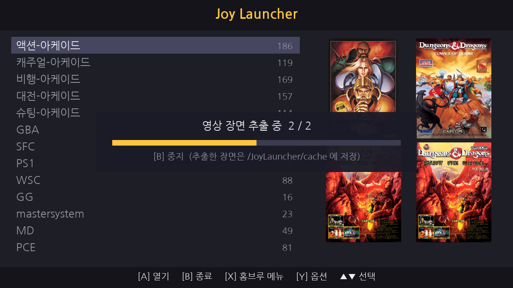 | 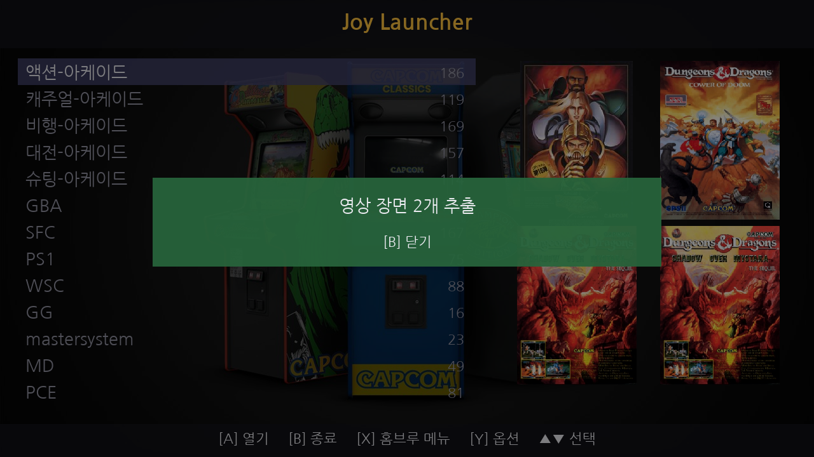 |

## 7. 게임 목록 저장과 새로 고침

게임이 많으면 롬 폴더 전체를 읽는 데 시간이 걸리므로, **처음 한 번 읽은 목록을 `/JoyLauncher/library.cache` 에 저장해 두고 다음부터 그대로 씁니다.**

아래가 바뀌면 다음 실행 때 자동으로 다시 읽습니다.

- 롬 폴더를 추가하거나 지웠을 때
- `metadata.pegasus.txt` / `gamelist.xml` 을 고쳤을 때
- RetroArch 코어를 추가하거나 지웠을 때
- `cores.txt` 의 `[user]`, `settings.txt` 의 `hide_cores` 를 바꿨을 때
- 런처를 업데이트했을 때

목록 파일은 그대로 두고 **롬·그림·영상 파일만 넣거나 뺐을 때**는 **Y** 옵션 창에서 **"게임 목록 새로 고침"** 을 고르세요. 다 읽으면 "게임 목록을 새로 읽었습니다 (N개)" 알림이 뜨며, **B** 로 닫으면 원래 화면으로 돌아갑니다.

## 8. 테마 (카테고리별 배경)

테마는 SD 카드 루트의 `/JoyLauncher/themes/<테마 이름>/` 에 있습니다.

### 기본 테마 JoyBasic

> 테마는 런처 자동 업데이트로 설치되지 않습니다. **테마 선택 창 맨 아래의 "기본 테마 JoyBasic 내려받기"** (이미 있으면 "다시 받기 (최신으로)") 로 받으세요. 깃헙 최신 릴리스에서 받아 크기·SHA-256 을 확인한 뒤 `/JoyLauncher/themes/JoyBasic/` 에 풀고, 기존 그림은 새것으로 바꾸며 직접 넣은 그림은 그대로 둡니다. 진행 중 B 로 취소할 수 있습니다. (인터넷 연결 필요. 연결이 없으면 릴리스의 zip 에서 `JoyLauncher/themes/JoyBasic/` 을 복사)

배포 zip 에 무료 기본 테마 **JoyBasic** 이 들어 있습니다. `/JoyLauncher/themes/JoyBasic/` 에 복사해 두면 처음 실행할 때 자동으로 선택됩니다.

- 배경은 기종 계열별 색 그라디언트와 단순한 도형, 로고는 기종 이름 글자(나눔고딕 Bold)로만 만든 **자체 제작 그림**입니다. 회사 로고·게임 화면을 쓰지 않아 자유롭게 쓰고 고칠 수 있습니다.
- SFC, MD, PS1, GBA, PCE, WSC 등 흔한 롬 폴더 이름과 응애팩의 아케이드 카테고리(액션·캐주얼·비행·대전·슈팅)를 `theme.txt` 로 연결해 두었습니다.
- 그림은 저장소의 `tools/make_joybasic.py` 로 다시 만들 수 있습니다.

```
backgrounds/<이름>.jpg(png)   카테고리 배경
logos/<이름>.png              게임 목록 제목 로고 (선택)
backgrounds/default.jpg       카테고리 배경이 없을 때 쓰는 기본 배경 (선택)
theme.txt                     dim=150 (배경 어둡게 0~255) 과 이름 연결
```

### 그림을 찾는 순서

1. `theme.txt` 에 **카테고리 이름**으로 지정한 그림 (직접 지정이 항상 우선)
2. 롬 폴더가 하나인 카테고리: **롬 폴더 이름**과 같은 그림 (예: `/roms/GBA` → `backgrounds/GBA.jpg`)
3. 카테고리의 `shortname` 이나 이름과 같은 그림
4. 여러 롬 폴더를 합친 카테고리: 그림이 있는 첫 폴더의 그림

맞는 그림이 없으면 배경 없이 기본 화면으로 보입니다. (대소문자 무시)

### theme.txt 로 이름 연결

한글 이름의 그림 파일은 스위치 FTP 로 만들어지지 않는 경우가 있으므로, 그림은 영문 이름으로 두고 `theme.txt` 에서 연결합니다.

```ini
dim=150
액션-아케이드=arcade_action     # 한글 카테고리 → backgrounds/arcade_action.jpg
SNES=SFC                        # /roms/SNES 폴더 → backgrounds/SFC.jpg
Play Station=PS1                # psx·psp 를 합친 카테고리 → backgrounds/PS1.jpg
```

`#`, `;`, `[` 로 시작하는 줄은 설명용이라 무시합니다.

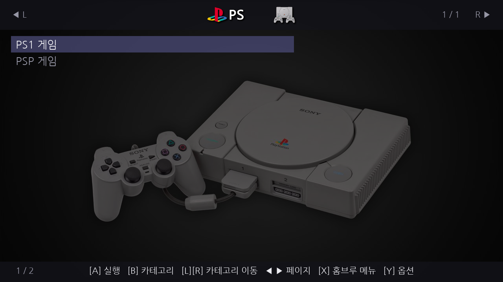

### 테마 바꾸기

- **Y** 옵션 창 → **"테마 설정"** → 테마 선택 → **A** (**B** 로 닫기)
- **"기본 (배경 없음)"** 을 고르면 테마를 끕니다. 고른 테마는 `settings.txt` 에 저장됩니다.
- 테마 폴더를 새로 넣으면 선택 목록에 바로 나타납니다. (폴더 이름 = 테마 이름)
- JoyBasic 외의 테마 그림은 저작권 문제로 포함하지 않습니다. 원하는 그림을 위 구조대로 넣어 쓰세요. (구조 안내: `/JoyLauncher/themes/README.txt`)

| 테마 선택 | 테마를 끈 화면 |
|---|---|
| 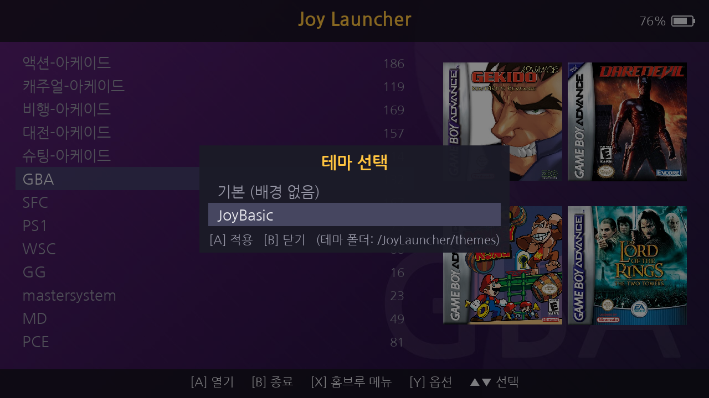 | 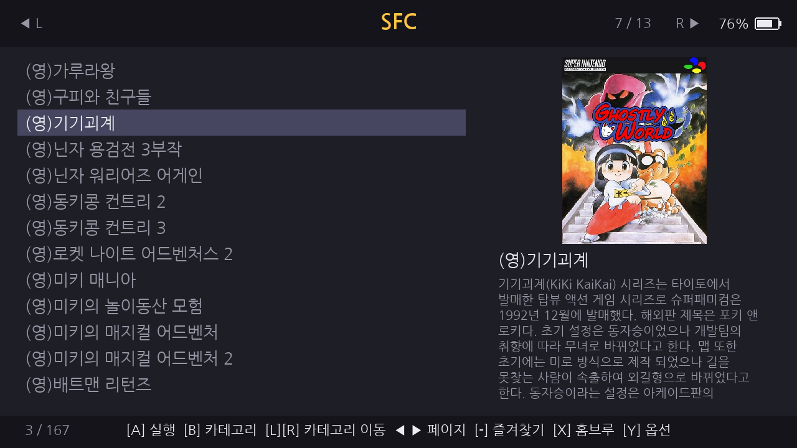 |

## 9. 조작과 메뉴

| 화면 | 조작 |
|---|---|
| 카테고리 | ▲▼ 선택 / A 열기 / B 종료(확인 창에서 A 종료·B 돌아가기) / X 홈브루 메뉴 / Y 옵션 / + 바로 종료 |
| 게임 목록 | ▲▼ 이동 / ◀▶ 페이지 / L·R 이전·다음 카테고리 / A 실행 / B 카테고리로 / **− 즐겨찾기 넣기·빼기** / X 홈브루 메뉴 / Y 옵션 / + 종료 |

방향키 대신 왼쪽·오른쪽 스틱으로도 움직일 수 있습니다. 방향키·스틱 모두 누르고 있으면 연속으로 이동합니다.

- **게임을 하고 돌아오면** 실행했던 게임이 선택된 채로 그 목록으로 돌아옵니다.
- **종료(HOME) 후 다시 켜면** 카테고리 목록 맨 위에서 시작합니다.

- **X**: 원래 홈브루 메뉴(sphaira / nx-hbmenu)를 바로 엽니다.
- **즐겨찾기**: 게임 목록에서 **−** 버튼을 누르면 즐겨찾기에 넣고, 한 번 더 누르면 뺍니다. 즐겨찾기한 게임은 이름 앞에 ★ 가 붙고, 카테고리 목록 맨 위에 **"즐겨찾기"** 카테고리가 생깁니다(즐겨찾기가 있을 때만). `/JoyLauncher/favorites.txt` 에 저장되어 게임 목록을 새로 고쳐도 그대로입니다. 테마 배경 이름은 `favorites` 입니다.

| 카테고리 맨 위의 즐겨찾기 | 즐겨찾기한 게임의 ★ |
|---|---|
| 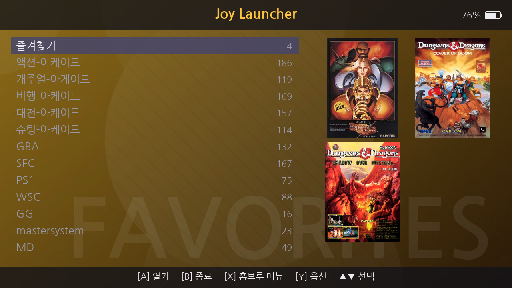 | 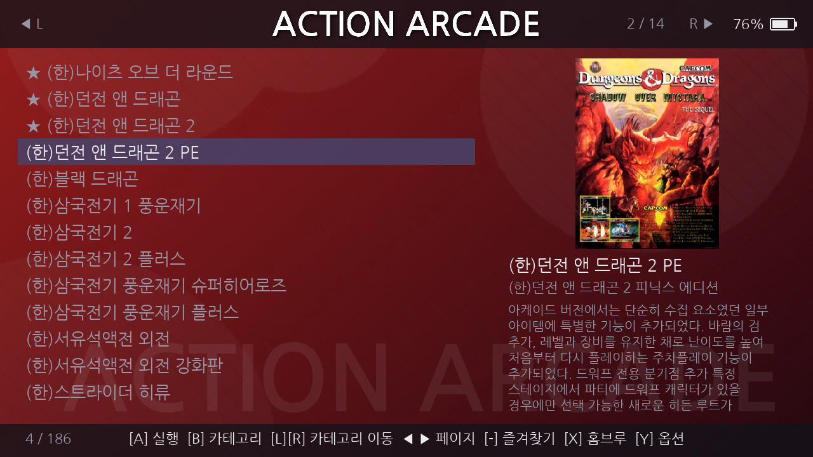 |

- **오른쪽 정보 칸**: 맨 위에 게임 제목, 그 아래 제작사·연도·인원, 장르, 설명 순서로 보여 줍니다. 목록의 제작사 칸에 긴 제목이 적혀 있으면(목록 제목으로 시작하면) 그 긴 제목을 제목으로 보여 줍니다. 설명이 칸보다 길면 3초 뒤 천천히 위로 올라가며 끝까지 보여 주고, 끝에서 3초 멈춘 뒤 처음으로 돌아갑니다.
- **긴 글자**: 화면에 다 안 들어가는 게임 이름·카테고리 이름·옵션 항목·알림은, 선택된 줄만 잠깐 멈췄다가 천천히 가로로 흘러가며 끝까지 보여 줍니다. 선택되지 않은 줄은 끝을 «…» 로 줄입니다.
- **배터리**: 오른쪽 위에 스위치 HOME 화면처럼 잔량(%)과 전지 아이콘을 보여 줍니다. 충전 중이면 초록색과 번개 표시, 15% 이하이면 빨간색입니다.

**Y 옵션 창** (▲▼ 선택 / A 실행 / ◀▶ 값 바꾸기 / B 닫기, 설치된 것만 표시):

| 메뉴 | 내용 |
|---|---|
| 홈브루 메뉴 (sphaira / nx-hbmenu) | 원래 홈브루 메뉴 열기 |
| RetroArch / PPSSPP | 에뮬레이터 단독 실행 |
| 영상 장면 일괄 추출 | 6번 참고 (뽑을 장면이 남아 있을 때만) |
| 게임 목록 새로 고침 | 7번 참고 |
| 테마 설정 | 8번 참고 |
| BGM 설정 | A 로 BGM 창을 엽니다. 아래 "배경 음악" 참고 (곡이 없으면 흐리게 표시) |
| 언어 / Language | 자동(본체 언어) → 한국어 → English. 고르면 바로 바뀝니다 |
| 기본 홈브루 메뉴로 설정 / 되돌리기 | 3번 참고 |
| 종료 (HOME) | |

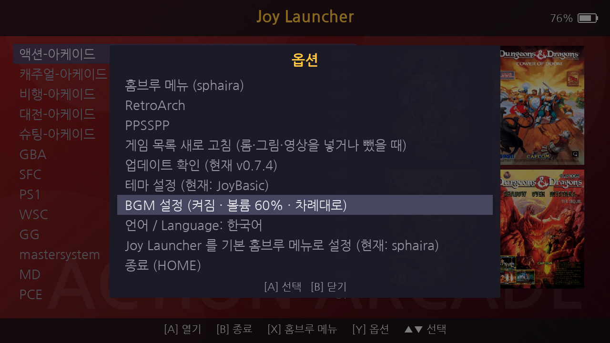

### 배경 음악 (BGM)

- `/JoyLauncher/bgm/` 폴더에 **mp3 또는 ogg** 파일을 넣고 런처를 다시 실행하면, Y 옵션 창에 BGM 항목이 나타납니다. (런처에는 음악이 들어 있지 않습니다)
- Y 옵션 창의 **"BGM 설정"** 에서 A 를 누르면 BGM 창이 열립니다. (B 로 닫기)
  - **BGM: 켜짐 (On) / 꺼짐 (Off)** (기본: 꺼짐, 재생 중이면 초록색 글자), **볼륨** (◀▶ 로 10% 씩), **순서** (차례대로 / 무작위), **다음 곡** (켜져 있을 때)
- 화면을 오가도 끊기지 않고, 곡이 끝나면 다음 곡을 틉니다. 읽을 수 없는 파일은 건너뜁니다.
- 게임이나 다른 프로그램을 실행할 때, 종료할 때는 소리를 서서히 줄인 뒤 멈춥니다.
- 슬립이나 HOME 으로 나가면 멈추고, 돌아오면 약 1초 동안 소리를 키우며 이어서 재생합니다.

### 언어

- 화면 문구는 한국어와 영어가 있습니다. 기본은 **자동**으로, 스위치 본체 언어가 한국어면 한국어, 그 밖의 언어면 영어로 보입니다.
- Y 옵션 창의 **"언어 / Language"** 에서 자동 → 한국어 → English 로 바꿀 수 있습니다.
- 게임 이름·설명·카테고리 이름은 롬 모음의 목록(메타데이터)에 적힌 그대로 보입니다. (`cores.txt` 의 설명은 한국어만)

## 자동 업데이트

런처는 깃헙 릴리스에서 새 버전을 받아 스스로 업데이트할 수 있습니다. (스위치가 인터넷에 연결되어 있어야 합니다)

- **시작할 때 확인**: 런처를 켜면 뒤에서 새 버전이 있는지 확인하고, 있으면 "새 버전 vX.Y.Z 이 있습니다" 알림을 잠깐 보여 줍니다. (확인만 하고 자동으로 설치하지는 않습니다)
- **설치**: **Y** 옵션 창 → **"업데이트 설치: vX.Y.Z"** → A → 확인 문구가 뜨면 A 를 한 번 더 누르면 내려받습니다. 진행 중 **B** 로 취소할 수 있습니다.
- 받은 파일은 크기와 SHA-256 으로 검증한 뒤에만 교체합니다. 이전 파일은 `joylauncher.nro.old` 로 남겨 둡니다.
- Joy Launcher 가 기본 홈브루 메뉴(`/hbmenu.nro`)로 설정되어 있으면 그것도 함께 교체합니다.
- 설치가 끝나면 런처가 새 버전으로 다시 시작됩니다.
- **자동 업데이트는 런처 본체(`joylauncher.nro`)만 바꿉니다.** 기본 테마 JoyBasic 은 **Y 옵션 → 테마 설정 → "기본 테마 JoyBasic 내려받기"** 로 받거나, 릴리스의 zip 을 내려받아 `JoyLauncher/themes/` 를 SD 카드에 직접 복사하세요.
- 새 버전 확인을 끄려면 `settings.txt` 에서 `auto_update=off` 로 바꿉니다. (옵션 창의 "업데이트 확인" 으로는 언제든 직접 확인할 수 있습니다)

## 10. 설정 파일 (`/JoyLauncher/`)

| 파일 | 내용 |
|---|---|
| `settings.txt` | `theme=` 테마, `hide_cores=` 숨길 코어(쉼표 구분, 비우면 모두 표시), `video_frames=auto/manual`, `auto_update=on/off`, `language=auto/ko/en`, `bgm=on/off`, `bgm_volume=0~100`, `bgm_shuffle=on/off` |
| `cores.txt` | 코어 대체 설정 (5번) |
| `launch_log.txt` | 최근 실행 기록 20개 (5번) |
| `library.cache` | 저장된 게임 목록 (7번, 지워도 다시 만들어짐) |
| `cache/` | 영상에서 뽑은 장면 (6번, 영상이 남아 있으면 지워도 다시 만들어짐) |
| `roots.txt` | 추가 롬 폴더 (4번) |
| `state.txt` | 게임 실행 전 위치 |
| `hbmenu_prev.txt` | 이전 기본 홈브루 메뉴 정보 |
| `themes/` | 테마 (8번) |
| `bgm/` | 배경 음악 mp3·ogg (9번) |
| `favorites.txt` | 즐겨찾기한 게임 (롬 경로) |

## 11. 문제 해결

- **게임이 목록에 안 보임**: 롬 파일 이름이 한글이면 영문으로 바꾸세요(4번). 롬 파일이 실제로 있는지, 제외·숨김 기종인지(5번), 스위치에 그 기종의 코어가 있는지 확인하세요. 롬만 추가했다면 "게임 목록 새로 고침".
- **엉뚱한 코어로 실행됨**: `launch_log.txt` 의 "원래 코어 / 선택 방법" 을 보고 `cores.txt` 의 `[user]` 에 원하는 코어를 적으세요.
- **게임 후 런처로 안 돌아옴**: Y 옵션 창에서 "Joy Launcher 를 기본 홈브루 메뉴로 설정" 을 하세요.
- **큰 게임이 느리거나 실행되지 않음**: 화면 위에 빨간 "애플릿 모드" 가 보이면 타이틀 모드(풀 메모리)로 런처를 실행하세요. (3번)
- **화면 사진 자리에 박스 사진만 나옴**: 그 게임에 화면 사진·영상이 없는 경우입니다. 영상이 있다면 영상 파일도 SD 카드에 복사했는지 확인하세요.
- **배경이 안 나옴 / 다른 배경이 나옴**: 8번의 그림 찾는 순서를 보고 `theme.txt` 에 카테고리 이름으로 지정하세요.
- **BGM 항목이 흐리게 나옴**: `/JoyLauncher/bgm/` 에 mp3·ogg 파일이 없는 경우입니다. 넣은 뒤 런처를 다시 실행하세요.

## 12. 예시 화면

`docs/images` 의 사진은 안드로이드용 페가수스 롬 모음(응애팩)의 롬 폴더 중 아케이드 ~ PS1 기종을 `/roms` 에 그대로 복사했을 때의 화면입니다. (목록·이미지 수정 없이 복사, 기본 테마 JoyBasic 적용)

| 파일 | 내용 |
|---|---|
| 01_categories | 카테고리(기종) 선택 화면 |
| 02 ~ 05, 09 | 카테고리별 게임 목록 (액션·슈팅 아케이드, SFC, PS1, GBA) |
| 06_screenshot_layout | 게임 화면 사진 + 작은 박스 사진 |
| 07_theme_select / 08_no_theme | 테마 선택 창(맨 아래 기본 테마 받기) / 테마를 끈 기본 화면 |
| 10_video_frame | 영상에서 뽑은 장면 |
| 11_hbmenu_install / 12_hbmenu_restore | Y 옵션 창: 기본 홈브루 메뉴로 설정 / 되돌리기 |
| 13 ~ 15 | Y 옵션 창의 영상 장면 일괄 추출 / 진행 / 완료 |
| 16_merged_category | 여러 롬 폴더를 합친 카테고리의 배경 (theme.txt 지정) |
| 17_applet_mode | 앨범(애플릿 모드)으로 실행했을 때의 빨간 표시 |
| 18_options_bgm_language | Y 옵션 창의 BGM·언어 항목 |
| 19_favorites / 20_favorites_list | 즐겨찾기 카테고리 / 게임 목록의 ★ 표시 |
| en_01 ~ en_05 | 영어 화면 (영어 설명서용) |

| | |
|---|---|
| 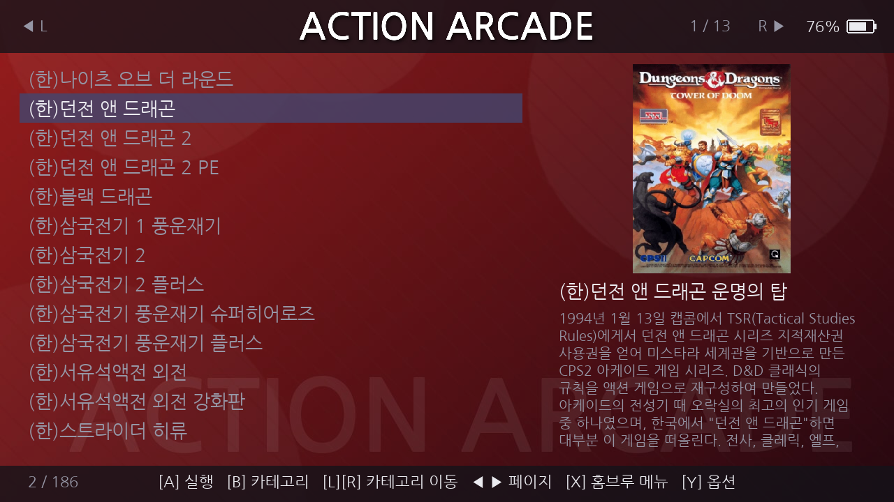 | 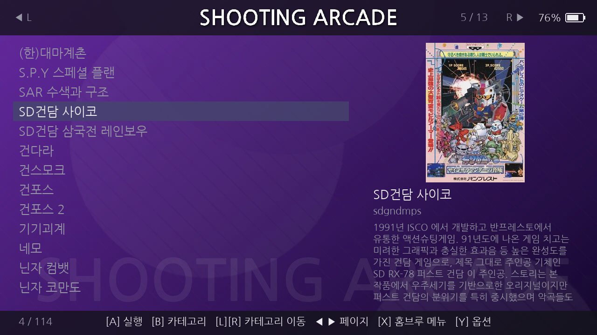 |
| 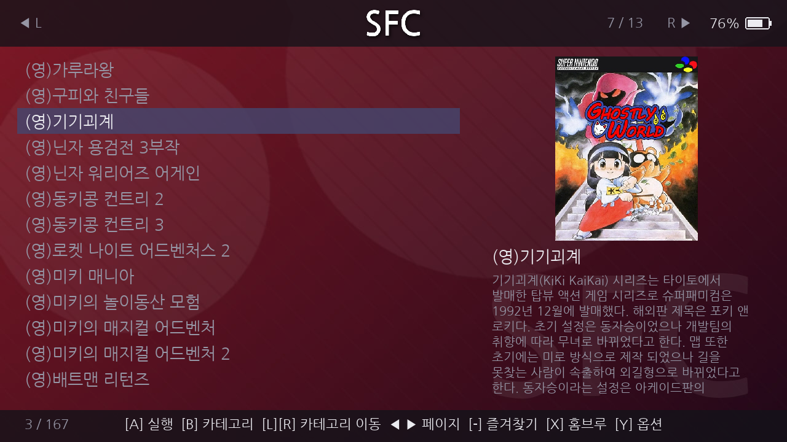 | 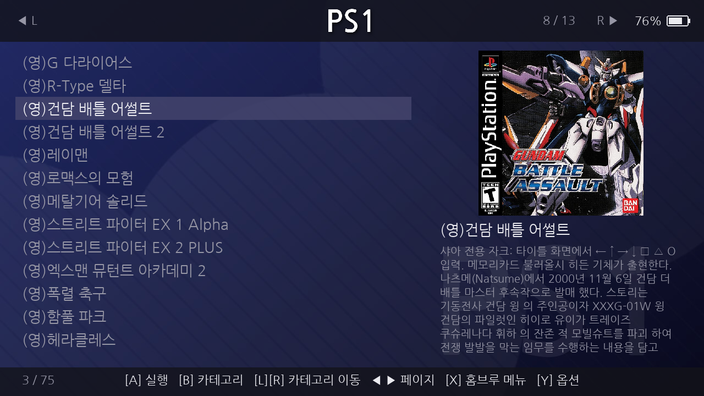 |

---

글꼴: 나눔고딕 (SIL Open Font License 1.1, `NanumGothic_OFL.txt`)
