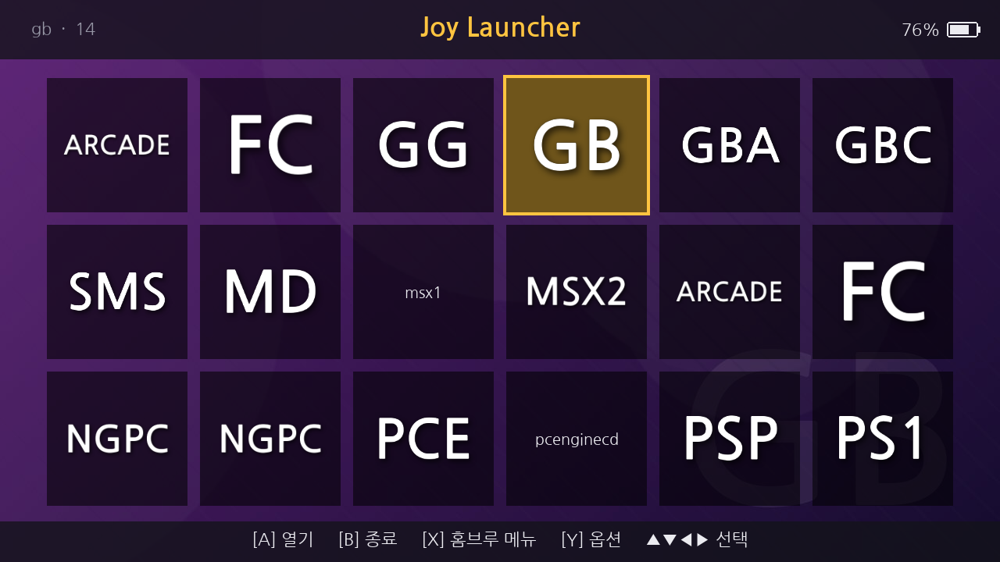

# Joy Launcher 테마 화면 구성 설명서 (layout.txt)

[테마 추가·제작 설명서](테마_만들기.md) · [설명서](설명서.md) · English: [theme-layout-en.md](theme-layout-en.md)

**v1.0.0 부터** 테마 폴더에 `layout.txt` 를 넣으면 배경·로고뿐 아니라 **화면 구성 자체**를 바꿀 수 있습니다.

- 카테고리 화면을 **기종 카드 격자**로, 게임 목록을 **박스 사진 격자**로
- 목록·사진·설명·제목·배터리·도움말의 **위치와 크기**
- **글꼴, 글자 크기, 색**
- 내가 만든 **그림(판, 테두리, 장식)과 글자**를 원하는 자리에 추가

`layout.txt` 가 없는 테마는 지금까지와 똑같이 보입니다. `layout.txt` 에는 **바꾸고 싶은 것만** 적으면 됩니다.

| 격자 카테고리 화면 (JoyBasic 그림 + layout.txt) |
|---|
|  |

---

## 1. 기본 개념

- 화면 크기는 **1280 × 720** 입니다. 모든 위치·크기는 이 기준의 점(px) 단위입니다.
- 화면은 **요소**(그림, 글자, 목록 …)의 모음입니다. 화면은 두 가지입니다.
  - `categories` — 카테고리(기종) 화면
  - `games` — 게임 목록 화면
- 요소마다 이름이 있고, `layout.txt` 에서 `[화면.요소이름]` 으로 고릅니다.
  - **기본 요소**(6번 표)의 이름을 쓰면 그 요소를 고칩니다. 적은 속성만 바뀝니다.
  - **새 이름**을 쓰고 `type` 을 적으면 요소가 추가됩니다.
- `rect = 왼쪽,위,폭,높이` 로 자리를 정합니다.

```ini
# 예: 게임 화면의 목록을 오른쪽으로 옮기고, 사진을 왼쪽에
[games.list]
rect = 532,92,720,546

[games.media]
rect = 40,92,440,300

[games.info]
rect = 40,404,440,256
```

### 파일 형식

- 테마 폴더 바로 안의 `layout.txt`, **UTF-8** 로 저장
- `[구역]` 아래에 `이름 = 값` 을 한 줄에 하나씩
- `#` 또는 `;` 로 시작하는 줄은 설명. 줄 끝 설명은 **공백 뒤의 `#`** (`size = 24   # 설명`). 값 맨 앞의 `#` 은 색입니다.
- 그림·글꼴 파일은 **테마 폴더 기준 경로** (`ui/card.png`). 폴더·파일 이름은 영문 권장
- 잘못 적은 줄은 무시하고, 테마를 고를 때 "layout.txt 에 문제가 N건" 알림이 뜹니다. 내용은 테마 폴더의 **`layout_errors.txt`** (줄 번호: 내용)에 적힙니다. 문제를 다 고치면 이 파일은 지워집니다.
- 고친 `layout.txt` 를 다시 읽으려면 **Y 옵션 → 테마 설정 → 같은 테마 → A**

## 2. 빠르게 해 보기 — JoyBasic 을 격자로

1. SD 카드의 `/JoyLauncher/themes/JoyBasic` 폴더를 복사해 `JoyGrid` 로 이름을 바꿉니다.
2. `JoyGrid/layout.txt` 를 만들어 아래 내용을 넣습니다.
3. 런처에서 Y 옵션 → 테마 설정 → JoyGrid

```ini
[categories.preview]
visible = off

[categories.list]
style = grid
rect = 60,100,1160,548
columns = 6
rows = 3
gap = 16,16
image = logo
padding = 16
card_color = #00000090
selection = #ffc440
color = text
size = 20

[categories.name]
type = text
text = {category}  ·  {games}
rect = 40,26,400,0
size = 22
color = dim
```

- 미리보기(`preview`)를 끄고, 목록(`list`)을 6×3 격자로 바꿨습니다. 칸 그림은 테마의 `logos/` 그림입니다.
- 격자에서는 **▲▼◀▶** 로 움직입니다.
- `categories.name` 은 새로 추가한 글자 요소입니다. 커서가 있는 카테고리 이름과 게임 수를 왼쪽 위에 보여 줍니다.

## 3. 구역

| 구역 | 내용 |
|---|---|
| `[theme]` | 글꼴, 색, 바탕색 (4번) |
| `[names]` | 카테고리를 화면에 보일 이름으로 바꾸기 (5번) |
| `[categories.<요소>]` | 카테고리 화면의 요소 |
| `[games.<요소>]` | 게임 화면의 요소 |

## 4. `[theme]` — 글꼴과 색

```ini
[theme]
font = fonts/regular.ttf        # 일반 글꼴 (ttf / otf)
font_bold = fonts/bold.ttf      # 굵은 글꼴 (안 적으면 font 를 같이 씀)
background_color = #101828      # 배경 그림이 없을 때의 바탕색
color.text = #ffffff
color.dim = #c8c8d0
color.accent = #7fd4ff
color.selection = #7fd4ff60
color.bar = #00000080
color.mycolor = #ff8800         # 내가 정한 색 이름 (요소에서 color = mycolor)
```

- 글꼴에 없는 글자(예: 영문 전용 글꼴의 한글)가 들어간 글은 **내장 글꼴(나눔고딕)** 로 그립니다.
- 옵션 창·알림 상자는 테마와 상관없이 기본 모양입니다.

### 색 쓰는 법

| 형식 | 예 |
|---|---|
| `#rrggbb` | `#ffc440` |
| `#rrggbbaa` (끝 두 자리 = 불투명도, 00 투명 ~ ff 불투명) | `#00000080` |
| `#rgb` | `#fc4` |
| `r,g,b` 또는 `r,g,b,a` (0~255) | `255,196,64,128` |
| 색 이름 | `text`, `dim`, `accent`, `selection`, `bar`, 또는 `[theme]` 에서 정한 이름 |

기본 색 이름:

| 이름 | 쓰이는 곳 | 기본값 |
|---|---|---|
| `text` | 기본 글자, 선택된 줄 글자 | `#ebebf0` |
| `dim` | 흐린 글자 (목록, 설명) | `#9696a5` |
| `accent` | 제목 | `#ffc440` |
| `selection` | 선택 막대 | 배경 그림이 있으면 `#46466ed2`, 없으면 `#464660` |
| `bar` | 위·아래 막대 | `#14141a` (배경 그림이 있으면 반투명) |

`[theme]` 에서 `color.<이름>` 을 정하면 그 이름을 쓰는 모든 요소가 함께 바뀝니다.

## 5. `[names]` — 카테고리 이름 바꾸기

```ini
[names]
액션-아케이드 = 아케이드 (액션)
gba = Game Boy Advance
```

`카테고리 이름(또는 shortname, 롬 폴더 이름) = 화면에 보일 이름`. 목록과 `{category}` 에 적용됩니다. 그림을 찾는 이름(theme.txt)은 바뀌지 않습니다.

## 6. 기본 요소

`layout.txt` 가 없을 때의 화면입니다. 이 이름으로 구역을 만들면 그 요소를 고칩니다. 끄려면 `visible = off`.

### categories (카테고리 화면)

| 이름 | type | rect | 내용 |
|---|---|---|---|
| `background` | image | 0,0,1280,720 | 카테고리별 배경 (`backgrounds/`) |
| `topbar` | rect | 0,0,1280,76 | 위 막대 |
| `bottombar` | rect | 0,668,1280,52 | 아래 막대 |
| `list` | list | 28,92,720,546 | 카테고리 목록 (13줄, 게임 수 표시) |
| `preview` | preview | 800,96,440,510 | 커서가 있는 카테고리의 박스 사진 2×2 |
| `title` | text | 320,18,640,0 | "Joy Launcher" |
| `applet` | text | 100,26,0,0 | 애플릿 모드 표시 |
| `battery` | battery | 1056,28,200,20 | 배터리 |
| `hint` | text | 640,680,0,0 | 조작 도움말 |

### games (게임 화면)

| 이름 | type | rect | 내용 |
|---|---|---|---|
| `background` | image | 0,0,1280,720 | 카테고리별 배경 |
| `topbar` / `bottombar` | rect | | 위·아래 막대 |
| `list` | list | 28,92,720,546 | 게임 목록 (13줄) |
| `media` | media | 800,92,440,300 | 화면 사진 + 박스 사진(오른쪽 아래 작게) |
| `info` | info | 800,404,440,256 | 제목·제작사·연도·장르·설명 |
| `title` | text | 320,18,640,0 | 카테고리 이름 (로고가 있으면 로고) |
| `applet` | text | 100,26,0,0 | 애플릿 모드 표시 |
| `prev` | text | 30,26,0,0 | "◀ L" |
| `battery` | battery | 1056,28,200,20 | 배터리 |
| `pager` | pager | (배터리 왼쪽) | "2 / 13   R ▶" |
| `counter` | text | 40,680,0,0 | "12 / 340" |
| `hint` | text | 640,680,0,0 | 조작 도움말 |

## 7. 요소 종류와 속성

### 모든 요소 공통

| 속성 | 값 | 설명 |
|---|---|---|
| `type` | 아래 종류 | **새 요소는 맨 먼저** 적습니다. 기본 요소를 고칠 때는 안 적어도 됩니다 |
| `rect` | `x,y,w,h` | 자리. `x` `y` `w` `h` 를 따로 적어도 됩니다 |
| `visible` | `on` / `off` | 보이기 / 숨기기 |
| `z` | 숫자 | 그리는 순서 (작을수록 먼저 = 아래). 기본 요소: 배경 0, 막대 10, 목록·사진 30, 글자 50. 새 요소 기본 20 |
| `color` | 색 | 글자색 / 칠할 색 |

### `rect` — 색 칠한 네모

`color` 로 칠합니다. 반투명 판을 깔 때 씁니다.

```ini
[games.shade]
type = rect
rect = 780,84,480,584
color = #00000080
```

### `image` — 그림

| 속성 | 값 | 설명 |
|---|---|---|
| `file` | 경로 | 테마 폴더의 그림 (항상 같은 그림) |
| `source` | `background` / `logo` / `icon` / `boxart` / `screenshot` | 카테고리·게임에 따라 바뀌는 그림 (아래) |
| `folder` | 폴더 이름 | `source = icon` 일 때 찾을 폴더 (기본 `icons`) |
| `fallback` | 경로 | `source` 그림이 없을 때 대신 쓸 그림 |
| `fit` | `contain` / `cover` / `stretch` | 비율 유지하고 안에 맞춤(기본) / 비율 유지하고 가득(넘치면 자름) / 칸에 맞춰 늘림 |
| `align`, `valign` | `left` `center` `right` / `top` `center` `bottom` | `contain` 일 때 칸 안 위치 (기본 가운데) |
| `alpha` | 0~255 | 불투명도 |
| `dim` | 0~255 | 그림 위에 덮는 검은 막. `background` 는 안 적으면 theme.txt 의 `dim` |
| `tint` | 색 | 그림에 색 입히기 (흰 로고를 다른 색으로) |

`source`:

| 값 | 그림 |
|---|---|
| `background` | 커서가 있는(열린) 카테고리의 `backgrounds/` 그림 |
| `logo` | 그 카테고리의 `logos/` 그림 |
| `icon` | 그 카테고리의 `icons/` (또는 `folder` 로 정한 폴더) 그림 |
| `boxart` | 선택된 게임의 박스 사진 (게임 화면) |
| `screenshot` | 선택된 게임의 화면 사진 또는 영상 장면 (게임 화면) |

- `backgrounds/`·`logos/`·`icons/` 그림은 모두 [테마 설명서 5번](테마_만들기.md)의 **이름 규칙**(롬 폴더 이름, theme.txt 연결)으로 찾습니다.
- `w`,`h` 를 0 으로 두면 그림 크기 그대로 그립니다.

```ini
# 모든 카테고리에 같은 배경을 쓰기 (카테고리별 배경이 없을 때의 대신 그림)
[categories.background]
fallback = backgrounds/default.png
```

### `text` — 글자

| 속성 | 값 | 설명 |
|---|---|---|
| `text` | 글 | 보일 글. `{자리표}` 를 넣으면 내용으로 바뀝니다 (8번) |
| `font` | `regular` / `bold` | |
| `size` | 6~200 | 글자 크기 |
| `align` | `left` / `center` / `right` | `rect` 의 왼쪽 끝 / 가운데 / 오른쪽 끝에 맞춤 |
| `valign` | `top` / `center` / `bottom` | `h` 가 있을 때 세로 위치 |
| `wrap` | `on` / `off` | 여러 줄 (`w` 폭에서 줄바꿈, `h` 를 넘으면 천천히 위로 흐름) |
| `scroll` | `on` / `off` | 한 줄 글이 `w` 를 넘을 때 옆으로 흐르기 (끄면 … 으로 줄임) |
| `logo`, `logo_rect` | `on` / `off`, `x,y,w,h` | 카테고리 로고가 있으면 글자 대신 `logo_rect` 자리에 로고 |

- `w` 가 0 이면 폭 제한 없이 `x` 를 기준으로 정렬합니다. (`rect = 640,680,0,0` + `align = center` → x=640 가운데)
- 자리표가 모두 비어 글이 없으면 그리지 않습니다.

### `list` — 목록 (카테고리 / 게임)

화면마다 하나입니다. `style` 로 모양을 고릅니다.

| 속성 | 값 | 설명 |
|---|---|---|
| `style` | `text` / `grid` | 한 줄씩 글자 목록 / 격자 |
| `color` | 색 | 글자색 |
| `selected_color` | 색 | 선택된 항목의 글자색 |
| `selection` | 색 | 선택 막대(text) 또는 선택된 칸의 테두리 바탕(grid, `selector` 가 없을 때) |
| `selector` | 경로 | 선택 표시 그림. 줄(또는 칸) 크기로 늘려 덮습니다 |
| `selector_grow` | 숫자 | 선택 그림을 칸보다 사방으로 이만큼 크게 |
| `font`, `size` | | 글자 |

`style = text`:

| 속성 | 값 | 설명 |
|---|---|---|
| `row_height` | 숫자 (소수 가능) | 줄 높이. 줄 수 = `h` ÷ `row_height` (또는 `rows`) |
| `rows` | 숫자 | 줄 수를 직접 지정 |
| `text_offset` | `x` 또는 `x,y` | 줄 안에서 글자 위치. `y` 를 안 적으면 세로 가운데 |
| `align` | `left` / `center` / `right` | |
| `count`, `count_color`, `count_size`, `count_offset` | | 카테고리 목록의 게임 수 (오른쪽 끝) |

`style = grid`:

| 속성 | 값 | 설명 |
|---|---|---|
| `columns`, `rows` | 숫자 | 열·줄 수. 칸 크기는 `rect` 와 `gap` 에서 계산됩니다 |
| `gap` | `x,y` | 칸 사이 간격 |
| `image` | `icon` / `logo` / `boxart` / `none` | 칸 그림. 기본: 카테고리 화면 `icon`, 게임 화면 `boxart` |
| `folder` | 폴더 이름 | `icon` 그림 폴더 (기본 `icons`) |
| `padding` | `n` 또는 `왼,위,오른,아래` | 칸 안쪽 여백 (그림이 들어갈 자리) |
| `card` | 경로 | 칸 바탕 그림 (칸 크기로 늘림) |
| `card_grow` | 숫자 | 바탕 그림을 칸보다 사방으로 이만큼 크게 (그림자용) |
| `card_color` | 색 | 칸 바탕색 (그림 없이 색만) |
| `selected_scale` | 0.5~2.0 | 선택된 칸 확대 (예: 1.08) |
| `label` | `auto` / `on` / `off` | 이름표. `auto`(기본): 그림이 없는 칸만 이름을 가운데에 / `on`: 칸 아래쪽에 항상 / `off`: 없음 |
| `label_height` | 숫자 | `label = on` 일 때 이름표 높이 |

- 격자 조작: ▲▼◀▶ 한 칸씩. 한 줄 목록: ▲▼ 한 줄, ◀▶ 한 쪽.
- 카테고리 격자에서 `image = boxart` 는 그 카테고리 첫 게임의 박스 사진입니다.
- 칸 그림은 칸 크기에 맞춰 줄여서 읽으므로 큰 그림(예: 800×1000)을 넣어도 됩니다. 다만 **처음 보일 때 읽는 시간**은 그림 크기에 비례하니, 칸 크기의 2배 이하를 권장합니다.

### `preview` — 카테고리 박스 사진 미리보기

커서가 있는 카테고리의 박스 사진을 `columns` × `rows` 만큼 보여 줍니다. `gap = x,y`.

### `media` — 게임 사진

화면 사진(없으면 영상 장면)을 크게, 박스 사진을 오른쪽 아래에 작게 겹칩니다. 화면 사진이 없으면 박스 사진만 보입니다. `overlay = off` 로 겹치기를 끕니다.
박스 사진과 화면 사진을 따로 놓으려면 `media` 를 끄고 `image` 요소(`source = boxart`, `source = screenshot`)를 추가하세요.

### `info` — 게임 정보 묶음

제목 → 제작사·연도·인원 → 장르 → 설명을 위에서부터 차례로 그립니다. (없는 줄은 건너뜀)

| 속성 | 설명 |
|---|---|
| `title_color`, `title_size` | 제목 (기본 `text`, 27) |
| `color`, `size` | 제작사·장르 줄과 설명의 색, 줄 글자 크기 (기본 `dim`, 22) |
| `desc_size` | 설명 글자 크기 (기본 20) |

항목을 따로 놓으려면 `info` 를 끄고 `text` 요소(`{title}`, `{genre}`, `{description}` …)를 추가하세요.

### `battery` — 배터리

`rect` 의 **오른쪽 끝**에 맞춰 그립니다. `color` 로 색을 바꿉니다.

### `pager` — 카테고리 번호 (게임 화면)

"2 / 13   R ▶". `rect` 를 정하면 그 오른쪽 끝에 맞추고, 안 정하면 배터리 왼쪽에 붙습니다.

## 8. 글자 자리표

| 자리표 | 내용 |
|---|---|
| `{category}` | 커서가 있는(열린) 카테고리 이름 |
| `{games}` | 그 카테고리의 게임 수 |
| `{index}`, `{count}` | 목록에서 선택 위치 / 전체 (카테고리 화면: 카테고리, 게임 화면: 게임) |
| `{category_index}`, `{category_count}` | 카테고리 번호 / 전체 |
| `{title}` | 선택된 게임 제목 |
| `{longtitle}` | 긴 제목 (없으면 제목) |
| `{developer}`, `{year}`, `{release}`, `{players}`, `{genre}` | 게임 정보 |
| `{meta}` | "제작사 · 연도 · 인원" 한 줄 |
| `{description}` | 게임 설명 (`wrap = on` 과 함께) |
| `{hint}` | 그 화면의 조작 도움말 |
| `{clock}` | 시각 (시:분) |
| `{app}`, `{version}` | "Joy Launcher", 런처 버전 |
| `{applet}` | 애플릿 모드일 때만 "애플릿 모드" |

```ini
[games.maker]
type = text
text = {developer}  ({year})
rect = 800,60,440,0
size = 18
color = dim
```

## 9. 예: 카드 격자 + 목록 판

기종 아이콘 카드를 격자로 놓고, 게임 화면은 왼쪽에 목록 판을 까는 구성입니다. 함께 들어 있는 **벽골김씨테마**(`themes/ByeokgolKim`)가 이 구성이니 그 폴더의 `layout.txt` 를 고쳐 가며 익히면 쉽습니다. 직접 만들 때는 그림을 준비합니다.

```
MyTheme/
├─ backgrounds/default.png          전체 배경
├─ icons/<롬 폴더 이름>.png           기종 카드 그림 (세로 4:5)
├─ logos/<롬 폴더 이름>.png
├─ ui/card.png                      카드 그림자
├─ ui/selector.png                  선택 테두리
├─ ui/panel.png                     목록 판
├─ fonts/regular.ttf
├─ theme.txt                        dim=160
└─ layout.txt
```

```ini
[theme]
font = fonts/regular.ttf
color.text = #ffffff
color.dim = #d0d0d8
color.accent = #ffffff

# ---- 카테고리 화면
[categories.background]
fallback = backgrounds/default.png
[categories.topbar]
visible = off
[categories.bottombar]
visible = off
[categories.preview]
visible = off

[categories.title]
text = {category}
size = 30
rect = 240,26,800,0

[categories.count]
type = text
text = {games} GAMES
size = 20
color = dim
rect = 240,66,800,0
align = center

[categories.list]
style = grid
rect = 112,112,1056,520
columns = 5
rows = 2
gap = 24,24
card = ui/card.png
card_grow = 6
selector = ui/selector.png
selector_grow = 3
selected_scale = 1.06

[categories.hint]
size = 18
color = dim
rect = 640,676,0,0

# ---- 게임 화면
[games.background]
fallback = backgrounds/default.png
[games.topbar]
visible = off
[games.bottombar]
visible = off

[games.panel]
type = image
file = ui/panel.png
rect = 0,0,640,720
fit = stretch

[games.list]
rect = 50,84,540,550
row_height = 50
size = 24
text_offset = 20
color = #505058
selected_color = #101014
selection = #00000026

[games.counter]
rect = 320,42,0,0
align = center
color = #606068
size = 18

[games.title]
rect = 664,50,572,0
logo_rect = 730,26,360,84
[games.prev]
rect = 664,60,0,0
[games.pager]
rect = 1016,60,220,0
[games.battery]
rect = 1056,14,200,20

[games.media]
rect = 664,130,572,290
[games.info]
rect = 664,436,572,214

[games.hint]
size = 16
color = dim
rect = 952,684,0,0
```

## 10. 알아 둘 점

- `layout.txt` 가 있는 테마는 **v1.0.0 이상**에서만 그 구성으로 보입니다. 이전 버전에서는 배경·로고만 적용됩니다.
- 요소를 겹칠 때는 `z` 로 순서를 정합니다. 같은 `z` 는 기본 요소가 먼저, 새 요소는 `layout.txt` 에 적은 순서입니다.
- 목록(`list`)을 숨기면 화면에는 안 보여도 조작은 그대로 됩니다. 숨기지 마세요.
- 줄무늬가 있는 판 그림에 줄을 맞추려면 `row_height` 에 소수(예: `50.4`)를 쓸 수 있습니다.
- 밝은 배경 테마에서는 `color.text`·`color.dim` 을 어둡게 정하세요. 배터리는 `[<화면>.battery] color` 입니다.
- 회사 로고·게임기 사진 등 남의 그림이 들어간 테마는 공유할 때 저작권에 주의하세요.

## 11. 확장 문법 (v1.1.0 부터)

v1.1.0 에서 더해진 문법입니다. 쓰는 테마는 `[theme]` 에 `requires = 1.1.0` 을 적어 두면, 이전 런처에서 열 때 "새 버전이 필요" 알림이 뜹니다 (테마 빌더는 내보낼 때 자동으로 적음).

### 11-1. 칸 안 요소 — `[화면.<목록>.<이름>]`

목록(list)의 **칸(격자)마다·줄(줄 목록)마다** 반복해서 그릴 글자·그림·네모입니다. 게시판 표(번호·제목·조회)나 카드 안 여러 줄 글자를 만들 수 있습니다.

```ini
[categories.list]
style = grid
rect = 32,212,1216,440
columns = 5
rows = 2
image = icon
padding = 70,14,70,96
label = off                 # 기본 이름 글자를 끄고 아래 요소로 직접 배치

[categories.list.short]     # 칸 안 글자 (type 을 안 적으면 글자)
text = {short}
rect = 0,112,0,0            # 칸 기준 자리. 폭 0 = 칸 폭 전체
align = center
size = 15
color = dim

[categories.list.posts]
text = 게시글 {games}
rect = 0,166,0,0
align = center

[categories.list.selbg]     # 선택된 칸에만 깔리는 바탕
type = rect
rect = 2,2,-4,-4            # 폭·높이 0 이하 = 칸 끝까지 (음수는 그만큼 덜)
color = #eef0fa
state = selected
z = -1                      # 음수 = 칸 내용(그림·이름) 아래
```

- `rect` 는 **칸 왼쪽 위 기준**. 폭·높이가 0 이하면 칸 끝까지 (글자는 높이 0 = 한 줄)
- `state = all | selected | normal` — 모든 칸 / 선택된 칸만 / 선택 안 된 칸만
- `selected_color` — 선택된 칸에서 쓸 글자(네모) 색
- `z` 가 음수면 칸 내용 아래, 0 이상이면 위
- 줄 목록(style = text)에서도 됩니다. `label = off` 면 기본 제목을 그리지 않습니다.
- 칸 안 자리표는 **그 칸의 항목** 기준입니다 (아래 11-3).

```ini
# 게시판 표: 번호 · 제목(★) · 조회
[games.list]
label = off
[games.list.num]
text = {num_desc}
rect = 6,0,60,37
valign = center
align = center
[games.list.title]
text = {fav?★ :}{title}
rect = 76,0,460,37
valign = center
[games.list.views]
text = {playcount}
rect = 540,0,52,37
valign = center
align = right
```

### 11-2. 조건 — `visible_if` / `hidden_if`

```ini
[games.desc]
type = text
text = {description}
visible_if = description    # 설명이 있을 때만 (자리표 이름 또는 {자리표} 틀)
[games.played]
type = text
text = {playcount}회 실행
visible_if = playcount      # 값이 비었거나 0 이면 숨김
```

### 11-3. 자리표 더하기

| 자리표 | 내용 |
|---|---|
| `{name}` | 칸 항목 이름 (카테고리 화면: 카테고리, 게임 화면: 게임 제목) |
| `{short}` | 약칭 (shortname, 없으면 롬 폴더 이름) |
| `{system}` | ES-DE 기종 이름 (nes, snes, arcade_action …) |
| `{num}` / `{num_desc}` | 칸 번호 1부터 / 거꾸로 (게시판 번호) |
| `{fav}` | 즐겨찾기면 ★ |
| `{playcount}` / `{lastplayed}` | 실행 횟수 / 마지막 실행 날짜 (런처가 `/JoyLauncher/playcount.txt` 에 기록) |
| `{selected}` | 선택된 칸이면 1 |
| `{file}` | 롬 파일 이름 (확장자 뺌) |
| `{date}` | 오늘 날짜 |

틀 문법:

| 틀 | 뜻 |
|---|---|
| `{developer,year,players,genre\| · }` | 값이 있는 것만 ` · ` 로 이어 붙임 (`\|` 뒤가 구분 글자) |
| `{fav?★ 개념글:☆ 개념 보내기}` | 값이 있으면(0 아님) 앞, 없으면 뒤 |
| `{screen=games?게임:카테고리}` | 값이 같으면 앞, 아니면 뒤 |

### 11-4. `[strings]` — 화면 문구 바꾸기

```ini
[strings]
hint.categories = [A] 입갤    [B] 탈갤    [X] 홈브류    [Y] 갤 설정    ▲▼◀▶ 이동
hint.games = [A] 실행   [B] 갤 목록   [L/R] 갤 이동   [-] 개념 보내기   [X] 홈브류   [Y] 옵션
게임 목록이 없습니다 = 글이 없습니다

[strings.en]
hint.games = [A] Play  [B] Back  …
```

- `hint.categories`, `hint.categories_grid`, `hint.games`, `hint.games_grid` — 조작 도움말 (`_grid` 가 없으면 격자에서도 앞의 것을 씀)
- 그 밖에는 **원래 한국어 문구 = 바꿀 말** (런처 화면의 모든 문구, 옵션 창 포함). `[strings]` 는 한국어 화면, `[strings.en]` 은 영어 화면에 적용

### 11-5. 내장 기종 이름 표

롬 폴더·카테고리 이름(FC, SFC, MD, PS1, 패미컴, 액션-아케이드 …)을 **ES-DE 기종 이름**(nes, snes, megadrive, psx, arcade_action …)으로 알아서 바꿔 그림을 찾습니다. ES-DE 테마 그림을 이름 그대로 넣으면 theme.txt 연결 줄 없이 보입니다. theme.txt 의 연결이 있으면 그쪽이 먼저입니다.

### 11-6. 테마 빌더

PC 에서 화면을 보며 만드는 프로그램이 있습니다: [테마_빌더.md](테마_빌더.md)

## 12. 움직임·캐러셀·보기 탭·나만의 카테고리 (v1.1.0 부터)

### 12-1. 화면 효과 — `[theme]`

```ini
[theme]
anim_ms = 200          # 선택·스크롤이 미끄러지는 시간 (0 = 바로, 기본)
bg_fade_ms = 320       # 카테고리 배경이 바뀔 때 서서히 (0 = 바로)
transition = slide     # 화면 전환: none / fade(겹쳐 바뀜) / slide(밀어냄)
transition_ms = 260
```

- 목록마다 `anim_ms` 로 따로 정할 수 있습니다 (`-1` = 테마 값).
- 줄 목록: 스크롤과 선택 막대가 미끄러짐. 격자: 줄 넘김이 미끄러지고 선택 칸 확대(`selected_scale`)가 서서히.
- 화면 전환은 카테고리 ↔ 게임, L·R 카테고리 이동, 보기 탭 바꿀 때.
- 스위치 **옵션 → 화면 효과** 를 끄면 모두 바로 바뀝니다 (settings.txt `effects=off`).

### 12-1-1. 조작 도움말의 버튼 그림 — `button_icons` (v1.1.1 부터)

도움말·안내 글의 `[A]` `[B]` `[X]` `[Y]` `[L]` `[R]` `[ZL]` `[ZR]` `[+]` `[-]` `[L/R]` 은 스위치 버튼 모양 그림(동그라미·둥근 막대, 글자 부분은 비움)으로 그려집니다. 색은 그 글자의 색, 크기는 글자 크기에 맞춥니다. 한 줄에 다 들어가지 않으면 글자 그대로 씁니다.

```ini
[theme]
button_icons = off     # 글자 그대로 [A] … (기본 on)
```

### 12-2. 캐러셀 — `style = carousel`

선택한 칸이 늘 가운데에 크게, 양옆으로 작아지고 흐려집니다.

```ini
[categories.list]
style = carousel
direction = horizontal    # horizontal(가로) / vertical(세로, 휠)
rect = 0,210,1280,330     # 가운데 = 이 자리의 가운데
item_size = 230,230       # 칸 크기 (확대 전)
spacing = 250             # 칸 중심 사이 거리
visible_items = 7         # 보이는 칸 수
center_scale = 1.35       # 가운데 크기
side_scale = 0.72         # 양옆 크기
side_alpha = 140          # 양옆 불투명도 (0~255)
image = icon              # 칸 그림: icon / logo / background / boxart / screenshot / none
card = ui/card.png
selector = ui/selector.png
label = off
```

- 칸 그리기(card, selector, padding, label, 칸 안 요소)는 격자와 같습니다.
- 조작: 가로는 ◀▶ 한 칸·▲▼ 보이는 칸 수만큼, 세로는 ▲▼ 한 칸·◀▶ 보이는 칸 수만큼.

### 12-3. 보기 탭 (게임 화면, ZL / ZR)

**ZL / ZR** 로 보기를 바꿉니다: 전체 → ★ 즐겨찾기 → 최근 실행. 카테고리를 바꾸면 전체로 돌아갑니다.

| 자리표 | 내용 |
|---|---|
| `{view}` | `all` / `fav` / `recent` |
| `{view_name}` | 보기 이름 (전체면 빈칸) — 기본 화면은 왼쪽 위 `[games.view]` |
| `{view_count}` | 보기의 게임 수 |

```ini
# 고른 탭 뒤에만 막대 (visible_if 와 조건 틀)
[games.tab_fav_bg]
type = rect
rect = 585,26,120,34
color = accent
visible_if = {view=fav?1:}
```

### 12-4. 테마 글자 번역

`[strings.en]` 에 **테마 글자 전체**를 적으면 영어 화면에서 그 글로 보입니다 (`전체 = All`).

### 12-5. 나만의 카테고리 — `/JoyLauncher/categories.txt` (테마와 별개)

```ini
[PlayStation]                 # 화면에 보일 이름
image = playstation           # 그림 이름
include = 플레이스테이션, PS2, PSP   # 롬 폴더 또는 카테고리 이름 (쉼표, * = 모두)
exclude =                     # 뺄 것
genre =                       # 장르에 이 글이 든 게임만 (쉼표)
games = mypick.txt            # 롬 경로 목록 파일 (/JoyLauncher 기준)
hide_included = on            # 묶은 원래 카테고리 숨김 (genre 를 쓰면 숨기지 않음)
position = top                # top / bottom / after:<카테고리 이름>

[hide]                        # 목록에서 숨길 카테고리 (한 줄에 하나)
DOS
```

- 게임 실행은 원래 폴더의 설정 그대로 (PS2 게임은 PS2 코어로). 게임이 없으면 카테고리를 만들지 않습니다.
- 그림 찾는 순서: ① 테마 theme.txt 연결 ② 테마의 `<image>` 그림 ③ **내 그림 폴더** ④ include 에 처음 적은 기종의 그림 (PS1 → psx)

### 12-6. 내 그림 폴더 — `/JoyLauncher/categories/`

`backgrounds/`, `logos/`, `icons/` 안에 `<이름>.png|jpg` (폴더 바로 안의 그림은 아이콘). 테마에 그 카테고리 그림이 없으면 여기서 찾습니다 — **테마를 바꿔도 유지**됩니다.

### 12-7. 그림 읽기

스위치에서는 그림 파일을 따로 도는 스레드가 읽고 줄여, 큰 그림을 넘길 때 화면이 멈칫하지 않습니다 (읽는 동안은 빈 칸·직전 배경).
